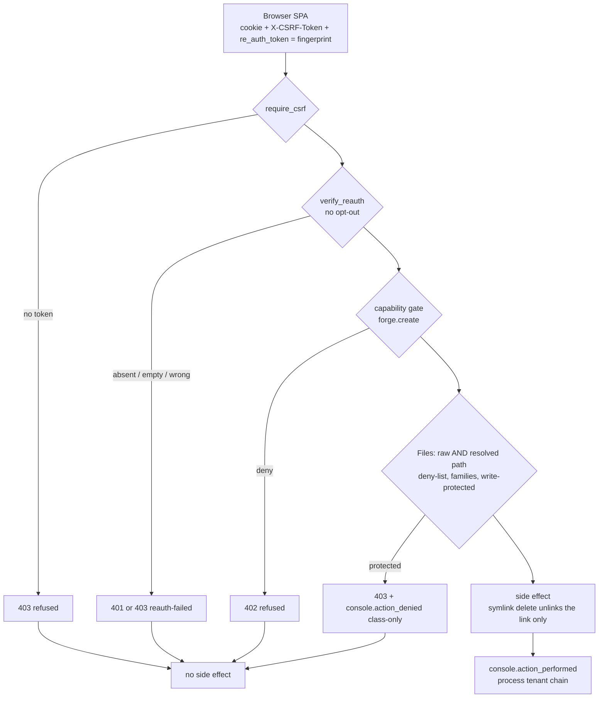

# Console security surfaces — Memory, Files, audit tail, re-auth, licence, API keys, panels

Release-readiness gap closure (2026-10-24, branch `gap/security-settings`). Every rule below is
proven by an HTTP test against a real uvicorn console in the two-tenant sandbox
(`tests/sandbox/test_gap_*.py`, `tests/sandbox/test_p0_s1a.py`, `test_p0_s11a.py`) or, where the
licence tier must be simulated, through the console router (`tests/license/test_*_e2e.py`).

Gate order (Mermaid; an SVG under `docs/diagrams/` could not be persisted in this session):

## One-tenant-per-process audit (read this first)

`forge.security_events.write_event` refuses a record whose `tenant_id` is not the PROCESS tenant
(`CORVIN_TENANT_ID` → `_default`; `AuditTenantMismatch`) and `corvin_console.audit._emit` swallows the
refusal. A console process therefore records console actions only for its own tenant; actions of a
session minted for another tenant are executed but not recorded. This is pre-existing (see
`routes/consent.py` "Known limitation") and NOT changed here. Proofs that assert audit records run as
the process tenant `_default`.

## DNS rebinding — Host / Origin allowlist (`host_guard.py`, review SRF-1, 2026-11-05)

Local login is credential-less ("the TCP peer is 127.0.0.1" is the authorisation). A page that
rebinds its own name to 127.0.0.1 used to get a session cookie for its origin from
`/auth/local-login` and the CSRF token from `/auth/whoami`. Now every request on every host must
name a Host this install answers to (the Host's port never matters):

| Source | Allows |
|---|---|
| always | `localhost`, `*.localhost`, a loopback or ANY IP literal (rebinding needs a name; an address is the server itself, which keeps a LAN-IP bind working) |
| bind host | `CORVIN_BIND_HOST`, the `--host` of the uvicorn process serving the app (`uvicorn …` / `python -m uvicorn …`, as every unit and `corvin serve` start it), `spec.console.bind` — when it is a NAME |
| `CORVIN_DOMAIN` | that name and `www.<name>` (the Caddy deployment, `ops/docker-compose.yml` passes it to the app) |
| `CORVIN_TS_HOSTNAME` | the Tailscale MagicDNS short name `<name>` and exactly `<name>.<tailnet>.ts.net` (one tailnet label; no other `.ts.net` name) — set by `ops/tailscale/docker-compose.yml` |
| LAN bind (bind host `0.0.0.0`/`::`/a non-loopback address or name) | the machine's own hostname, its short name and `<short>.local` (mDNS) |
| operator allowlist | env `CORVIN_ALLOWED_HOSTS` (comma separated) + `spec.console.allowed_hosts` (list) in the `_default` tenant's `tenant.corvin.yaml` |

Allowlist entries (`parse_entry`, one table for Python and JS: `corvin_operator/bridges/shared/js/host_guard_cases.json`):
whitespace is stripped; a host name (a port on it is dropped, as is one trailing dot) or a domain
suffix with a leading dot (`.corvin.lan`, never with a port); empty entries, `.`, a suffix with a
port, a path or an empty label are IGNORED and logged once. A Host with a trailing dot
(`corvin.lan.`) is not normalised: it is refused unless listed so.

Not guarded: the signed A2A wire routes on the console/gateway app (`POST /v1/a2a/receive`,
`/v1/a2a/ping`, `/v1/a2a/friendship-ack`) — a paired peer reaches them by DNS name and each request
is authenticated by the pairing HMAC (no cookie, no session). The stdlib A2A listener
(`a2a_http_server.py`, also the ingress) has no Host guard on those routes either; only its
`/metrics` additionally requires a loopback Host (a rebound page has a loopback PEER but a foreign
Host, review RC-4).

A WebSocket that carries an `Origin` must have the same host as its Host header and the same
explicit port (a port written on one side only is a mismatch), or be the vite dev server, or be in
`CORVIN_ALLOWED_ORIGINS`. The scheme is NEVER compared: behind a TLS-terminating proxy (Caddy) the
browser sends `Origin: https://corvin.example.com` on a socket the app sees as plain `ws`
(review RC-6). `/auth/local-login` additionally requires a LOOPBACK Host — an allowlisted public
name never earns a credential-less session.

**Reverse proxies (nginx, Caddy, Traefik): pass the client's Host through.** nginx needs
`proxy_set_header Host $host;` (its default rewrites Host to the upstream, e.g. `127.0.0.1:8765`).
With the Host rewritten, every proxied visitor looks like a loopback browser: the guard passes AND
`/auth/local-login` hands out an owner session. The loopback check on local-login is by design —
it is the whole authorisation — so never put it behind a proxy that rewrites Host or forwards
anonymous traffic. Caddy v2 passes Host through by default (`ops/Caddyfile.template`).

| Where | How |
|---|---|
| gateway (`corvin_gateway/app.py`, what `corvin-service` runs) | `HostGuardMiddleware` on the whole app (console API, SPA, `/local-stats`, gateway routes) |
| console `create_app()` | the same middleware |
| standalone (`corvinos-serve`) | the same middleware (`/local-stats`, `/`, `/console`, the SPA) + the router dependency |
| every host mounting the console router | router-level dependency `require_allowed_host` on `corvin_console.app.router` (HTTP + WebSocket) |
| `/auth/local-login` | `require_loopback_host` |
| bridge daemons (`shared/js/host_guard.js`) | the WhatsApp daemon's HTTP API (`/pair`, `/qr.png`, `/status`) and `shared/js/health-server.js`; reads `CORVIN_ALLOWED_HOSTS` + `spec.console.allowed_hosts` (via the bridge Python, mtime-cached), not the console's deployment names (the daemons bind loopback) |

Refused: HTTP 400 `{"detail":"host not allowed","hint":"… add it to CORVIN_ALLOWED_HOSTS or
spec.console.allowed_hosts in tenant.corvin.yaml"}` (local-login: 403), WebSocket close 1008.
Recorded as `http.host_rejected` (`surface`, `reason` = `host_not_allowed`/`origin_not_allowed`/
`local_login_host`, `scope_type`, `path_class` = first two path segments, `host_fp`/`origin_fp` =
16-hex sha256 fingerprints — never the value, `suppressed_count`) in the `_default` chain. The
throttle is per (reason, host) — once a minute — AND global — at most 20 records a minute across
all hosts — so a page rotating names cannot turn each refusal into an fsync'd chain write;
`suppressed_count` on every record says how many refusals were not recorded since the previous
one. The per-host map is LRU-bounded (4096); eviction never resets the global window. Same rule in
the JS twin. In tests, the repo-root `conftest.py` makes every Starlette `TestClient`
default to `http://127.0.0.1` (HTTP and `websocket_connect`, which hard-codes
`ws://testserver` otherwise) and allowlists the test-only names `testserver`/`test` for the API
(httpx `ASGITransport` clients); production code knows no test hostname. Proofs:
`core/console/tests/test_host_guard_dns_rebinding.py` and `test_refute_console_host_guard.py`
(gateway app AND standalone app over TestClient with a crafted Host/Origin; every deployment
source; throttle; TLS-proxy WebSocket; a mutation check that removing the standalone middleware is
noticed; the shared parse table), `corvin_operator/bridges/shared/js/test_host_guard.js` (real
health server over loopback HTTP, the same table, the YAML source),
`corvin_operator/bridges/shared/test_a2a_get_routes_gated.py` (`/metrics` vs a rebound Host).

Operator docs that name a non-loopback URL say which setting admits it: `ops/README.md`,
`ops/.env.example`, `ops/docker-compose.yml`, `ops/tailscale/{README.md,docker-compose.yml,.env.template}`,
`ops/Caddyfile.template`, `docs/DOCKER.md`, `docs/docker-headless-setup.md`, `docs/docker-setup-guide.md`.

## tenant.corvin.yaml writes

Every console writer goes through `corvin_console/tenant_yaml.py` (0o600 before `os.replace`,
atomic, an unreadable file is refused with 409/422 and never rewritten from `{}`) —
`layer-engines.md` § "the console's own save re-broke it". A read-modify-write is ONE
`tenant_yaml.update(path, mutate)` call: the lock (thread lock + `flock` on
`.tenant.corvin.yaml.lock`) is held from the read to the replace. `routes/engine.py` (PUT
`/settings/engine`, `/provider-compliance`, `/sensitive-route`) read and wrote unlocked until
review RC-3, so a concurrent locked update landing in between was silently undone; the gateway's
`tenant_config.save` (CLI `corvin tenant …`) now imports the same module and takes the same lock.
Open: `corvin_gateway/plugin_cmd.py::save_tenant_config` still writes the file itself (exempted
with a reason in `test_tenant_yaml_writer.py`, which fails on any other writer that dumps the
tenant YAML or reads-then-writes it outside `update`).

A symlinked `tenant.corvin.yaml` is written THROUGH to its target (the link stays). Comments are
NOT preserved: a rewrite re-dumps the mapping and starts with `# managed by console - … comments
in this file are not preserved`. Only the Settings page's raw YAML editor (`write_text`) keeps the
text as typed.

## Unauthenticated routes trimmed / file serving

* `GET /v1/console/stats/features` requires a session since 2026-11-05 (SRF-12) and reads the
  home through `forge.paths.corvin_home()`; it is no longer in `deps.PUBLIC_ROUTES`.
* Compute stage images (`/compute/pipelines/{p}/stages/{s}/artifact-image/{f}`) are served with
  `attachments_common.serve_headers`: `nosniff`, and an SVG inline but with
  `Content-Security-Policy: sandbox` (SRF-6, `core/console/tests/test_compute_stage_image_headers.py`);
  stage artifact downloads carry `nosniff` + `sandbox`.

## Memory panel (`routes/memory.py`)

- The panel used to list, read, write and delete `~/.claude/projects/<slug>/memory` — the host
  developer's Claude Code memory — for EVERY tenant (S-1a).
- Now: `GET /memory` returns `{tenant_id, available: false, reason, files: []}` without a path or
  any filesystem access; `GET /memory/{name}` is 404; PUT/DELETE no longer exist (405).
- A per-tenant memory view is ADR A-10 (owner-only, read-only, from the tenant's own recall store).
  Never put sample data in its place (ADR-0763).
- `/memory` and `/forget` slash replies say so; `/forget` points to `/erase`.

## Files panel deny-list (`routes/files.py`)

| Rule | Where | Applies to |
|---|---|---|
| exact names → `none` (no list/read/download) | `_NO_ACCESS` | adds `connector_vault.json` (plaintext connector keys), `github-audit.jsonl`, `github-config.json`, `github-worker-status.json`, `recovered/` |
| sibling families → `none` | `_NO_ACCESS_FAMILIES` | `recall.db-*`, `audit.jsonl.*`, `audit.backup-*`, `secrets.json.*`, … — NOT inside the user's `files/` zone |
| write-protected stores (read stays allowed, GDPR Art. 15) | `_WRITE_PROTECTED` via `_write_protected_class` | delete / upload / mkdir refused under `session_ledger`, `.corvin-ledger`, `cel_anchors`, `pending_notifications`, `web_chat`, `consent`, `grants`, `disclosure`, `roles`, `quota`, `memory`, `plugins` (anchored at the tenant root) |
| raw AND resolved path graded | `_effective_access` | tree, content, download, upload, **delete, mkdir** (delete/mkdir used the raw path only) |
| a symlink is deleted as a link | `files_delete` | the link's own location is judged and only the link is unlinked; the target is never removed (it used to be: `_resolve_safe` followed the link) |
| denials are audited | `_deny` | `console.action_denied {action: files.<verb>, target_kind: file, target_id: <class>, reason: protected}` — the class, never the path (paths carry chat ids) |

## Audit tail and Audit & Compliance (`routes/audit_tail.py`, `audit_layers.py`, `members.py`)

- `GET /audit/tail` reads the tenant's chains; the instance-wide pre-tenancy chain
  `<corvin_home>/global/forge/audit.jsonl` is merged **only for `_default`** (S-11a). Other readers of
  that chain (chat OS-turn/spans views) are S-11b and unchanged.
- Custom audit layers: the declared `allowed_fields` are registered with the core writer's details
  floor (`register_event_allowlist`) at register AND emit time, so they reach the chain instead of
  `_dropped_fields`. A name the floor refuses (`message`, `payload`, `query`, …) answers **400** at
  registration. The tail shows a layer's declared fields for its own event types.
- Roles card (`GET /members`): for `_default` it also reads `<corvin_home>/global/{roles,quota,consent,disclosure}`
  — the bridge writers' path when they pass no tenant. Never for another tenant.
- **Verify chain** button → `POST /audit/verify` (CSRF): runs `verify_chain_incremental` (the boot
  tripwire's walker, same verdict as `verify_chain`) over the tenant chain and returns
  `{ok, records, problem_count, problems[{line, issue}], took_ms}`; records `audit.chain_verify`
  (performed / failed with the first problem code). The page has eight sections.

## Re-auth (`deps.verify_reauth`)

- Every re-auth route refuses an absent or empty `re_auth_token`; the token is the session
  fingerprint (`/auth/whoami` → `fingerprint`), compared in constant time. There is no opt-out
  parameter: a route that should not need re-auth must not call the function.
- The SPA publishes the fingerprint to its API client like the CSRF token
  (`web-next/src/lib/reauth.ts`, set in `lib/auth.tsx`); every re-auth API function sends it.
- Call sites: `setup.py` PUT `/setup/engines/{id}`; `profile.py` PUT `/profile`, POST `/profile/reset`;
  `chat_settings.py` PATCH `/chat-settings/{ch}/{chat}`; `promote.py` POST `/tools|skills/{n}/promote`;
  `bridges.py` PUT settings, PUT enabled, POST disconnect; `settings.py` PUT worker-engine,
  PUT `/settings/{label}`, PUT features/{flag} (these three answer 403 `reauth-failed`, the rest 401);
  `compute.py` PUT `/compute/config`, POST `/compute/runs`; `license.py` POST `/license/key`;
  `byok.py` DELETE `/byok/secrets/{key}`.
- `chat.py` (create session) and `workflows.py` (create workflow) declare a `re_auth_token` field but
  never check it — they are not re-auth routes.

## Licence Apply Key (`routes/license.py`)

- Re-auth token required. Signature, claims, revocation, device and **installation binding** are
  checked before anything is written.
- Validate-then-swap under one lock: the previous `license.key` bytes are kept; if the reload raises,
  nothing loads, or the active licence's `jti` is not the pasted one, the previous key is restored
  (temp + `os.replace`, 0600) and reloaded. A rejected paste never costs a valid licence.
- `GET /license/status` no longer 503s without the optional Enterprise `corvin_license` plugin
  (F-12); it answers from the `corvin_operator/license` key.

## API keys delete (`routes/byok.py`, `agent/byok.py`, `provider_keys.py`)

- `DELETE /byok/secrets/{key_name}` (CSRF + re-auth) removes the key from the L16 vault
  (`vault.forget_item`) and from `service.env` (`provider_keys.remove_key`); 404 when not stored;
  501 on a hosted install (the Instance Agent has no delete endpoint).
- Audit: `console.action_performed byok.secret_deleted` (key name only) and the agent's
  `vault.secret_deleted` (registered in `EVENT_SEVERITY` + `_EVENT_ALLOWLIST`); failures are
  `console.action_failed` with a reason.

## AI panel install gate (`chat_runtime._install_generated_panels`)

- The chat path into the panel store (a turn writes `corvin-panel*.html`) applies the SAME
  `forge.create` capability gate as `POST /panels` and records `console.panel_created`; a refusal is
  `console.action_denied {action: panel.install, reason: forge-create-denied}` and consumes the file.
- The iframe sandbox tokens of AI panels (`allow-same-origin`) are an open operator decision
  (ADR-2189 proposes trust-derived, default-closed tokens) and are unchanged.

## Proofs (where each rule is tested, and over which interface)

| Rule | Proof | Interface |
|---|---|---|
| Re-auth refusal on every mutating re-auth route (absent and empty token) | `tests/sandbox/test_gap_reauth.py` (on main: 28 failed; on branch: green) | real uvicorn console, HTTP |
| Memory empty state, no `~/.claude` | `tests/sandbox/test_p0_s1a.py` | HTTP |
| Files deny-list, families, write refusal, symlink delete | `tests/sandbox/test_gap_files.py` (on main: 14 of 15 failed) | HTTP |
| Audit tail tenant scoping | `tests/sandbox/test_p0_s11a.py` | HTTP |
| Audit & Compliance: custom-layer fields, Roles path, Verify chain | `tests/sandbox/test_gap_compliance.py` (on main: 7 failed) | HTTP |
| Licence Apply Key validate-then-swap | `tests/license/test_license_apply_swap_e2e.py` | console router, TestClient |
| API-key delete | `tests/sandbox/test_gap_keys.py` (on main: 3 failed) | HTTP |
| Chat panel install gate | `tests/sandbox/test_gap_panels.py` (on main: 2 failed) | child process calling the real install function |
| Learnings anomalies path, maturity radar title and key set | `tests/sandbox/test_gap_dashboard.py`, `tests/sandbox/test_gap_maturity.py` | source + HTTP |
| Real Claude turn, Files and Memory on its output, chain verify | `tests/sandbox/test_gap_llm_turn.py` (opt-in `SBX_REAL_LLM=1`) | WebSocket turn + HTTP |
| Browser: Files, Verify chain button, Apply Key request, API-key delete, dashboard label | `tests/sandbox/test_gap_ui.py` (opt-in `SBX_UI=1`, Chromium) | gateway host, SPA build |

**Test-only client shim.** `core/console/tests/_reauth_shim.py` makes `TestClient` send the session's own
fingerprint on re-auth routes when a test sends no token, as the SPA does. It is opt-out per request
(header `X-Sbx-No-Reauth-Shim: 1`). Refusal is never proven through the shim; the sandbox tests above
send real HTTP with no shim.

**Known pre-existing failure, unchanged here:** `tests/license/test_g3_gates_e2e.py::test_refusal_matrix[skill-creator]`
fails on `origin/main` too (the skill generator's gate is `require_skill_forge_quota`, not the forge capability).

## GitHub Verify (`routes/github.py`) — awaiting operator acknowledgement

`POST /github/verify` asks the real GitHub API; only a `verified: true` config may sync. Commit
b582ca168 reverses the unverified half of c2c8ce6f7 and is not merged until the operator agrees.
