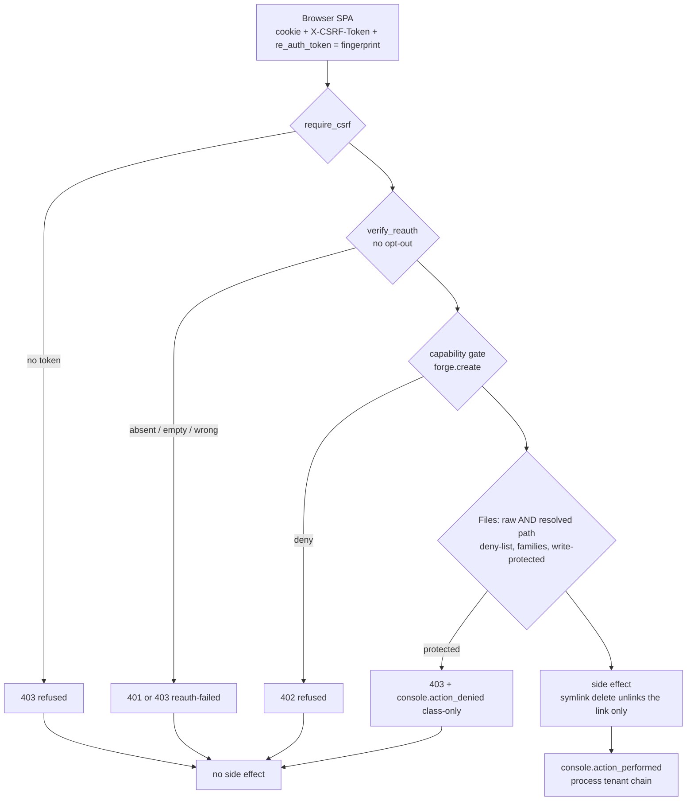

# Console security surfaces — Memory, Files, audit tail, re-auth, licence, API keys, panels

Release-readiness gap closure (2026-10-24, branch `gap/security-settings`). Every rule below is
proven by an HTTP test against a real uvicorn console in the two-tenant sandbox
(`tests/sandbox/test_gap_*.py`, `tests/sandbox/test_p0_s1a.py`, `test_p0_s11a.py`) or, where the
licence tier must be simulated, through the console router (`tests/license/test_*_e2e.py`).

Gate order (Mermaid; an SVG under `docs/diagrams/` could not be persisted in this session):

## One-tenant-per-process audit (read this first)

`forge.security_events.write_event` refuses a record whose `tenant_id` is not the PROCESS tenant
(`CORVIN_TENANT_ID` → `_default`; `AuditTenantMismatch`) and `corvin_console.audit._emit` swallows the
refusal. A console process therefore records console actions only for its own tenant; actions of a
session minted for another tenant are executed but not recorded. This is pre-existing (see
`routes/consent.py` "Known limitation") and NOT changed here. Proofs that assert audit records run as
the process tenant `_default`.

## Memory panel (`routes/memory.py`)

- The panel used to list, read, write and delete `~/.claude/projects/<slug>/memory` — the host
  developer's Claude Code memory — for EVERY tenant (S-1a).
- Now: `GET /memory` returns `{tenant_id, available: false, reason, files: []}` without a path or
  any filesystem access; `GET /memory/{name}` is 404; PUT/DELETE no longer exist (405).
- A per-tenant memory view is ADR A-10 (owner-only, read-only, from the tenant's own recall store).
  Never put sample data in its place (ADR-0763).
- `/memory` and `/forget` slash replies say so; `/forget` points to `/erase`.

## Files panel deny-list (`routes/files.py`)

| Rule | Where | Applies to |
|---|---|---|
| exact names → `none` (no list/read/download) | `_NO_ACCESS` | adds `connector_vault.json` (plaintext connector keys), `github-audit.jsonl`, `github-config.json`, `github-worker-status.json`, `recovered/` |
| sibling families → `none` | `_NO_ACCESS_FAMILIES` | `recall.db-*`, `audit.jsonl.*`, `audit.backup-*`, `secrets.json.*`, … — NOT inside the user's `files/` zone |
| write-protected stores (read stays allowed, GDPR Art. 15) | `_WRITE_PROTECTED` via `_write_protected_class` | delete / upload / mkdir refused under `session_ledger`, `.corvin-ledger`, `cel_anchors`, `pending_notifications`, `web_chat`, `consent`, `grants`, `disclosure`, `roles`, `quota`, `memory`, `plugins` (anchored at the tenant root) |
| raw AND resolved path graded | `_effective_access` | tree, content, download, upload, **delete, mkdir** (delete/mkdir used the raw path only) |
| a symlink is deleted as a link | `files_delete` | the link's own location is judged and only the link is unlinked; the target is never removed (it used to be: `_resolve_safe` followed the link) |
| denials are audited | `_deny` | `console.action_denied {action: files.<verb>, target_kind: file, target_id: <class>, reason: protected}` — the class, never the path (paths carry chat ids) |

## Audit tail and Audit & Compliance (`routes/audit_tail.py`, `audit_layers.py`, `members.py`)

- `GET /audit/tail` reads the tenant's chains; the instance-wide pre-tenancy chain
  `<corvin_home>/global/forge/audit.jsonl` is merged **only for `_default`** (S-11a). Other readers of
  that chain (chat OS-turn/spans views) are S-11b and unchanged.
- Custom audit layers: the declared `allowed_fields` are registered with the core writer's details
  floor (`register_event_allowlist`) at register AND emit time, so they reach the chain instead of
  `_dropped_fields`. A name the floor refuses (`message`, `payload`, `query`, …) answers **400** at
  registration. The tail shows a layer's declared fields for its own event types.
- Roles card (`GET /members`): for `_default` it also reads `<corvin_home>/global/{roles,quota,consent,disclosure}`
  — the bridge writers' path when they pass no tenant. Never for another tenant.
- **Verify chain** button → `POST /audit/verify` (CSRF): runs `verify_chain_incremental` (the boot
  tripwire's walker, same verdict as `verify_chain`) over the tenant chain and returns
  `{ok, records, problem_count, problems[{line, issue}], took_ms}`; records `audit.chain_verify`
  (performed / failed with the first problem code). The page has eight sections.

## Re-auth (`deps.verify_reauth`)

- Every re-auth route refuses an absent or empty `re_auth_token`; the token is the session
  fingerprint (`/auth/whoami` → `fingerprint`), compared in constant time. There is no opt-out
  parameter: a route that should not need re-auth must not call the function.
- The SPA publishes the fingerprint to its API client like the CSRF token
  (`web-next/src/lib/reauth.ts`, set in `lib/auth.tsx`); every re-auth API function sends it.
- Call sites: `setup.py` PUT `/setup/engines/{id}`; `profile.py` PUT `/profile`, POST `/profile/reset`;
  `chat_settings.py` PATCH `/chat-settings/{ch}/{chat}`; `promote.py` POST `/tools|skills/{n}/promote`;
  `bridges.py` PUT settings, PUT enabled, POST disconnect; `settings.py` PUT worker-engine,
  PUT `/settings/{label}`, PUT features/{flag} (these three answer 403 `reauth-failed`, the rest 401);
  `compute.py` PUT `/compute/config`, POST `/compute/runs`; `license.py` POST `/license/key`;
  `byok.py` DELETE `/byok/secrets/{key}`.
- `chat.py` (create session) and `workflows.py` (create workflow) declare a `re_auth_token` field but
  never check it — they are not re-auth routes.

## Licence Apply Key (`routes/license.py`)

- Re-auth token required. Signature, claims, revocation, device and **installation binding** are
  checked before anything is written.
- Validate-then-swap under one lock: the previous `license.key` bytes are kept; if the reload raises,
  nothing loads, or the active licence's `jti` is not the pasted one, the previous key is restored
  (temp + `os.replace`, 0600) and reloaded. A rejected paste never costs a valid licence.
- `GET /license/status` no longer 503s without the optional Enterprise `corvin_license` plugin
  (F-12); it answers from the `corvin_operator/license` key.

## API keys delete (`routes/byok.py`, `agent/byok.py`, `provider_keys.py`)

- `DELETE /byok/secrets/{key_name}` (CSRF + re-auth) removes the key from the L16 vault
  (`vault.forget_item`) and from `service.env` (`provider_keys.remove_key`); 404 when not stored;
  501 on a hosted install (the Instance Agent has no delete endpoint).
- Audit: `console.action_performed byok.secret_deleted` (key name only) and the agent's
  `vault.secret_deleted` (registered in `EVENT_SEVERITY` + `_EVENT_ALLOWLIST`); failures are
  `console.action_failed` with a reason.

## AI panel install gate (`chat_runtime._install_generated_panels`)

- The chat path into the panel store (a turn writes `corvin-panel*.html`) applies the SAME
  `forge.create` capability gate as `POST /panels` and records `console.panel_created`; a refusal is
  `console.action_denied {action: panel.install, reason: forge-create-denied}` and consumes the file.
- The iframe sandbox tokens of AI panels (`allow-same-origin`) are an open operator decision
  (ADR-2189 proposes trust-derived, default-closed tokens) and are unchanged.

## Proofs (where each rule is tested, and over which interface)

| Rule | Proof | Interface |
|---|---|---|
| Re-auth refusal on every mutating re-auth route (absent and empty token) | `tests/sandbox/test_gap_reauth.py` (on main: 28 failed; on branch: green) | real uvicorn console, HTTP |
| Memory empty state, no `~/.claude` | `tests/sandbox/test_p0_s1a.py` | HTTP |
| Files deny-list, families, write refusal, symlink delete | `tests/sandbox/test_gap_files.py` (on main: 14 of 15 failed) | HTTP |
| Audit tail tenant scoping | `tests/sandbox/test_p0_s11a.py` | HTTP |
| Audit & Compliance: custom-layer fields, Roles path, Verify chain | `tests/sandbox/test_gap_compliance.py` (on main: 7 failed) | HTTP |
| Licence Apply Key validate-then-swap | `tests/license/test_license_apply_swap_e2e.py` | console router, TestClient |
| API-key delete | `tests/sandbox/test_gap_keys.py` (on main: 3 failed) | HTTP |
| Chat panel install gate | `tests/sandbox/test_gap_panels.py` (on main: 2 failed) | child process calling the real install function |
| Learnings anomalies path, maturity radar title and key set | `tests/sandbox/test_gap_dashboard.py`, `tests/sandbox/test_gap_maturity.py` | source + HTTP |
| Real Claude turn, Files and Memory on its output, chain verify | `tests/sandbox/test_gap_llm_turn.py` (opt-in `SBX_REAL_LLM=1`) | WebSocket turn + HTTP |
| Browser: Files, Verify chain button, Apply Key request, API-key delete, dashboard label | `tests/sandbox/test_gap_ui.py` (opt-in `SBX_UI=1`, Chromium) | gateway host, SPA build |

**Test-only client shim.** `core/console/tests/_reauth_shim.py` makes `TestClient` send the session's own
fingerprint on re-auth routes when a test sends no token, as the SPA does. It is opt-out per request
(header `X-Sbx-No-Reauth-Shim: 1`). Refusal is never proven through the shim; the sandbox tests above
send real HTTP with no shim.

**Known pre-existing failure, unchanged here:** `tests/license/test_g3_gates_e2e.py::test_refusal_matrix[skill-creator]`
fails on `origin/main` too (the skill generator's gate is `require_skill_forge_quota`, not the forge capability).

## GitHub Verify (`routes/github.py`) — awaiting operator acknowledgement

`POST /github/verify` asks the real GitHub API; only a `verified: true` config may sync. Commit
b582ca168 reverses the unverified half of c2c8ce6f7 and is not merged until the operator agrees.
