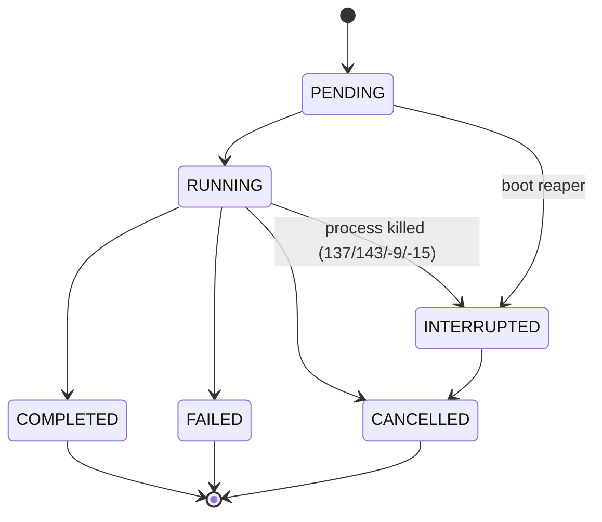

# Layer 22 — Task Engine M2: Background Task Execution (ADR-0081, ADR-0082)

> **Messenger notify-on-completion:** the worker's terminal branches call
> `_notify_task_done()` → `completion_notify.mark_done()`, so a task whose
> producer registered a messenger origin gets a delivered Discord/WhatsApp/…
> notification when it finishes. See
> [background-completion-notify.md](background-completion-notify.md).


**Status (0.9.0):** Backend modules present (`task_queue.py`, `task_worker_pool.py`,
`task_pubsub.py`, `routes/tasks.py`) and unit-tested, but **NOT wired into the
console**: `routes/tasks.py` is never registered in `app.py`, the
`TaskWorkerPool` daemon is never started, and the frontend never calls the
tenant-global task API. The shipping console chat path uses the M1
session-scoped `TaskManager` (per-turn event log + streamed tokens) only.
Wiring M2 into the console is deferred — see the "Wiring status" note below.

## Overview

Task Engine M2 decouples task execution from WebSocket sessions, enabling:
- **Independent execution:** Tasks run to completion even if user switches chats
- **Cross-session visibility:** All running tasks visible across chat windows
- **Offline resilience:** Page reload recovers task state from local cache
- **Real-time progress:** WebSocket pub/sub for instant cross-session updates

## Architecture

```
┌─────────────────────────────────────────────────────────────────┐
│ FRONTEND (Browser)                                              │
├─────────────────────────────────────────────────────────────────┤
│  useTaskProgress()          (WebSocket pub/sub)                 │
│  useTaskPolling()           (HTTP fallback)                     │
│  useTaskIDBSync()           (IndexedDB write-on-event)         │
│  TaskStatusBarM2            (Real-time task visibility)         │
│  task-recovery.ts           (Page-reload hydration)             │
└─────────────────────────────────────────────────────────────────┘
                            ↕ (HTTP + WebSocket)
┌─────────────────────────────────────────────────────────────────┐
│ BACKEND (FastAPI + Worker Daemon)                               │
├─────────────────────────────────────────────────────────────────┤
│  routes/tasks.py            (4 tenant-global endpoints)         │
│  TaskQueue                  (Persistent append-only log)        │
│  TaskWorkerPool             (Background subprocess executor)     │
│  TaskPubSub                 (In-memory per-tenant broadcast)    │
│  TaskManager                (M1 compat: session-scoped events)  │
└─────────────────────────────────────────────────────────────────┘
```

## Backend Components

### TaskQueue (task_queue.py)

**Persistent append-only queue at `tenants/<tid>/global/tasks_<tid>.jsonl`**

```python
queue = TaskQueue(tenant_global_dir)

# Create task
task_id = queue.enqueue(
    tenant_id="_default",
    chat_key="web:session_1",
    instruction="Hello, world!",
    ttl_seconds=3600,
)

# Dequeue (FIFO, marks as RUNNING)
task = queue.dequeue("_default")  # Next PENDING task, skips expired

# Update status
queue.update_status(task_id, TaskStatus.COMPLETED, exit_code=0)

# List tasks
tasks = queue.list_tenant_tasks("_default", status=TaskStatus.RUNNING)
```

**Key Features:**
- FIFO + TTL expiry enforcement
- Multi-tenant isolation (per-tenant log file)
- Idempotent log replay (state derived from events)
- No locks needed (append-only, atomic writes via fsync)

### TaskWorkerPool (task_worker_pool.py)

**Independent background worker daemon**

```python
pool = TaskWorkerPool(queue, taskmanager_factory=..., max_workers=5)
await pool.run()  # Main loop: poll queue, spawn workers
```

**Lifecycle:**
1. Poll `task_queue.dequeue()` every 100ms
2. Spawn subprocess: `claude -p --input-format stream-json --output-format stream-json --verbose`
   — the instruction is NOT an argv element: it is written to stdin as one
   stream-json `user` message, then stdin is closed (`_build_worker_argv` +
   `_worker_stdin_payload`). An instruction beginning with `-` used to be
   parsed by the CLI as a flag (`/task --add-dir / …` → `--add-dir`;
   F-E1, 2026-09-07). Regression: `core/console/tests/test_task_worker_pool_argv.py`.
3. Record events to **both**:
   - TaskManager (session-scoped, for M1 SSE compatibility)
   - TaskPubSub (broadcast to all subscribers)
4. Background cleanup: mark expired tasks as FAILED every 60s

**Configurable:**
- `CORVIN_TASK_MAX_WORKERS` (default 5)
- `poll_interval_ms` (default 100)

### TaskPubSub (task_pubsub.py)

**In-memory pub/sub for real-time task progress**

```python
pubsub = get_pubsub()

# Subscribe to all tenant task events
async for event in pubsub.subscribe("_default"):
    print(f"Task {event['task_id']}: {event['event']}")

# Publish event (called by worker pool)
await pubsub.publish("_default", task_id, {"event": "progress", "pct": 50})
```

**Properties:**
- Per-tenant isolated channels
- asyncio.Queue based (bounded, backpressure handling)
- Auto-cleanup slow subscribers (logging only)
- Event schema: `{task_id, event, seq, timestamp, ...}`

### HTTP Endpoints (routes/tasks.py)

**Tenant-global task API (separate from session-scoped chat.py endpoints)**

| Method | Path | Purpose |
|--------|------|---------|
| POST | `/v1/console/tasks` | Create task |
| GET | `/v1/console/tasks/{task_id}` | Get task (cross-session) |
| POST | `/v1/console/tasks/{task_id}/abort` | Cancel task |
| WS | `/v1/console/tasks/progress` | Subscribe to all task events |

**Example: Create task**
```
POST /v1/console/tasks
{
  "chat_key": "web:session_1",
  "instruction": "...",
  "ttl_seconds": 3600
}

Response:
{
  "ok": true,
  "task_id": "uuid"
}
```

**Example: Get task status**
```
GET /v1/console/tasks/<task_id>

Response:
{
  "task_id": "uuid",
  "chat_key": "web:session_1",
  "status": "running",
  "created_at": 1717317600,
  "started_at": 1717317601,
  "progress_pct": 45
}
```

## Frontend Components

### useTaskProgress()

**Real-time cross-session task visibility via WebSocket**

```typescript
const { tasks, isConnected } = useTaskProgress();

// tasks = [
//   {task_id: "...", chat_key: "...", status: "running", progress_pct: 45},
//   ...
// ]
```

`status` mirrors `TaskState` (`pending | running | completed | failed | cancelled |
interrupted`). A task in one of `ENDED_STATUSES` (`completed`, `failed`, `cancelled`,
`interrupted`) leaves the list five minutes after the status arrived (BGT-14, 2026-10-21:
`interrupted` used to stay forever). Note that the socket carries the worker's raw
stream events; a `status` field arrives only when an event carries one.

### useTaskPolling()

**HTTP polling fallback (when WebSocket unavailable)**

```typescript
const { events, isPolling, error } = useTaskPolling({
  taskId: "...",
  enabled: sseFailedOrUnavailable,
  pollIntervalMs: 5000,
});

// Adaptive backoff: 5s → 30s if no new events
// Etag caching for efficiency
```

### useTaskIDBSync()

**IndexedDB write-on-event with batching**

```typescript
const { cachedEvents, writeEvent } = useTaskIDBSync({
  taskId: "...",
  onEvent: (event) => {
    setEvents(prev => [...prev, event]);
  },
});

// Intercept SSE/pub/sub events
writeEvent(event);  // Batches + flushes to IDB every 500ms
```

### task-recovery.ts

**Page-reload recovery**

```typescript
const { tasks, recovered, failed } = await recoverTaskState();
// Hydrates from IDB, verifies via HTTP, re-subscribes to pub/sub
```

## Frontend Components (ADR-0082)

### task-db.ts — IndexedDB Schema

**Database:** `corvin_tasks` v2  
**ObjectStore:** `tasks` (keyPath: `task_id`)

```typescript
interface Task {
  task_id: string;           // UUID
  chat_key: string;          // e.g., "web:session_1"
  persona: string;           // Active persona name
  instruction: string;       // User input / prompt
  status: "pending" | "running" | "completed" | "failed";
  created_at: number;        // Timestamp (ms)
  started_at: number | null;
  completed_at: number | null;
  progress_pct: number;      // 0–100
  latest_line: string;       // Last output line
  result: string;            // Full output
  error: string | null;
  last_synced_at: number;    // Last backend sync
  synced: boolean;           // Is synced with backend?
  etag: string | null;       // For polling Etag caching
}
```

**Indexes:**
- `chat_key` (non-unique) — query tasks for current chat
- `status` (non-unique) — filter by state
- `created_at` (non-unique) — sort by creation time
- `last_synced_at` (non-unique) — cleanup old tasks

**CRUD Operations:**
```typescript
saveTask(task)               // Create/update (put)
getTask(task_id)             // Read single
getAllTasksForChat(chat_key) // Read by chat
deleteTask(task_id)          // Delete
cleanupOldTasks(ttlMs)       // Delete > ttlMs old
```

### task-polling.ts — HTTP Fallback

**Purpose:** Fallback when WebSocket unavailable (browser offline, network issue)

**Polling interval:** 3 seconds (configurable)  
**Etag caching:** Only fetch if backend changed (HTTP 304)

```typescript
class TaskPoller {
  start(): void;     // Begin polling loop
  stop(): void;      // Stop polling
  private pollOnce() // Single HTTP GET + update IDB
}
```

**Flow:**
1. `GET /v1/console/chat/{chat_id}/tasks?etag={lastEtag}`
2. If 304: Skip (no change)
3. If 200: Parse tasks, save to IDB, call `onTaskUpdate()`
4. Repeat every 3s

### task-lifecycle.ts — Cleanup + Export/Import

**Phase 3: Automatic cleanup**
```typescript
startTaskCleanupSchedule(ttlMs = 30 days)  // Run daily
// Deletes tasks > ttlMs old from IDB
```

**Phase 4: Export/Import**
```typescript
exportTask(taskId)          // → JSON string
exportAllTasks()            // → JSONL (one per line)
importTaskFromJSON(json)    // ← Single task
importTasksFromJSONL(jsonl) // ← Multiple tasks
```

### use-task-persistence.ts — React Hook

**Loads persisted tasks when chat switches**

```typescript
const { tasks, isLoading } = useTaskPersistence(chatKey);
// Runs on mount, re-runs when chatKey changes
// Fetches from IDB, falls back to HTTP
```

### TaskPanel Component

**Displays persisted tasks in chat sidebar**
- Shows task ID (first 8 chars)
- Instruction preview (first 50 chars)
- Status badge (pending/running/completed/failed)
- Progress bar (0–100%)
- Sync status (✓ Synced / ✧ Local)
- Export button (aria-label: "Export task as JSON")
- Delete button (aria-label: "Delete task from IndexedDB")

**Props:**
```typescript
interface TaskPanelProps {
  tasks: Task[];
  onDeleteTask?: (taskId: string) => void;
  onExportTask?: (taskId: string) => void;
  isLoading?: boolean;
}
```

## Deployment

### Systemd Service

**File:** `ops/systemd/corvin-task-worker.service`

```ini
[Unit]
Description=Corvin Task Worker Pool (tenant %i)
After=default.target

[Service]
ExecStart=/path/to/.venv/bin/python -m corvin_console.task_worker_pool
Environment=CORVIN_TASK_MAX_WORKERS=5
Restart=on-failure
RestartSec=5s

[Install]
WantedBy=default.target
```

**Enable:**
```bash
systemctl --user enable corvin-task-worker@_default.service
systemctl --user start corvin-task-worker@_default.service
```

## Monitoring

**Queue depth:**
```bash
wc -l ~/.corvin/tenants/_default/global/tasks__default.jsonl
```

**Worker daemon health:**
```bash
systemctl --user status corvin-task-worker@_default
journalctl --user -u corvin-task-worker@_default -f
```

**Pub/sub subscribers:**
```python
pubsub.subscriber_count("_default")  # Active WebSocket connections
```

## Backward Compatibility

- **M1 endpoints unchanged:** `GET /v1/console/chat/sessions/{sid}/tasks`, `GET /v1/console/chat/sessions/{sid}/tasks/{id}/events` (SSE)
- **M2 endpoints additive:** New tenant-global scope
- **TaskManager M1 compat:** Worker pool writes to session-scoped `workdir/tasks/` for SSE

## Edge Cases & Limits

| Limit | Value | Notes |
|-------|-------|-------|
| Max concurrent workers | 5 (configurable) | Per tenant |
| Max task TTL | 1 hour (default) | Enforced on dequeue |
| Task queue backlog | Unbounded | Append-only JSONL |
| Pub/sub queue size | 1000 events | Per tenant, backpressure drops slow subscribers |
| Task result cap | 64 MB | Same as Forge output |

### Stuck-task recovery (three complementary mechanisms)

A task killed mid-run (process SIGKILL / `bridge.sh restart`) never writes a
terminal event and is stuck on `running` — which also counts against the
per-chat `max_concurrent` quota and eventually starves the chat of new tasks.
Two layers clean this up:

- **M2 worker pool** (`task_worker_pool.py`): background cleanup marks expired
  tasks `FAILED` every 60s while the worker daemon runs. (Not active in 0.9.0 —
  the pool is not wired; see the Status note above.)
- **M1 adapter TaskManager** (`task_manager.py`, ADR-0080): the bridge has no
  long-running worker daemon, so it reaps at **boot** instead.
  `TaskManager.reap_stale_running()` finalizes a `running`/`pending` orphan as
  `INTERRUPTED` (`error="orphaned_on_restart"`, append-only `task.interrupted`
  event; before PLAN-0958 P1 it was `task.failed` with the same reason, which
  is still READ as interrupted, see below), but
  **only when its recorded engine pid is no longer alive**
  (`_task_pid_alive` / `_last_started_pid`). The earlier "at boot nothing can
  legitimately be running" assumption was false — an engine subprocess can
  outlive a restart (reparented, still streaming), and a task can itself boot
  `adapter.main()` (the E2E security suite does). **Load-bearing producer
  contract:** every code path that spawns an engine MUST record the real
  subprocess pid in its `task.started` event, or the reaper will read no pid,
  treat the live turn as an orphan, and falsely finalize it. The console chat
  path (`chat_runtime.py`) records `proc.pid` for the direct `claude`
  subprocess; the delegation path runs inline and records no engine pid (a
  console restart there is a genuine orphan). The adapter `main()` runs the
  reaper once per boot across all tenants/chats (logged as `task-reaper: …`).

**A turn cut off by a host restart is re-run (2026-10-15).** The reaper only *finalizes* an
orphan; it never ran it again. `systemctl --user restart corvin-webui` kills the unit's whole
control group, so a running console turn ended `failed` / exit 143 (`-15` as asyncio reports
it) with an empty `result_summary` and no retry. `corvin_console/turn_recovery.py` closes
that: both host lifespans call `note_shutdown()` on stop (`last_shutdown.json` in EACH tenant's
global dir) and `schedule_recovery()` on start. Both walk every tenant under
`<corvin_home>/tenants/` (`turn_recovery.tenant_ids`, invalid directory names skipped) and work per
tenant with that tenant's own id, never the process's `CORVIN_TENANT_ID` (BGT-13, 2026-10-21: until
then only that one tenant was recovered). The newest task of a chat is re-run through the
normal `stream_turn` path (same gates, ledger and persistence as a typed message) only when it
failed with a signal exit code, produced no output, ended inside the shutdown window (or was reaped
as an orphan) and is under 30 min old. The re-run is recorded as the request AS TYPED with the
marker `recovery: {attempt, of_turn}` beside it (chat log user line, task `input.recovery`); the
engine alone receives the `[Automatic restart: ...]` prefix (BGT-15, 2026-10-21: until then the
prefixed prompt was stored as the user's words).
A re-run that again yields no `result` is repeated, at most `MAX_ATTEMPTS` (2) per request,
counted in `tasks/recovery_attempts.json` so a crash loop cannot restart forever; exhaustion is
audited (`chat.turn.recovery_exhausted`). Cancels and background-scope caps are not signal exits
inside the shutdown window and are never re-run. Prevention is still `scripts/safe-restart.sh`.
Proof: `core/console/tests/test_turn_recovery_e2e.py` (real `stream_turn`, real SIGTERM to the
fake CLI, both host lifespans).

**The user is told, and can read it back (PLAN-0958 P2).** Each step of a recovery emits one
notice (`core/console/corvin_console/task_notices.py`): `interrupted_resuming` before every
attempt, `recovered` when it produced an answer, `gave_up` after the last attempt. A notice
is a fixed EN/DE template with a closed field set (task label = the user's own first 60
characters with id-shaped tokens scrubbed, class label, attempt, remaining attempts); a text that
still carries an id-shaped token fails closed. It is appended to the chat's `turns.jsonl` as an
assistant turn flagged `notice` (survives reload; `session_ledger.records_from_turn_log` skips it,
so a worker never reads its own bookkeeping) and to the task's event log as `task.notice`
(`task.notice_sent` on the audit chain: kind and channel only). `GET
/v1/console/chat/sessions/{sid}/tasks/{task_id}/timeline` returns the read model
(`task_timeline.py`): one row per transition or notice, folded from the event log, never a second
writer. The endpoint is kept for the API; the SPA page **Task Timeline** (`/app/task-timeline`) was
removed from the console, so the notices in the chat are the user-visible surface.
Proof: `core/console/tests/test_turn_recovery_e2e.py::test_user_is_told_in_the_chat_and_can_read_the_timeline`.

**Platform-correct kill, and a terminal write the state machine refuses (2026-10-21).** The console's stop path
ends a CLI that ignores SIGTERM with `process_signals.hard_kill` — `os.kill(SIGKILL)` on POSIX, `Popen.kill()`
(TerminateProcess) on Windows, recorded as `SIGKILL` on both; `signal.SIGKILL` does not exist on Windows and the
previous call raised there, masking the original error and leaving the CLI running. `failure_classes` reads the
number through `getattr(signal, "SIGKILL", 9)` for the same reason (its import failure took turn recovery, the
adapter's exit classifier and the interruption report with it on Windows). When the finishing turn's `task.failed`
write is refused (`cancelled -> failed`, `interrupted -> failed`: the operator's cancel or a reaper already ended
the task) the refusal is logged and the streamed text is still persisted, exactly like the `task.completed` case.

**Cancel vs. cut-off, and what a disconnect really does (PLAN-0958 P5).** A client disconnect
does NOT end a turn: `routes/chat.py::_detach_turn` lets it finish and only a watchdog
(`CORVIN_DETACHED_TURN_MAX_S`) cancels it. CONCEPT-0112's class C2 ("disconnect = cancelled, turn
gone") therefore describes a path that no longer exists. What reaches
`chat_runtime._finalize_in_flight_task` is told apart by `note_cancel_reason()` (set BEFORE the
cancel): an operator stop (own socket, another tab) ends as `task.cancelled`, silent and never
resumed (ADR-2236 D14); the watchdog (`detached_timeout`, class C4) and any other close without a
terminal event end as `task.interrupted` and the user gets a `needs_user` notice - these are NOT
re-run automatically (a timed-out turn would only time out again, and a step may have had an effect).
Verified with a real child: `cancel_live_turn` terminates the `claude` process
(`test_operator_cancel_ends_the_child_and_is_final`), which answers CONCEPT-0112 Q2.

**An outbound effect is never repeated silently (PLAN-0958 P4).** `scripts/task_interruption_report.py`
measured this install (214 finished turns, 68 interrupted): 24 % use Write/Edit/message tools and up to 85 %
call Bash, so "most interrupted turns are read-only" is false. A workspace effect is safe to continue (the
re-run prompt says "continue from the current state of the workspace"); an OUTBOUND one is not - a sent
mail, A2A task, share or push cannot be seen in the workspace. `turn_recovery.outbound_tools()` reads the
tool names the interrupted run already called from its own event log (names only, never arguments — matched on
word boundaries, so `get_post` and `list_posts` are reads); a Bash call is recorded with a closed `effect_class`
(`outbound_possible` when the command's leading word is a sender: `git push`, `curl`, `gh`, `mail`, `ssh`, `scp`,
`rsync`, cloud CLIs, package publishers — the command itself is never stored); a
match (`OUTBOUND_MARKERS` or that class) means the request is NOT re-run: the user gets a `needs_user` notice, the
attempt budget is closed so a later boot does not ask again, and `chat.turn.recovery_needs_user` is audited.

**EVERY host reaps, not just the bridge (2026-09-21).** Until this date the sweep
had exactly one caller — `adapter.py`'s boot — so an install that never started a
messenger bridge never reaped at all. On a console-only install that is not a slow
leak but a **permanently dead chat**: nothing moves a task out of `running` except
a terminal event or this sweep, so every console restart mid-turn leaks one, and
the fifth leak reaches `max_concurrent=5` and makes every subsequent turn raise
`QuotaExceededError` forever. No restart, cache clear or waiting recovers it,
because the count is read from `status: "running"` in the on-disk meta, which
nothing reconciles against reality. Measured on a console-only Windows install:
5/5 orphans on one web chat, oldest 9.7 h, chat dead — surfacing to the operator
only as the opaque `chat.py` catch-all "The turn failed unexpectedly
(QuotaExceededError)".

The sweep therefore lives in `corvin_plugins.bootstrap._reap_stale_tasks()`, called
from **`boot_platform()`** — the one sequence both shipped hosts provably run
(`corvin_console.standalone`, `corvin_gateway.app`; pinned by
`core/plugins/tests/test_boot_platform_call_site.py`). That is the same seam, and
the same remedy, as the ADR-0232 tripwire, the ACP Skills registry and the
ADR-0231 health collector — each of which also shipped wired into one host only.
The adapter keeps its own call: a bridge process is a fourth host and reaps its own
boot.

Properties that are load-bearing:

- **Boot-only.** `reap_stale_running()` must never run concurrently with active
  workers — that is how a live task gets a second terminal event. `boot_platform`
  runs once per process, before it serves.
- **It inherits the pid liveness gate and must never add its own staleness rule.**
  An age cutoff layered on top would re-create the 2026-06-17 false-positive on a
  reparented engine that outlived the restart.
- **It resolves the tree through `corvin_home()`** (ADR-0007). Hard-wiring
  `~/.corvin` makes a `CORVIN_HOME` install sweep the wrong subtree and log
  success while its own chats stay starved.
- **It is best-effort and swallows everything.** The cost of a failed sweep is a
  blocked quota; the cost of a fatal one is an install that will not serve.
- **The "nothing found" log line is indistinguishable from "swept the wrong
  tree".** Hence `test_the_sweep_honours_corvin_home` carries a positive control:
  it proves the orphan *was* reapable before asserting the wrong-home sweep
  returned 0.

**The boot sweep is only half of it — the PRODUCER must finalize too (2026-09-21).**
Reaping at boot fixes the orphans a dead process left behind. It cannot help while
the console keeps running for days, and that is where the leak is actually
produced: a client that vanishes mid-turn. The console's own turn generator
(`chat_runtime._stream_turn_impl`) records a terminal event on every ordinary exit
(~25 call sites), and on interruption recorded none — its three
`(CancelledError, GeneratorExit)` handlers emit the paired ADR-0171 audit end and
re-raise without touching the task lifecycle, and an interruption earlier than any
of them (pre-spawn gates, model resolution, context build) reached no handler at
all. Measured: one mid-turn disconnect → `running=1` at t+30s, event log
`['task.created', 'task.started']`, forever. Five browser refreshes and the chat is
dead with no restart involved.

The seam is `chat_runtime.stream_turn`, a thin wrapper whose only job is a
`finally` calling `_finalize_in_flight_task(sess)`; the impl registers its task in
`sess.in_flight_task` immediately after `create_task`. Load-bearing properties:

- **`contextlib.aclosing` around the impl.** A bare `async for` delegation leaves
  closing the inner generator to the garbage collector, so the finalizer could run
  before the impl's own `finally` (which kills the engine subprocess). Deterministic
  close also orders the impl's own terminal write FIRST, so it wins.
- **Idempotent by STATUS, not by bookkeeping.** It writes only while the task is
  still `running`/`pending`. A "did we already finalize" flag would drift from the
  meta it guards; double-writing would double-count the turn and re-emit its
  ADR-0314 outcome — worse than the leak.
- **`task.cancelled`, not `task.failed`.** An abandoned turn is not a statement
  about engine quality, and `record_event` deliberately emits no learning outcome
  for `task.cancelled` (it does for `failed`).
- **No pid liveness probe here, unlike the boot sweep.** The sweep infers deadness
  from outside and needs `_task_pid_alive` to avoid finalizing a reparented engine
  (incident 2026-06-17). The producer KNOWS the turn is over: the consumer is gone,
  the generator is closing, no further event can reach this task.
- **Fully synchronous.** It runs inside a `finally` during cancellation, where any
  `await` re-raises `CancelledError` and skips the write entirely.

Quota exhaustion is also no longer reported as "unexpected": `routes/chat.py` maps
`QuotaExceededError` to an actionable message naming the count. The catch-all
wording sent the 2026-09-21 investigation looking for a crash.

Guards: `core/console/tests/test_chat_turn_task_finalized_on_disconnect.py` — real
WebSocket route + real on-disk `TaskManager`, with the five-disconnect quota
reproduction, the "no second terminal event on a completed turn" idempotence check,
and an AST assertion that the impl still registers its task adjacent to
`create_task` (the one half those WS tests substitute).
Also `core/plugins/tests/test_stale_task_reaper_call_site.py` — an AST
assertion that `boot_platform` calls it (a substring search would be satisfied by
the comment explaining it), ordering after `assert_compliance`, no off switch, and
a red→green reproduction that builds five orphans at the real
`tenants/*/sessions/web_*/tasks` path, asserts `check_quota` raises, sweeps, and
asserts it passes.

## Task lifecycle states and the transition guard (PLAN-0958 P1)

One declaration of the states: `core/console/corvin_core/task_states.py`
(`TaskState`). `TaskManager` (`task_manager.py`, as `TaskStatus`) and `TaskQueue`
(`task_queue.py`) alias it; no other module may declare a task-lifecycle enum
without an entry in `REGISTERED` of `core/console/tests/test_task_state_enum_guard.py`.



Six states, every one of them written by a real event (`EVENT_TARGET_STATE`:
`task.started`, `task.completed`, `task.failed`, `task.cancelled`,
`task.interrupted`; `pending` is the initial state). The P1 table also declared
`waiting_retry`, `resuming`, `needs_user` and `abandoned` — none had a writer (no
event name, no queue or manager call site, nothing in the UI), so no task could
reach them and their rows were dead ends; they were removed on 2026-10-21 (BGT-14,
`test_task_state_machine.py::test_every_non_initial_state_has_a_writer` fails on the
next writer-less state). `needs_user` / `interrupted_resuming` / `recovered` /
`gave_up` are `task_notices` KINDS (what the user is told), not states.
`INTERRUPTED` is not terminal — the user can still cancel it — but nothing ever
resumes the task itself: `turn_recovery` re-runs the REQUEST as a new task, and
`TaskQueue.update_status` drops the payload file at `interrupted` exactly as at a
terminal state (`PAYLOAD_DROP_STATES`; proof
`test_task_queue.py::TestInterruptedCleanup`). The console's cross-chat progress hook
(`use-task-progress.ts`) types `interrupted` and auto-cleans it after the same five
minutes as the other ended states (`ENDED_STATUSES`; proof
`tests/unit/use-task-progress.test.tsx`).

**Guard.** `TaskManager.record_event` checks the transition for `task.started`,
`task.completed`, `task.failed`, `task.cancelled` and `task.interrupted` BEFORE it
appends anything. A forbidden transition raises `InvalidTransitionError` and the
log is untouched (for example `cancelled -> completed`, `completed -> failed`,
`interrupted -> running`, `failed -> running`). Same-state writes are idempotent.
`TaskQueue.update_status` refuses to move a terminal task to a different state.

**Worker.** `TaskWorkerPool` maps a worker that exited with 137/143/-9/-15 to
`INTERRUPTED` (queue and `TaskManager` alike). A user abort that landed first
(the queue already holds `CANCELLED`) stays cancelled; a refused write is logged
by `_finish_queue` and does not crash the worker.

**HTTP.** `POST /v1/console/tasks/{id}/abort` maps a refused transition to
`409 Conflict` (the body carries the `from -> to` pair). Terminal tasks keep the
idempotent `200` for abort.

**Read mapping (append-only).** A pre-P1 `task.failed` with
`error="orphaned_on_restart"` is READ as `INTERRUPTED` (`_replay_task`,
`list_task_summaries`). The event and the meta snapshot are never rewritten.

**Audit.** `task.interrupted` is registered in `security_events.py`
(`EVENT_SEVERITY` and `_EVENT_ALLOWLIST`). Interrupted tasks emit no learning
outcome (only completed and failed do), so the learning loop no longer counts an
orphaned task as a failed outcome.

**Not yet in P1:** the other domain enums (orchestrator, vibe-engineering,
inspection, nervous-system, orchestration subsystems) are registered with their
reasons, not converted. There is no resume path for a task: a cut-off REQUEST is
re-run as a new task (§ Stuck-task recovery), the interrupted task stays
`interrupted` until the user cancels it.

## Testing

**Unit tests:** `test_task_queue.py` (13 tests, all passing)

**State machine and guard:** `test_task_state_machine.py` (transition table,
refusal leaves the log untouched, read mapping of legacy orphans) and
`test_task_state_enum_guard.py` (fails on a new unregistered task-state enum).

**E2E (real boundary):** `test_task_interrupt_http_e2e.py` — the real tasks router
through `TestClient`, the real `TaskWorkerPool._execute_task` spawning a fake
`claude` that sleeps, SIGKILL on the engine pid, then `GET` shows `interrupted`;
abort of an interrupted task works; a stale-read abort of a completed task returns 409.

**E2E tests:** `test_task_manager_e2e.py`, `test_task_queue.py`, `test_task_state_machine.py`, `test_task_interrupt_http_e2e.py`, `test_turn_recovery_e2e.py` (the file `test_task_engine_m2_e2e.py` named here until 2026-10-21 does not exist)
- Multi-tenant task isolation
- Pub/sub broadcast across subscribers
- Task lifecycle (create → running → completed)

**Browser E2E:** vitest + playwright (TBD)
- Cross-chat task visibility
- Page-reload recovery
- Polling fallback activation

## Related ADRs

- **ADR-0081:** Task-Engine M2 Backend (this page)
- **ADR-0082:** Frontend Persistence Layer (IndexedDB + polling + recovery)

## Migration Path (M1 → M2)

1. Deploy `task_queue.py` + `task_worker_pool.py` + systemd service
2. Start worker daemon: `systemctl --user start corvin-task-worker@_default`
3. Deploy frontend hooks: `use-task-polling.ts`, `use-task-progress.ts`, `task-recovery.ts`
4. Integrate routes/tasks.py (no removal of M1 endpoints)
5. Migrate UI to TaskStatusBarM2 (parallel with old status bar during transition)
6. Monitor: queue depth, worker health, pub/sub subscriber count
7. Sunset M1 after 2-week observation window

