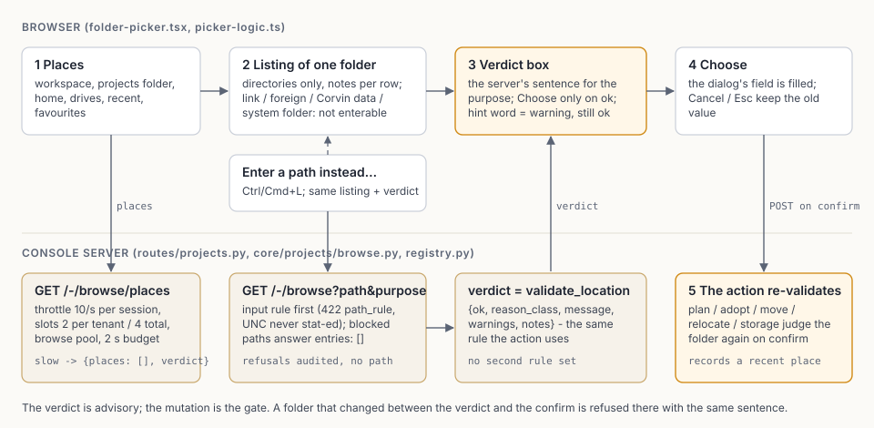

# Projects (ADR-2315, CONCEPT-0126)

A **project** is a directory the user owns, with a `project.yaml`. CorvinOS keeps only an index of it.
Losing the index loses no project. Design: `Corvin-Knowledge` CONCEPT-0126; decisions ADR-2315
(project object), ADR-2316 (several KBs, scope), ADR-2317 (chat context); plan PLAN-0970.
Status 2026-11-08: registry, manifest, fragment engine and the API exist (T-0351, T-0352, T-0355); the
template catalogue is the first-party plugin `project_templates` (T-0354, T-0356, in Corvin-Marketplace, published); the console's Projects panel, wizard, inspector, scope selector, videos action and doctor exist (T-0357 to T-0362). Status 2026-11-11 (PLAN-0972 phase 1, ADR-2321): the managed workspace is the default place, one location rule judges every path a client names, and the console shows it (Settings sections, Where row and filter, default-place dialog, wizard step 2) - verified on Linux; the Windows VM run of phase 1 (T-0389) has NOT been done. Status 2026-11-11 (PLAN-0972 phases 3-4, ADR-2323): sharing is built - export, import, duplicate over the project bundle, with the console's Share dialogs (§ Share in the console) - verified on Linux; the Windows/macOS runs of phases 3-4 have NOT been done.

## Where things live

| Piece | Path |
|---|---|
| `project.yaml` schema 1, validation, atomic write | `core/projects/manifest.py` |
| Registry (index) + path rules for client-supplied locations | `core/projects/registry.py` |
| Fragment/template engine: plan, apply, repair, closure checks | `core/projects/fragments.py` |
| Atomic writes that never follow a symlink, cross-platform lock | `core/projects/fsutil.py` |
| Service layer (audit, plugin state, bound engine, plans, create/adopt/toggle/repair/open/health) | `core/console/corvin_console/projects_service.py` |
| HTTP routes `/v1/console/projects` | `core/console/corvin_console/routes/projects.py` (mounted in `app.py`) |
| The catalogue (fragments, templates) | `Corvin-Marketplace/plugins/buildin/knowledge_management/project_templates/` (docs in the plugin: `docs/CATALOGUE.md`) |
| Registry file | `<tenant_home>/projects/registry.json` (0o600, dir 0o700) |
| Where new projects go | `<tenant_home>/projects/settings.json` (schema 2: `default_storage` `managed`\|`root`, `projects_root` - unset = `~/projects` as the fallback folder rebuild looks in, `workspace_key`, `managed_root`); written only by `registry.write_settings` |
| Proof | `tests/e2e/test_projects_registry_e2e.py`, `test_projects_fragments_e2e.py`, `test_projects_api_e2e.py`, `test_project_templates_catalogue_e2e.py` (the REAL catalogue) |
| Platform data directory, managed workspace path, user places, drives, the lists the location rule judges against | `core/paths/user_dirs.py` (ADR-2321 Decision 7, stdlib only, Python 3.11-safe) |
| Export jobs (bundles above 100 MiB) | `<tenant_home>/projects/exports/<job_id>/` (`job.json` + the file; dir 0o700, files 0o600), TTL 24 h, swept by the projector tick (`sweep_share`) and every export request |
| Import stagings | `<tenant_home>/projects/import_staging/<staging_id>/` (`bundle.zip`, `report.json`; 0o700/0o600), TTL 1 h, at most 5 per tenant, 2 GiB across the host, 1 GiB per tenant; removed on Cancel, after the last card was applied, by the sweep and by every validate request |
| Bundle format, never-list, validation, git import | `core/projects/bundle.py`, `core/projects/bundle_rules.py`, `core/bundle_common/` (§ Share) |

### Erasure and retiring a tenant (ADR-2321 Decision 13)

GDPR Art. 17 (L36): the layer `L-projects` (`erasure_handlers.ProjectsMetadataHandler`, in `real_handler_chain`)
reports `SKIPPED` for every subject with the note "projects metadata carries no per-person key; project files are
user-owned and outside Art. 17 automation — review them in the Projects panel", deletes nothing and never logs the
subject id; `<tenant_home>/projects` is listed in `UNATTRIBUTABLE_DIRS`. Proof:
`tests/security/test_erasure_projects_handler_e2e.py` (through `ErasureOrchestrator` with the real chain; every
planted file and project folder byte-identical afterwards; since T-0403 also a REAL import staging and a REAL export job,
produced through the routes, byte-identical afterwards and still usable - the job file downloads, the staging answers its
report). Import stagings and export jobs carry no per-person key either: they are bounded by their TTLs (1 h, 24 h) and the
host budget, never by Art. 17. The trash (§ Trash) is the same: no per-person key, so `L-projects` leaves every entry in
place (`tests/e2e/test_projects_trash_e2e.py::Erasure`); the 30-day sweep bounds it.

**Retiring a tenant** - CorvinOS has no tenant-offboarding entry point (NOTE-0020 O10). An operator removes by hand:
`<tenant_home>/projects/` (registry, settings, chat attachments, locks, picker history, `import_staging/`, `exports/`) and the tenant's `managed_root` (the path in `settings.json`, including `.trash/`). `own` folders are the
user's and are never part of it.

### The managed workspace (ADR-2321 Decision 7)

Diagram of the location model (default storage, workspace binding, the one location rule with the hint test):
[`docs/diagrams/projects-location-model.svg`](../diagrams/projects-location-model.svg).

A tenant's *Corvin workspace* lives in the platform's per-user data directory, OUTSIDE `CORVIN_HOME`:

| Platform | `managed_root` |
|---|---|
| Linux | `$XDG_DATA_HOME/corvin/projects/<key>/` (default `~/.local/share/corvin/projects/<key>/`) |
| macOS | `~/Library/Application Support/Corvin/projects/<key>/` |
| Windows | `%LOCALAPPDATA%\Corvin\projects\<key>\` |

`user_dirs.managed_parent()` is `<data>/corvin/projects/`; `<key>` is an opaque `w-<10 lowercase hex>`
(`user_dirs.new_workspace_key()`, `secrets.token_hex(5)`). The key rule: never a tenant id, never a word the
path gate's `_looks_protected` matches, never derived from where `CORVIN_HOME` lies; it is stored in the tenant's
`settings.json` (`workspace_key`) and in the workspace marker. `user_dirs.managed_projects_root(key)` refuses
anything that is not `w-<10 hex>`. The module also answers the lists the location rule uses:
`system_prefixes()` (Decision 10 check 6; `/opt`, `/srv`, `/media` deliberately absent),
`is_under_system_prefix()` (given and resolved form; the own home's subtree is exempt when the home itself lies
below a prefix, and so is a path strictly below `/run/media/<own user>/<label>`), `home_roots()`,
`app_data_dirs()`, `platform_links()`, `user_places()`, `drives()` (never raises; a mapped network drive is a
`drive` with note `network`, never probed there) and `display_path()`.

**Migration (existing installs).** Nothing moves. Every project registered before the managed workspace existed reads
`storage: own` and stays where it is; a tenant whose `settings.json` already names a `projects_root` keeps creating there
(`default_storage: root`), a fresh tenant creates in the workspace. The managed workspace is OUTSIDE the tenant home, so a
backup of `CORVIN_HOME` does not contain it: back it up with "Export all projects" once E-058 ships; until then copy the
folder whose path the Projects page names under Change… (the `managed_root`).

**Tests never reach the real workspace.** The repo-root `conftest.py` puts `XDG_DATA_HOME` (on Windows also
`LOCALAPPDATA`/`APPDATA`) into the session sandbox for every test process, and its tripwire lists the real
`<data dir>/corvin/projects` of every platform form (resolved once, before any env change) around every test, and
one level down the entries of each existing `w-*` workspace in it (REVIEW-0064 #5): a new entry in either fails the
test ("wrote into the real Corvin workspace"). `corvin_operator/bridges/run-all-tests.sh` exports the same for
plain-script suites. The isolated Playwright backend (`web-next/scripts/start-isolated-e2e-backend.sh`) names
`XDG_DATA_HOME`/`XDG_STATE_HOME`/`XDG_CACHE_HOME` (under Git Bash on Windows also `LOCALAPPDATA`/`APPDATA`/`USERPROFILE`)
below its sandbox home like `start-fresh-install-backend.sh`, so a calling shell's own value never reaches it
(REVIEW-0064 #6, `tests/security/test_isolated_e2e_backend_env.py`). `HOME` stays the operator's (the live suites need `~/.claude`); on macOS
the data dir follows `HOME`, so there the guard is the tripwire plus the projects test `Sandbox`, which moves `HOME`.
Proof: `tests/projects/test_user_dirs.py`, `tests/security/test_conftest_data_dir_sandbox.py` (including a write into an
existing workspace).

## The directory is the truth

`project.yaml` (schema 1): `id` (kebab-case, 1-28 chars: the projector's scope label `prj-<id>` must
pass its 32-char rule), `title`, `tenant`, `template` (`<id>@<n>`), `docs_mode` (`nested`|`plain`,
default `nested`, see ADR-2315 amendment), `features` (id -> bool), optional `videos`, `directory.peers`.
No secret and no machine-local path. Unknown top-level keys are kept on rewrite.

The registry holds `{"schema": 1, "projects": [{id, path, template, added_at, storage}]}` and is rebuilt from
the directories by `registry.rebuild(tenant)` (adds, never removes, never touches a directory). The
operator's `projects_root` lives in a SEPARATE file so that deleting the index never loses the place
`rebuild` has to look in. `corvin_console.kb_projection.project_kbs` reads this same shape.

**Storage kinds (ADR-2321 Decisions 1, 3, 9).** Every entry has `storage`: `managed` (its folder lies directly
in the tenant's managed root) or `own` (anywhere else; every pre-ADR-2321 project, e.g. `~/projects/x`, reads
`own` and is never moved or touched). The built-in `corvin` tile is `builtin`. The kind is derived from the path
(`registry.storage_of`), healed on read for an entry without it and written back on the next save; `relocate`
recomputes it. A NEW project's place, first match wins (`registry.default_location`): an explicit folder from
the client; `default_storage: root` -> `<projects_root>/<id>`; `default_storage: managed` (the shipped default)
-> `<managed_root>/<id>`. `rebuild` scans the managed root AND the projects root (direct children, dot-named
ones skipped, `project.yaml` naming this tenant); an `own` project elsewhere is re-found only by adopt.

**Settings, schema 2 (ADR-2321 Decision 8).** `<tenant_home>/projects/settings.json` (0o600):
`{"schema": 2, "default_storage": "managed"|"root", "projects_root"?, "managed_root", "workspace_key"}`.
A schema-1 file (`{"projects_root": …}`) or none reads `default_storage = root` when a root is set, else
`managed`; the value is fixed at the first write, so a tenant that had set a root keeps creating there.
`registry.write_settings(tenant, **changes)` is the ONE writer: read-merge-write under the registry lock,
unknown keys kept, `default_storage: root` without a root refused (`root_required`). `set_projects_root`
merges through it, so `PUT /projects/root` keeps `default_storage`, `managed_root` and `workspace_key`.
A tenant without `settings.json` (the default `~/projects` was never set explicitly) reads `managed`: its new
projects go to the workspace from now on, its existing ones stay where they are.

**Workspace binding (ADR-2321 Decision 7).** `registry.ensure_managed_root` creates the managed parent and the
key directory 0o700 (re-applied when wider; a link is refused), writes the key into `settings.json` and the
marker `workspace.json` `{"schema": 1, "tenant", "workspace_key", "corvin_home": "<resolved>"}`. Rules:
(a) marker names this tenant, key and home -> used; (b) another home that no longer exists (a moved
`CORVIN_HOME`) -> the marker is rewritten, `project.storage_changed outcome=rebound`; (c) another home that
still exists (a copied install) -> `workspace_foreign`, 422 "This workspace belongs to another Corvin
installation.", nothing written; (d) another tenant or key -> `workspace_foreign`; (e) no key in
`settings.json` -> the managed parent's children are scanned for a marker naming this tenant AND this home
(`outcome=recovered`), else a new key. Every binding outcome is audited BEFORE the write. `GET /projects` binds
the workspace on read and reports `workspace: ok|foreign|unavailable`. `registry.rekey_workspace` starts a new
workspace (`outcome=rekeyed`; the Settings action, T-0387/T-0408).

## Locations a client may name (`registry.validate_location`)

ONE rule (ADR-2321 Decisions 4, 10, 10a, 15; replaces ADR-2315 Decision 6):
`registry.validate_location(tenant_id, raw, *, purpose, project_id=None) -> Path`, `purpose` in `create`
(plan and create), `adopt`, `projects_root` (`PUT /projects/root`; `validate_root` is this purpose), `move`,
`relocate`, `import`. A client-supplied location may be `<managed_root>/<id>`, a folder under the projects
root, or **any other folder that passes the rule** — "only under the projects root" is withdrawn (the one
deliberate widening: "Add existing folder" from anywhere the rule allows). The picker's verdict and the mutation
call the same function; the mutation re-validates on confirm. A refusal is a `ProjectPathError` with
`reason_class` (the HTTP 422 `detail.reason_class` and the `project.blocked` record carry it) and the class's
fixed sentence (`registry.SENTENCES`), never a path.

Two forms are judged: *given* (`normalize_input`, made absolute lexically, no link followed) and *resolved*.
Every component check runs over ALL components of both forms, from the anchor to the target. Order:

| # | Class | Refuses |
|---|---|---|
| 1 | `path_rule` | not a string, empty, NUL, > 1000 characters, not absolute, `..`; on Windows `normalize_input` first: every UNC (`\\server\share`, `\\?\UNC\…`) and device path, for every purpose, before anything is stat-ed |
| 2 | (`path_rule`) | `_check_windows_names`: device names to be created, trailing dot/space, `< > : " \| ? *` |
| 3 | (`path_rule`) | `_check_length`: the MAX_PATH budget when long paths are off |
| 4 | `top_level` | the anchor; fewer than three parts (`D:\projects` - use `D:\work\projects`); any user's home (a direct child of `/home`, `/Users`, `/var/home`, `C:\Users`, or `/root`); the own home or an ancestor of it; a mount point `user_dirs.drives()` reports (a folder below it is fine) |
| 5 | `corvin_home` | inside, above or equal to the resolved `corvin_home()`, the real `~/.corvin` or `$CORVIN_HOME` as given; also by identity (`os.path.samefile` on the target and each existing ancestor), so a bind mount of the home is caught |
| 6 | `system_prefix` | `user_dirs.is_under_system_prefix` on both forms (own-home subtree exempt when the home lies below a prefix; strictly below `/run/media/<own user>/<label>` exempt) |
| 7 | `protected` | a component in `PROTECTED_COMPONENTS` (`.git`, `.corvin`, `session_ledger`, `.corvin-ledger`, `cel_anchors`, `pending_notifications`, `tenants`, case-folded) at any depth; a path inside another user's home |
| 8 | `hidden` | a dot component below the own home (outside it: below the anchor); an application-data tree (`user_dirs.app_data_dirs()`: `~/.config`, `~/.local/share`, `~/.local/state`, `~/.cache`, `~/Library`, `%APPDATA%`, `%LOCALAPPDATA%`); the components of the own managed root are exempt |
| 9 | `other_tenant` / `workspace_root` | the managed parent, or anything under it outside the own `managed_root` (`other_tenant`); a directory another tenant's registry lists (`other_tenant`); the own `managed_root` itself or anything below a dot-named entry of it, e.g. `.trash/` (`workspace_root`) |
| 10 | `symlink` | any component of the GIVEN form that is a link by `fsutil.is_link` (symlink, junction, name-surrogate reparse point), except the ancestors of the own home and `user_dirs.platform_links()` (macOS `/etc`, `/tmp`, `/var`) |
| 11 | `nested` | inside or containing any tenant's registered project (the moved project ignored; re-adopting the tenant's own registered path passes, the service answers `id_taken`); a valid `project.yaml` in any ancestor; the projects folder itself (an added refusal) |
| 12 | per purpose | `create`/`move`/`import`: absent or empty (`not_empty`); `adopt`: exists (`missing`), `project.yaml` absent or naming this tenant (`other_tenant`; invalid -> `wrong_manifest`; a linked one -> `symlink`); `relocate`: holds this project's manifest of this tenant (`wrong_manifest`); `projects_root`: not a file |

**Grandfathering (REVIEW-0062 N1).** For every purpose except `projects_root`, a target below the stored
projects root (given below given AND resolved below resolved) is judged by checks 4, 6, 7, 8 and 10 only on the
components BELOW that root (and the root itself must not be a link); check 5 and checks 1-3, 9, 11, 12 run in
full. So a stored `~/.projects`, a root below a linked folder or a root in `/var/tmp` keeps accepting creates,
while `<root>/a/.git/b`, `<root>/.hidden/b` or a link below the root are still refused. **The grandfathering is bound to
the place the root had when it was set (REVIEW-0063 m5, `registry.grandfather_root`):** `set_projects_root` records the
root's resolved form as `projects_root_resolved` in `settings.json`, and a target is grandfathered only while the stored
root still resolves to it - an ancestor re-linked later ends the grandfathering, and the full rule (check 10 `symlink`,
check 6 ...) judges the target. A root stored before the record existed is pinned to its current resolution on first use
(trust on first use, lock wait at most 2 s, else next time); the default `~/projects` (nothing stored) is grandfathered
only while its given form has no link (check 10's tolerated home ancestors and platform links aside). The folder browser
uses the same binding (read-only, never pins).

**From the verdict to the folder (REVIEW-0063 m4).** Create, move, the projects root and the import's target parent are
made by `registry.make_location(resolved)` = `fsutil.make_dirs_nofollow`: from the anchor of the RESOLVED form each
existing component is opened `O_DIRECTORY|O_NOFOLLOW` relative to its parent's descriptor and each missing one is made with
`mkdir(name, dir_fd=parent)` and opened the same way, so a component swapped for a link after `validate_location` fails
instead of being followed; afterwards the path must still resolve to itself and name the directory that was opened, else
the folders this call made are removed and the request is refused `symlink` (audited `project.blocked`). Create re-checks
the place right before `registry.register` and removes its `project.yaml` through the held descriptor on a mismatch. Move
renames the project INTO the held descriptor of the verified parent (`os.rename(src, name, dst_dir_fd=...)`) and then
requires the moved folder to have the project folder's `st_dev`/`st_ino` at the judged place, else it is renamed back.
Windows (no `dir_fd`): each component is checked with `fsutil.is_link` before and after its `mkdir` and the same
resolve/identity checks run afterwards; a swap undone between two checks is not seen. Create writes `project.yaml`
INTO the held descriptor (POSIX: `manifest.write_into` = `fsutil.write_at`, a temp opened `O_CREAT|O_EXCL|O_NOFOLLOW`
relative to the folder's fd, then `rename` within it; REVIEW-0065), so a component swapped for a link after
`make_location` cannot place it at the link's target - the check before `register` refuses `symlink` and the manifest is
taken back through the same fd (Windows: by path, as before). Not closed: the fragment files written AFTER `register`
(`.git`, templates) go by path; when that write fails because the folder no longer resolves to itself, the 409
`create_failed` sentence names where it resolves now ("... its folder <loc> (it now resolves to <target>) was left as it
is - remove it or add it again"), so the operator knows what to remove. The root itself is
re-judged by the full rule only when it is set again (`PUT /projects/root` with the same value of a `~/.projects`
root answers `hidden`). Registered projects are never re-judged on read.

**Kept from 65b587f2e (Decision 10a)** - the rule only adds refusals: tenant id validation, the input
type/NUL/length rule, `normalize_input` with the UNC/device refusal, absolute and no `..`, Windows names, the
length budget, the mapped-network-drive rule (a drive letter that resolves to UNC keeps the letter), fewer than
three parts, inside/above/equal `CORVIN_HOME`, `PROTECTED_COMPONENTS`, hidden, the link walk and a linked
projects root, `_other_tenants_claiming`, `nesting_conflict`, the adopt manifest checks, the create rule, a file
is not a folder. `tests/e2e/test_projects_location_e2e.py::LocationRule::test_the_kept_checks_refuse_as_before`
runs the same inputs through the function at 65b587f2e (loaded from git) and the current one. The pre-ADR-2321
keywords `adopt`/`unmanaged`/`ignore` are still accepted by `validate_location` ONLY so the regression tests of
6250cd0b6/65b587f2e run unchanged; no production caller passes them.

**Test sandbox.** The rule refuses `/tmp` (system prefix) and other users' homes, so every projects test makes
its temp dir the OWN home: `tests/e2e/_projects_fixtures.py::Sandbox` and `sandbox_home_env(tmp)` set `HOME`,
`XDG_DATA_HOME` (on Windows also `USERPROFILE`, `LOCALAPPDATA`, `APPDATA`) into it and restore them. There is no
test-only mode in the rule.

## Picker: the server-side folder browser (ADR-2322, T-0390)

`core/projects/browse.py` is the pure core (no FastAPI import, no audit call; stdlib only, Python 3.11-safe). The route
(T-0391) adapts it and owns the budget, the throttle and the audit.

**What is listed.** Directories only - a listing never returns a file name, size, count, mtime or content; a link to a file
is skipped like a file. Each entry: `name`, `path` (where the row leads), `kind: "dir"`, `hidden`, `symlink`, `readable`
(`os.access(R_OK|X_OK)`), `project` (`mine` with `id` + `title` from the manifest, `other` - existence only, never an id or a
title -, or `none`) and an advisory `refusal` (`symlink`, `corvin_home`, `system_prefix`, `other_tenant`, `protected`,
`hidden`, `nested`, `top_level`). An entry is a link when `entry.is_symlink() or fsutil.dirent_is_junction(entry)`; a link is
never listed into or entered (`symlink: true`, `refusal: "symlink"`). Hidden entries (dot names, the Windows hidden
attribute) only with `hidden=1`, never below the own managed root. Sorted case-insensitively; 200 per page, `next_page` is
the last name of the page, `truncated` when more remain (or more than 20 000 entries were scanned). The listing also
carries `path`, `display` (`user_dirs.display_path`), `parent`, `breadcrumbs`, `readable` of the folder itself and the
`verdict`.

**What is never entered** (answers `entries: []` with the reason as the verdict, the class's fixed sentence): a path with a
linked component (the link walk of check 10, from the anchor or from a stored projects root the path lies below) ->
`symlink`; at or below a Corvin home, lexically or by `st_dev`/`st_ino` identity of the path or an ancestor -> `corvin_home`
(an ANCESTOR of a home is listed, the home is a row in it); a system prefix (`user_dirs.is_under_system_prefix`, the
own-home and `/run/media/<own user>/<label>/…` exemptions) -> `system_prefix`; the managed parent, a workspace below it
other than the own `managed_root`, or at/below another tenant's registered project -> `other_tenant`. The managed parent is
one row "Corvin workspaces" whose `path` is the own `managed_root` (no workspace yet: the row carries `refusal:
"other_tenant"`); no other workspace key is ever named.

**Input rule.** `browse.check_input` - checks 1-3 of ADR-2321 Decision 10 - runs before anything touches the filesystem:
type, NUL, at most 1000 characters, `registry.normalize_input` (every UNC/device path refused with its sentence "… map the
share to a drive letter"), absolute, no `..`; nothing is expanded (`~/x` is refused). Purpose outside `registry.PURPOSES`,
or `move`/`relocate` without `project_id`, is the same refusal. Windows names and length run next. A violation is
`BrowseInputError` (`reason_class = "path_rule"`).

**Verdict = the location rule.** `browse.verdict(tenant, path, purpose, project_id)` is `registry.validate_location`
caught into `{ok, reason_class, message[, warnings: ["hint_word"], notes: [{class, message}]]}` (`notes` carries the
sentence per warning class with the matched hint word, `registry.location_warnings` - "The assistant may refuse some shell
commands in a folder whose path contains 'forge'." - so the picker shows the server's sentence, T-0393); `ok` reads "Can be used — a new folder will be
created when you continue." for create/move/import, "Can be used" otherwise. A listing that can be entered carries exactly
this verdict; a blocked one carries the block's class (so `/etc` answers `system_prefix`, while the rule alone would say
`top_level` for that two-part path). The mutation re-validates on confirm.

**Places** (`browse.places`): `managed` ("Corvin workspace", when the tenant has a key), `root` ("Projects folder", when
set), `user_dirs.user_places()` (home, desktop, documents), `user_dirs.drives()`, then `recent` and `favourite` rows.
Nothing is created by reading places.

**Picker store** `<tenant_home>/projects/picker.json` (0o600, `atomic_write`, under `picker.lock`):
`{schema: 1, recent: [...], favourites: [...]}`. `record_recent` keeps the last 8 confirmed locations, newest first,
deduplicated (`os.path.normcase`); `set_favourites` replaces the list (at most 10 -> "At most 10 favourites.", each judged
by the input rule); `clear_recent` empties `recent`. Never audited; the `L-projects` erasure handler reports it `SKIPPED`
(no per-person key, ADR-2321 Decision 13). Recent places are recorded on success by `plan_project` (only with an
explicit `location`), `adopt_project`, `move_project`, `relocate_project`, `set_root` and `set_default_storage` with a
projects root - never by the browser.

**Routes, bounds, audit (T-0391, ADR-2322 Decisions 5-8, 11, 13).** `GET /v1/console/projects/-/browse/places`,
`GET /v1/console/projects/-/browse?path&purpose[&project_id][&hidden=1][&page]`, `PUT …/-/browse/favourites {paths}` and
`DELETE …/-/browse/recent` (CSRF for both). Session required, the tenant is the session's, no extra toggle or login (the
host guard of ADR-2313 applies as on every console route). Order of one listing request, all non-blocking:

1. per-session token bucket (10 requests/s, burst 10, bounded LRU of 256 sessions) - beyond it 429 `{"message": "Too many
   folder requests at once; wait a moment.", "reason_class": "throttled"}`;
2. `browse.check_input` on the loop (pure; a UNC/device path never reaches the filesystem) - 422 `path_rule` with the rule's
   sentence;
3. a finished late result of the same request (tenant, path, purpose, project id, hidden, page) younger than 10 s is
   answered at once;
4. slots: per tenant 2, global 4 (`projects_service.BrowseGate`, counters under one lock; only tenants with a running listing
   are tracked) - none free -> 200 `slow` at once;
5. the listing runs on `loop_health.browse_pool()` - a dedicated `ThreadPoolExecutor(max_workers=4,
   thread_name_prefix="corvin-browse")`, pre-warmed by `loop_health._prewarm_then_watch` in BOTH hosts' lifespan
   (`install_serving`), never the default executor that `asyncio.to_thread` and audit writes share - awaited with
   `asyncio.wait_for(asyncio.wrap_future(…), 2.0)`. On timeout 200 with `entries: []` and verdict `{ok: false,
   reason_class: "slow", message: "This folder did not answer in time (network share?). Try again or choose another
   place."}`. The thread is not cancelled: its slots are released by the future's done-callback when it really returns, and
   its result is kept 10 s for the next identical request. So at most 4 hung listings exist host-wide, 2 per tenant, and
   nothing else in the console waits for them.

`/browse/places` runs on the same pool with the same throttle and slots (`slow` -> `{places: [], verdict}`).
**Audit:** `project.browse_refused` (WARNING) `{reason_class, tenant_id}` on 422 `path_rule`, `slow`, `throttled` and a
listing answered with a refused verdict of class `corvin_home`, `system_prefix` or `symlink`; at most one record per
session per minute (an in-memory stamp per session id); written best-effort through an awaited `asyncio.to_thread`.
Successful listings, favourites and recents are never audited. Proof: `tests/e2e/test_projects_browse_e2e.py` (real HTTP
through the console router, concurrent requests in one event loop; registered in `run-all-tests.sh` with
`tests/projects/test_browse.py`).

**The dialog (T-0392, `web-next/src/components/folder-picker.tsx`; every decision in `pages/projects/picker-logic.ts`,
unit-tested).** `FolderPicker {open, purpose, projectId?, title?, initialPath?, inputTestId?, onChoose(path), onCancel}` and
the small `FolderField {value, onChange, purpose, …}` (the chosen path + "Choose a folder…"/"Change…"). Title "Choose a folder
for "<title>"" (or "Choose a folder"), the line "Folders on the computer that runs Corvin. Files are not shown.". Left: the
places in four groups - Places (Corvin workspace, Projects folder, Home, Desktop, Documents), Drives and network, Recent (with
"Clear recent places"), Favourites; an unavailable place is greyed with its note. Right: breadcrumbs with "‹" up (more than
five crumbs collapse the middle to "…"), a star that adds/removes the current folder as a favourite (`PUT …/favourites`, at
most 10), "Show hidden", the rows ("<name>" + the note: "Already a project (<title>)", "belongs to another workspace", "link —
cannot be chosen", "no permission", "Corvin's own data", "system folder", "protected place", "hidden", "inside a project").
A row that is a link, another workspace's, Corvin's data, a system folder or unreadable cannot be entered (`enterable`).
"New folder here [name]" only for `create`, `move`, `projects_root` and `import` (adopting and locating need an existing
folder): virtual - the picker returns `<current>/<name>` and the action creates it; the name rule is shown inline ("Use
letters, digits, '-', '_' or '.', no leading dot, at most 80 characters.") and a valid name gets its OWN verdict (a debounced
`GET /browse` of the target) before "Choose" turns on. The verdict box in the footer shows the target path and the sentence:
"Can be used — a new folder will be created when you continue." (create/move/import) or "Can be used", else the server's
message; a hint-word note is an extra amber line and does not turn "Choose" off. "Choose" is enabled only for a loaded folder
whose verdict is `ok`. "Enter a path instead…" (Ctrl/Cmd+L) opens the advanced field, pre-filled with the current folder and
selected; "Go" lists that path and judges it by the same verdict. States: skeleton rows while listing; "No folders here."; a
blocked folder "This folder cannot be opened here."; an unreadable one "No permission to read this folder."; `slow` -> "did not
answer in time" with **Retry** (the verdict line carries the fixed sentence); 429 -> "Too many folder requests at once; wait a
moment."; 422 -> the rule's sentence; the dialog never closes on an error. **Keyboard:** arrows move, Home/End, Enter opens the
focused folder, Backspace goes up, typing jumps by prefix (700 ms buffer; one letter cycles through the matches), Space marks
the current folder as the choice and moves the focus to "Choose" (Enter then chooses), Esc cancels (only the picker: the
dialog behind it stays), Ctrl/Cmd+L opens the path field. Keys and submits inside the picker never reach the form that
opened it (React events bubble through the portal; Enter in the path field once submitted "Default place" with an empty
folder). **375 px:** a full-screen sheet; places become a horizontal chip row, breadcrumbs collapse to "‹ <parent>" + the
current name, rows are 44 px, the verdict and the buttons sit in a sticky footer. Cancel leaves the field as it was.

**Where it is used (T-0393).** Wizard step 2 "Choose a folder…" (`create`, test id of the advanced field `wizard-location`);
"Add existing folder" (`adopt`, `adopt-location`); Settings > Location **Move…** (`move` + project id, `move-input`) ->
"Move here" -> "Yes, move the folder"; **Locate folder…** (`relocate` + project id, `locate-input`; Choose relinks at once,
moves nothing); "Default place for new projects" > "A folder of my own" (`projects_root`, `place-root-input`). No location
dialog shows a bare path field before the picker is opened. The import target (T-0402) will use the same component.

Proof: unit `tests/unit/projects-picker.test.ts` (38: a scripted keyboard session, the name rule table, verdict per purpose,
row notes, breadcrumbs, places); browser on the served bundle with a deterministic stubbed tree (`tests/e2e/projects-picker-stub.ts`):
`projects-picker.spec.ts` (Choose off until `ok`, foreign/link/unreadable rows not enterable, slow + Retry, keyboard-only path,
new folder, hint warning, favourites + clear recent, no ADR id or German word, the 375 px sheet, screenshots 1280/375 x both
themes), and the dialogs' own specs (`projects-wizard`, `-manage`, `-settings`, `-panel`); the running console, nothing
stubbed (keep-live, opt-in): `projects-picker-live.spec.ts` - refusals for `/etc`, the CORVIN_HOME and a folder under `/tmp`
(a system prefix: the picker cannot use `/tmp`, so the throwaway folder lives in the home), the verdict before Choose, a real
adopt, a real move through "New folder here" with the second click, a hand rename relinked with Locate folder, the hint-word
warning; it removes the entry, exactly its two folders and restores `picker.json`.

## The fragment engine (`core/projects/fragments.py`)

A catalogue is `<src>/fragments/<id>/fragment.yaml` (+ template files) and `<src>/templates/<id>.yaml`.
Fragments are DATA: no template code runs. The only active steps are the closed action set
`git_init`, `git_commit`, `kb_scaffold`, `kb_seed`, which the host implements.

* `requires` is hard, transitive and acyclic; `suggests` is a hint; `validate_catalogue` reports
  unknown ids, cycles and templates (default AND offered features) that are not requires-closed.
  `closure` orders dependencies first; `dependants` is the cascade a switch-off needs.
* **plan** (`build_plan`) writes nothing and returns the ops with a status (`new`, `changed`,
  `unchanged`, `skip`), diffs of changed generated files, conflicts (non-empty target on create),
  warnings and the tenant plugins the active features need. **apply** (`apply_plan`) is idempotent:
  `seed` files are written once and never overwritten, `generated` files are rewritten when they differ,
  `local` files (`.corvin/local/**`, `.mcp.json`) are mode 0o600 and git-ignored.
* `CLAUDE.md` is composed from the active features' `claude` sections; the text between
  `<!-- user:begin -->` and `<!-- user:end -->` is kept byte-identical on repair; an existing
  `CLAUDE.md` that carries no generated marker is never overwritten (a warning instead).
  `.gitignore` is managed between `# corvin:begin`/`# corvin:end`; lines outside are the user's.
  In `docs_mode: nested` the project's `.gitignore` lists `docs/` (docs is its own repository; a gitlink
  would record no content - the trap the reference project hit).
* **Order of a create plan:** `git_init`, then `kb_scaffold` BEFORE any file (the scaffold step refuses a
  `docs/` that already holds something it did not create), then every fragment's files, `kb_seed`
  (initiative, epic `E-001`, the fragments' `seed_tasks` through the BOUND KB's engine), then the nested
  `docs/` repository's own commit and finally the project's commit. `CLAUDE.md` is written only while the
  `claude` feature is on (any active fragment may contribute a section); `.mcp.json` whenever a fragment
  declares MCP servers (`acs`). A template's `videos:` block and `directory.peers: []` seed the manifest.
* Machine-local files (`.mcp.json`, `.corvin/local/kb-commands.md`) carry the absolute interpreter and
  engine paths and are regenerated per machine; committed files carry none (a test greps for them).
* Placeholders are a closed set (`{{project.id}}`, `{{paths.python}}` ...); an unknown or unvalued one
  is an error, never an empty string. Writes go through `fsutil.atomic_write` (fresh temp file +
  `os.replace`) and refuse any symlinked component.
* **Protected targets** (REVIEW-0066 m2, REVIEW-0069, `fragments._safe_target`): `load_catalogue` refuses a file `dst` in
  which ANY component - a folder on the way OR the final file name - is `.git`, `.claude`, `.vscode`, `HEAD`, `.corvin`
  (except a file below the engine-owned `.corvin/forge/`), `project.yaml`, `.mcp.json`, `.gitattributes`, `.gitmodules` or
  `.envrc`, plus the pairs `.github/workflows` and `kb/_meta` - compared case-insensitively and without trailing dots/spaces
  (the Windows spelling). The final component counts because a FILE named `.git` is a `gitdir:` redirect to a planted git
  directory whose `config` sets `core.fsmonitor` (REVIEW-0069's bypass of the first fix); `HEAD` because a folder holding
  `HEAD` + `objects/` + `refs/` is a git directory git discovers, and with `core.worktree = ..` in its `config` a plain
  `git status` there runs fsmonitor - no template needs a file named `HEAD`. The console's own git is neutral; the operator's
  terminal git and a terminal `claude` are not, so a catalogue must never seed what they execute. Every fragment path also refuses
  a colon and any `~<digit>` component on every platform (REVIEW-0070 N3): on NTFS `GIT~1` is the 8.3 short name of `.git` and
  `.git::$INDEX_ALLOCATION` names the folder itself, so either would reach `.git` without spelling it. Proof:
  `tests/projects/test_fragment_targets_review_0066.py`, `tests/projects/test_fragment_targets_review_0069.py` (the verifier's
  gitdir and bare-layout attacks through the real loader, planner, writer and `git`).

**Must NOT do:** execute code from a template · overwrite a seed or a non-generated `CLAUDE.md` ·
write an absolute path into a committed file · follow a symlink · take a path from a request outside
`plan`/`adopt` · store `projects_root` in the index.

## API (`/v1/console/projects`, tenant = session)

Session for every call, CSRF for every mutation. The tenant is ALWAYS `rec.tenant_id`; a project of
another tenant is 404 on every route (never a hint). Paths from a client exist only in `plan` and
`adopt`; everything else carries a project id and resolves the path from the registry.

| Method, path | Purpose |
|---|---|
| `GET /` | the tenant's projects (state `ok`, `missing` (folder gone), `invalid` (no readable `project.yaml`, or one that does not match the registry entry), `pending` (an import still being applied - `pending: "import"`, reason "Being imported" - or Corvin's built-in project before its knowledge base exists), each non-`ok` state with a `reason`; active features, `storage` `managed`/`own`/`builtin`, `display_path` `Corvin workspace › <id>` / `~/…` / OS form) + `default_storage`, `managed_root`, `projects_root`, `projects_root_set`, `workspace` (`ok`/`foreign`/`unavailable`), `hint_source` (null, or why the path gate's hint test cannot be loaded - § Hint words), `trashed` (every trashed list entry with state `trashed` and reason "In Trash", listed apart from `projects`, for the scope switcher - § Trash) and `trash_count`; binds the managed workspace on read (ADR-2321) |
| `GET /templates` | templates, features (requires/suggests), the tenant plugins each needs and their state; `available:false` + reason when the template plugin is not enabled for the tenant |
| `POST /plan` | `{template, title, [project_id, location, features, docs_mode, storage]}`: no project write; without `location` the place is `storage` when given (`managed`\|`root`, the wizard's step 2 - it replaces the tenant default for this one create; `root` without a stored projects folder is 409 `root_required`, another value 400), else `default_storage` (`<managed_root>/<id>` or `<projects_root>/<id>`); a `location` wins over `storage`; returns `location`, `storage`, the file list with owners, `pulled` dependencies, warnings, conflicts, plugin states, `plan_id` (15 min, in memory); audit `project.plan_created`; 422 `workspace_foreign` when the workspace belongs to another installation |
| `POST /` | `{plan_id}`: re-validates location, catalogue version and plugins, then writes `project.yaml`, registers, applies, seeds the KB; 201 |
| `POST /adopt` | `{location}`: registers an existing directory whose `project.yaml` names this tenant; writes nothing in it |
| `GET /{id}`, `GET /{id}/health` | detail with the feature catalogue (dependants, plugin states, suggestions) and `location_warnings` (`[{class: "hint_word", message}]` for an `own` folder whose path the path gate's hint test matches, else `[]`; the Settings tab's Location section shows the message); a checklist of real checks (manifest, features closed, generated files in sync, tenant plugins, `kb check`) - never a score |
| `PUT /{id}/features` | `{set: {feature: bool}, accept_dependencies, cascade}`: 409 `has_dependants` / `needs_dependencies` / `plugin_missing` carry the lists the UI shows; switching off never deletes a file; 409 `not_offered` (+ `features`) for a feature the project's template does not offer (REVIEW-0068 #4; switching OFF is always allowed; a project without a template, or with one the catalogue no longer holds, keeps every feature). `GET /{id}` lists in `catalogue.features` only the offered features plus the active ones |
| `POST /{id}/repair` | `{dry_run}`: pending changes with diffs; repair rewrites generated and machine-local files only |
| `POST /{id}/open` | audit `project.opened`; returns the context and a terminal command (`chat_attachment: false` until ADR-2317's spike) |
| `DELETE /{id}` | removes the registry entry ONLY; the directory stays |
| `DELETE /{id}/files` | `{confirm_id}` (CSRF): a MANAGED project's folder goes to the trash for 30 days (§ Trash); 200 `{project_id, trash_entry, deleted_at, restorable_until, warnings}`; 409 `not_managed` (an `own` project: "Only projects in the Corvin workspace can be deleted here; this one lives in your own folder."), `confirm_mismatch` ("Type the project id exactly to confirm."), `pending` (an unfinished import), `builtin`, `missing`, `cross_device`, `in_trash` |
| `GET /-/trash[?offset=0&limit=200]` | `{entries: [{entry, id, title, deleted_at, restorable_until, pending}], ttl_days: 30, total, offset, limit, next_offset}`, newest first by the deletion time in the entry name, one page of at most 200 (`limit` 1-200, else 422); `next_offset` is null on the last page (REVIEW-0063 m6) |
| `POST /-/trash/{entry}/restore` | (CSRF) back to `<managed_root>/<id>`; 200 the project detail (+ `repaired_files`, `warnings`); 409 `folder_not_empty` when that place is taken, `id_taken` when another project now has the id; 422 `path_rule` for a name that is not a trash entry or a link; 404 unknown / another tenant's |
| `DELETE /-/trash/{entry}` | `{confirm_id}` (CSRF): permanent removal; 200 `{entry, purged: true}`; 409 `confirm_mismatch`, `pending`; 422 `path_rule`; 404 |
| `PUT /settings/storage` | `{default_storage: managed\|root, projects_root?}`: where NEW projects go; moves nothing; audit-first `project.storage_changed` requested/applied; 200 `{default_storage, projects_root, managed_root, outside: [ids]}`; 409 `root_required` ("Choose a folder of your own before switching to it."); a bad root is the rule's 422. `{rekey: true}` starts a new workspace for a copied installation (binding rule (c), `outcome=rekeyed`); 409 `not_foreign` ("This workspace belongs to this installation.") while the workspace is this installation's (ADR-2321 Decisions 8, 16) |
| `PUT /root` | `{path}`: the ALIAS of `set_default_storage("root", path)` - not a second settings writer; response `{projects_root, outside}` as before; audit-first `project.root_changed`, plus `project.storage_changed` (`to: root`) only when `default_storage` flips (REVIEW-0062 N9) |
| `POST /{id}/relocate` | `{location}` ("Locate folder"): re-points the index at a folder that already holds this project's manifest (purpose `relocate`), re-attaches chats, runs repair; audit `project.relocated` requested/applied; 409 `not_missing` while the recorded path still holds the manifest; 422 `wrong_manifest` for a folder holding another project (ADR-2321 Decision 11) |
| `GET /-/browse/places` | the picker's places (`managed`, `root`, `home`, `desktop`, `documents`, `drive`, `recent`, `favourite`; each `{kind, label, path, available, note}`); bounded like a listing (§ Picker) |
| `GET /-/browse?path&purpose[&project_id][&hidden=1][&page]` | one page of a server folder's DIRECTORIES with the location rule's verdict for `path` + `purpose` (§ Picker); 422 `path_rule`, 429 `throttled`, 200 `slow` |
| `PUT /-/browse/favourites` | `{paths}` (CSRF): replaces the favourites (at most 10, each by the input rule; else 422 `path_rule` "At most 10 favourites."); answers `{places}` = the favourite rows |
| `DELETE /-/browse/recent` | (CSRF) "Clear recent places"; answers `{places}` |
| `POST /-/export` | `{project_ids (1-20), parts?: {git_history, generated, kb}, confirm?, passphrase? (8-128)}` (CSRF): 200 the file (<= 100 MiB) or 202 `{job_id, warnings}`; 409 `classification`/`confirm_required`/`secret_shape`/`secret_in_history`/`too_large`/`gpg_missing`, 429 `busy`, 404 an unknown or other tenant's project (§ Share) |
| `GET /-/export/preview?ids=a,b[&parts=kb,git_history,generated]` | the preview (counts, `left_out`, parts, commits, `kb_entries`, notes) plus `gpg: bool`; writes nothing |
| `GET /-/exports/{job_id}` | `{state: running/done/error, progress {files, bytes}, download_url?, warnings?, reason_class?, message?}`; another tenant's job is 404 |
| `GET /-/exports/{job_id}/file` | the finished file (kept until the 24 h TTL) |
| `POST /-/import/validate` | multipart, one `file` (CSRF): streamed to the tenant's staging, V1-V6; 200 the report with `default_location` and `conflicts`; 422 `<stage>`, 413 above 500 MB, 429 `staging_full`/`busy` (§ Share) |
| `GET /-/import/{staging_id}` | the stored report |
| `GET /-/import/{staging_id}/verdict?project&location&project_id` | the conflicts recomputed for a chosen place / new id |
| `DELETE /-/import/{staging_id}` | (CSRF) Cancel: the staging is removed, 204 |
| `POST /-/import/{staging_id}/apply` | `{project?, project_id?, location?, parts?: {git_history, kb}, title?}` (CSRF): 201 `{project, warnings, notes, origin: "unverified"}`; 409 `id_taken`/`same_source`/`folder_not_empty`/`nested`/`invalid_id`/`project_required`/`import_incomplete` (with `project_id`), 422 `<stage>` (re-validation), 422 `invalid` for a `title` the create rule refuses (`manifest.check_title`, checked before anything is written; the staging stays), 429 `busy`, 404 another tenant's staging (§ Share, Import second half) |
| `POST /{id}/duplicate` | `{project_id, location?, parts?: {git_history, kb, generated}}` (CSRF): 201 like apply; 409 `id_taken`, `classification` ("Secret projects cannot be duplicated."), `secret_shape`/`secret_in_history`, 429 `busy` (§ Share, Duplicate) |
| `POST /{id}/move` | `{location}`: same-disk rename only; a rename that fails with `EXDEV` (Windows error 17) answers 409 `cross_device` ("The new place is on another disk. Export the project and import it there, or copy the folder yourself and use Locate folder."), tree and index unchanged, `project.blocked reason_class=cross_device`; moving into/out of the managed root sets `storage` |

**Collection namespace `/projects/-/…` (ADR-2321 Decision 16, REVIEW-0061 M4).** `manifest.RESERVED_IDS` is NOT extended
(an existing project named `import`, `files` or `trash` would turn invalid on load). Collection-level routes of
ADR-2321..2323 (browse, export, import, trash) live under the first segment `-`, which `PROJECT_ID_RE` can never
match. The sub-router `routes/projects.py::collection` is registered BEFORE every `/{project_id}` route; it holds the
folder-browser routes (T-0391) and, last, a catch-all that answers 404 `not_found`, never a project lookup. Projects named `import`, `browse`,
`trash`, `export`, `exports`, `files` keep loading and answer detail, health and move.

**Hint words (ADR-2321 Decision 2, REVIEW-0061 M5).** `core/projects/hints.py` loads `_looks_protected` from
the path gate by file path (`importlib.util.spec_from_file_location`, once) - no copy of `_PROTECTED_HINTS`. The file is
`hints.gate_path()`: `<repo>/corvin_operator/voice/hooks/path_gate.py` in a checkout, else the wheel's vendored copy
`<vendor_operator_root()>/voice/hooks/path_gate.py` (hatch_build.py vendors the hook to
`corvin_core/_vendor/corvin_operator/voice/hooks/`; `corvin_core._operator_bootstrap.vendor_operator_root()` is the one
place that knows that root - REVIEW-0064 #1, proven by `tests/e2e/test_projects_wheel_e2e.py`, which builds and installs
the real wheel and creates a managed project over HTTP). A load failure raises `HintSourceUnavailable`. A NEW folder
directly in the managed root (`create`/`move`/`import`) whose path the gate's test matches is refused 422 `hint_word`
("The id contains '<word>', a word the assistant's safety check protects: commands that name this folder would be refused.
Choose another id." - the word is named since REVIEW-0068 #6; the generic sentence "Commands that name this folder would be
refused by the assistant's safety check; choose another id." remains for a match outside the folder's own name; the wizard shows
the sentence under the id field). No template's title yields such an id (`project_templates` 1.1.1 renamed "Research with
compute" to "Research and experiments"; `test_project_templates_catalogue_e2e.py` plans every template title in the managed
workspace). While the hint
source cannot be loaded, every such NEW managed folder is refused 422 `hint_source` instead ("The assistant's
safety-check word list could not be loaded, so no new folder can be made in the Corvin workspace; run the project doctor,
or choose your own folder.") - its own class, because the id is not at fault; `GET /projects` carries the reason in
`hint_source`, the doctor's `hint_source` check fails and the console logs ONE error (`corvin.projects`) per gate file
and process. Refusing stays right: without the list nobody can tell whether the new folder's path would make ordinary
assistant commands fail closed; an own folder (which only warns) and every other operation keep working. An own folder only warns: the plan response carries `location_warnings: ["hint_word"]`
and the sentence "The assistant may refuse some shell commands in a folder whose path contains '<word>'." in `warnings`.

**External prerequisites are warnings, never a refusal** (`external_warnings`, plan response `warnings`):
with `acs` the tenant's compute worker is probed read-only on its socket (`corvin_compute.endpoint.connect`,
1 s, nothing sent; `health` carries a `compute_worker` check) and a licence note says the engine cannot verify the
tier. A missing tenant PLUGIN, by contrast, is a refusal (409 `plugin_missing`).

**Where the MCP servers point** (REVIEW-0068 #5): `{{paths.repo}}` is `projects_service._operator_parent()` - the checkout
when it holds `corvin_operator/`, else (wheel install) the vendored root `corvin_core/_vendor` that
`corvin_core._operator_bootstrap.vendor_operator_root()` names, the same resolution as `hints.gate_path`. While the
engine's `.corvin/local/mcp.json` is registered (`mcp_sha`), `health` carries an `mcp_servers` check: every server's
`command` exists, every absolute `.py` script exists, and a `-m <module>` is found for this interpreter with the server's
`PYTHONPATH` - by the path finder, without importing or running anything from the file. The detail names servers, never
paths. Proof: `tests/e2e/test_projects_acs_mcp_e2e.py` - it also STARTS every server of a created acs project's
`mcp.json` with its own env and asserts `initialize` + a non-empty `tools/list` over stdio JSON-RPC (REVIEW-0068 #9).

**Create flow.** plan -> create: `project.yaml` is written first (the truth), then registered (the
index), then the fragments are applied; the KB scaffold is the Knowledge Graph plugin's real
`kb_init.py --no-engine` (`--no-git` in `plain` mode), seeded with `kb new` through the BOUND KB's
engine (the one the path gate pins). A failure after the registration leaves a registered project
whose health shows what is missing. A project can never enable a tenant plugin: a missing one is
409 `plugin_missing` before anything is written.

**Audit (audit-first, fail-closed).** `project.plan_created`, `project.created` (`outcome`
`requested` before, `applied`/`error` after), `project.adopted`, `project.opened`,
`project.feature_toggled` (one per feature, `to` on/off), `project.repaired`,
`project.registry_removed`, `project.blocked` (a refusal; best effort; its `reason_class` is the class of the
refusal; REVIEW-0063 m7: at most ONE record per (installation, tenant, session, reason class) per minute, like the
browser's `project.browse_refused` - `projects_service.REFUSAL_GATE`; the session comes from the routes' session
dependency through the `REFUSAL_SESSION` context variable, a call outside a request shares one key per tenant; the first
refusal of a key is always recorded, the ones after it in the minute are counted and the next record of the key carries
`coalesced: n` - allowlisted for `project.blocked` only), `project.storage_changed` (WARNING; `to` managed|root, `outcome`
requested|applied|rebound|recovered|rekeyed|error - never a path or a workspace key), `project.relocated` (WARNING;
`project_id`, `outcome`), `project.deleted` (WARNING; `project_id`, `outcome` requested|applied|purged|recovered|error), `project.restored`
(WARNING; `project_id`, `outcome` requested|applied|error) - § Trash. Allowlist: `project_id`,
`feature`, `to`, `template`, `files` (count), `reason_class`, `outcome`, `tenant_id`, `storage` (managed|own on
`project.plan_created`/`project.created`) - never a path. A `ProjectPathError` answers 422
`{message, reason_class}` with the exception's own class.
`project.feature_files_removed` and `project.video_created` are registered with their tasks.
`project.browse_refused` (WARNING; `reason_class`, `tenant_id` only - never a path or a name): § Picker.

## Trash (ADR-2321 Decisions 6, 12; PLAN-0972 phase 5, T-0404)

Diagram (delete, crash recovery, restore, permanent delete, sweep):
[`docs/diagrams/projects-trash-flow.svg`](../diagrams/projects-trash-flow.svg).

Corvin deletes files only of a MANAGED project (`storage: managed`, a folder directly in the own `managed_root`), only to
the trash, only with the typed id. An `own` project has no delete path at all: "Remove from the list" stays the only
action, and the folder is never touched.

**Delete** (`projects_service.delete_project_files`, under the project lock): refuses `builtin`, an entry of an
unfinished import (409 `pending` "This project is still being imported; wait until the import finishes, or remove the
unfinished import with the doctor's Repair, then delete it." - REVIEW-0064 #10), `own` (`not_managed`), a missing
workspace (409 `missing` "The Corvin workspace is not available right now; nothing changed." - an explicit answer, never
an `assert`, REVIEW-0064 #9; Restore and the purge answer the same), a wrong `confirm_id` (`confirm_mismatch`, both audited as `project.blocked`), a missing folder.
Audit `project.deleted requested`, then a same-disk `os.rename` of `<managed_root>/<id>` to
`<managed_root>/.trash/<id>-<YYYYMMDDTHHMMSSZ>/project/` (a second delete in the same second gets `-2`...). The entry
directory holds the sidecar `trash.json` (0o600: `{schema, id, title, deleted_at, deleted_ts, original_path, state}`)
next to `project/`, so a project file called `trash.json` is never overwritten and one `rmtree` removes the whole entry.
The sidecar is written with `state: pending` BEFORE the rename and set to `trashed` after the registry followed; a
failed rename removes the entry again (`EXDEV` answers 409 `cross_device`), a failed registry update renames the folder
back. The registry entry becomes `storage: trashed`, `trash_entry: <name>`, `path` the folder in the trash; every chat
attachment of the project is dropped; audit `applied`.

**Crash recovery (REVIEW-0064 #8, `_settle_pending`).** A delete holds the project lock from the `pending` write to the
`trashed` write, so a `pending` sidecar seen UNDER that lock is a crash's. It is settled, audit-first (`project.deleted
recovered`): no `project/` folder (crash before the rename) -> the entry is removed and the project is untouched (unless
the list already names the entry: then it is marked `trashed`); the list names the entry (crash after `set_trashed`) ->
`trashed`; the list still names the original folder, which is gone (crash between the rename and `set_trashed`) -> the
list follows (`set_trashed`), then `trashed` - the confirmed delete is completed, never undone; anything else -> `trashed`
(Restore then answers as for any trashed entry). Who settles: the trash listing (it takes the lock for at most
`TRASH_SETTLE_WAIT_S` = 0.2 s; busy -> the row stays `pending`, a running delete is never touched), Restore and Delete
permanently (under the lock they already hold) and the sweep for an expired entry.

**A trashed project is invisible outside the trash:** `GET /projects` leaves it out of `projects` and lists it in
`trashed` (`state: trashed`, `reason: "In Trash"`, for the scope switcher) with `trash_count` (every directory in
`.trash/` whose NAME is an entry name - no sidecar read, foreign names never counted); every per-project route answers 409 `in_trash`; the projector (`kb_projection.project_kbs`), the chat
attachment (`attachment.prompt_addition`), the export (`bundle._project`), the activity stream and the turn tracker skip
it. Its id stays taken until the entry is restored or purged.

**An entry is bound to its name (REVIEW-0063 m8, `_entry_sidecar`):** a sidecar whose `id` is not the id the entry name
carries is not an entry - it is not listed, not restored, purged or swept (404). Restore also requires that a trashed
registry entry for the id names THIS entry as its `trash_entry` (else 409 `id_taken` "another trash entry holds this
project; restore that one", audited `project.blocked` `trash_entry_mismatch`).

**Restore** (`restore_project`): the entry name must match `<id>-<stamp>[-n]` and lie directly in `.trash/` with no link
on the way (`fsutil.ensure_inside`; else 422 `path_rule`); `<managed_root>/<id>` must not exist (409
`folder_not_empty`, nothing changes); audit `project.restored requested`, rename back, `registry.set_restored`
(`storage: managed`, `trash_entry` dropped; a registry rebuilt meanwhile re-registers from the manifest), the entry
removed, audit `applied`, then repair (machine-local files only - the restored tree is byte-identical). Attachments stay
dropped.

**Permanent delete** (`purge_trash_entry`): the typed id must equal the sidecar's id; a `pending` entry is settled
first (§ Crash recovery; one that held nothing answers `purged: true`);
audit `project.deleted purged` FIRST, then `shutil.rmtree` of the entry, asserted to be a direct child of `.trash/`
with no link component; the registry entry is removed (the id is free again). On POSIX `rmtree` is fd-based
(`rmtree.avoids_symlink_attacks`): a symlink inside a trashed project is unlinked, never followed; on Windows it removes
a junction without descending (Python >= 3.8; the junction half of the test runs on the Windows VM).

**Sweep** (`sweep_trash`, called by the projector tick in `kb_projection._loop` - its own thread, never the event loop):
entries whose `deleted_ts` is older than 30 days, oldest first, at most 10 per tick (`TRASH_SWEEP_LIMIT`). The candidates
come from the WHOLE trash (REVIEW-0063 m6): every name that matches the entry pattern (up to `TRASH_NAME_CAP` = 100 000
names looked at, foreign names never counted), sorted by the deletion time the name carries; only names past the TTL are
candidates, and only the sidecar reads are capped (200 per tick, `TRASH_SCAN_LIMIT`) - so the 30-day bound holds however
many young entries or junk names lie in `.trash/`. A candidate (past the TTL by its NAME) whose sidecar is unreadable, names
another id than the name, carries no `deleted_ts`, or whose `deleted_ts` is not yet expired while lying more than
`TRASH_NAME_SKEW_S` = 300 s after the name's time (young by the sidecar, old by the name) is moved to
`.trash/.quarantine/` (0o700; under its project lock when the sidecar names a valid id; never deleted - the operator
decides), audited once per tick as `project.trash_quarantined` WARNING {`entries`, `outcome` requested/applied,
`tenant_id`} - a count, never a name - so such an entry costs one read once and 200 of them no longer hold the read budget
of every tick (REVIEW-0065, REVIEW-0063 m6 residual; the tick's result carries `quarantined: n`); skipped while `loop_health.host_saturated()`; an expired `pending` entry is settled first
under its project lock (waited for at most `TRASH_SWEEP_LOCK_S` = 1 s, else left to the next tick - a running delete is
never swept); each removal is audited like a permanent delete. The clock is `projects_service._now()` (tests pass `now=`).

Proof: `tests/e2e/test_projects_trash_e2e.py` (real HTTP, two tenants): delete -> list/trash/attachment/409, restore
byte-identical with a green doctor; own project 409 `not_managed`; wrong id; a planted folder blocks restore; a project
named `trash`; purge removes only that entry; names outside the trash and a planted symlink entry are 422 `path_rule`;
purge and sweep leave a symlinked outside directory byte-identical; sweep at +29 d keeps, at +31 d removes, busy skips,
a pending entry under a running delete stays and a crash's is settled then swept, bounded per tick, one REAL projector tick (`kb_projection._loop`, a stop event set after one pass) removes a 31-day-old entry and
skips it while `host_saturated()` is true (REVIEW-0064 #4: a dead or unwired call turns it red), every crash window
settled by the listing (`CrashWindows`), the explicit `missing`/`pending` refusals (`ExplicitRefusals`), the other tenant's trash untouched, the route pages over 205 entries with 50 foreign names
(`Paging`; the 300-junk / 400-young / 40-old / planted-sidecar cases in `tests/projects/test_trash_review_0063.py`); erasure leaves the trash; both events registered,
no path and no entry name in the chain, the chain verifies.

## Share: the project bundle `corvin.project-bundle` v1 (ADR-2323, E-058)

One ZIP carries one project or a set (at most 20). `core/projects/bundle.py` builds and validates it;
`core/projects/bundle_rules.py` holds the ONE protected-entry list both sides use; the container, ratio and secret
validators are shared with the Forge Bundle (`core/bundle_common/`, ADR-2323 Decision 11).

Diagram of the import: [`docs/diagrams/projects-import-flow.svg`](../diagrams/projects-import-flow.svg) (upload -> staging ->
V1-V6 -> report and conflicts -> verdict -> apply steps 1-10 -> audit points and the two failure contracts).

**The round trip from the API alone** (session cookie + `X-CSRF-Token` from `GET /v1/console/auth/whoami`):

1. `GET /-/export/preview?ids=alpha` - what would travel; `secret` refuses, `confidential` needs `confirm: true`.
2. `POST /-/export {project_ids: ["alpha"], parts: {git_history: true, kb: true, generated: false}}` - 200 the ZIP, or 202
   `{job_id}` -> poll `GET /-/exports/{job_id}` until `state: done` -> `GET /-/exports/{job_id}/file`.
3. `POST /-/import/validate` (multipart `file`) - 200 the report: `staging_id`, per card `default_location` and `conflicts`.
4. `GET /-/import/{staging_id}/verdict?project=alpha&project_id=alpha-2[&location=…]` - repeat until `conflicts` is empty.
5. `POST /-/import/{staging_id}/apply {project: "alpha", project_id: "alpha-2"}` - 201 `{project, warnings, notes,
   origin}`; or `DELETE /-/import/{staging_id}` to cancel.
6. `POST /alpha/duplicate {project_id: "alpha-3"}` - the same apply without a download.

**Measured (Linux, 2026-11-11):** an export of a project holding 150 MiB of incompressible data runs as a job and is done in
2.8 s (ZIP 150.0 MiB, stored); validating that bundle takes 0.11 s; validating the 464 MiB fixture of
`test_a_500_mib_bundle_validates_with_flat_memory_and_no_temp_file` takes 3.15 s including the interpreter start, at a peak RSS
of 60-64 MiB with no growth during validation (delta 0 KiB).

### Format (Decision 7)

| Entry | What |
|---|---|
| `project-bundle.json` | the envelope, written LAST at the ZIP root: `format: "corvin.project-bundle"`, `format_version: 1`, `created_at`, `exporter {app, version}`, `origin: "unverified"`, `projects[]` |
| `projects/<id>/project.yaml` | the manifest with the `tenant` key REMOVED, every other key as loaded |
| `projects/<id>/<files…>` | the directory's regular files minus the never-list and the parts left out |
| `projects/<id>/.corvin-export/git/history.bundle` | `git bundle create --branches --tags` of the project repository (part `git_history`) |
| `projects/<id>/.corvin-export/git/docs-history.bundle` | the same for a nested `docs/` repository |

Each project in the envelope: `id`, `title`, `template`, `role`, `classification` (the registry's protection record,
authoritative), `docs_mode`, `features`, `export_id` (a ULID), `source_project_uid` (32 hex, random, written into the
registry entry as `uid` on the first export by `registry.ensure_uid` - never derived from a path, tenant or user),
`parts` (`files`, `kb`, `git_history`, `videos_index`, `generated`, each `{name, included, note?}`), `git {head,
docs_head?}` (only with history), `left_out [{path, reason}]`, `files [{path, sha256, size}]` (every entry but the
envelope, the git bundles included), `counts {files, bytes}`. Entries are `ZIP_DEFLATED` (the git bundles stored), mtimes
as on disk, modes 0o644/0o755 only.

### Never in a bundle (Decision 8) - `bundle_rules.export_left_out(rel)` (= `protected_entry` + `bundle_reserved`)

| Path (case-insensitive, any depth) | `left_out` reason |
|---|---|
| a `.corvin` component (all of `.corvin/**`; repair re-seeds a fragment's `.corvin/` files) | `machine_local` |
| a `.git` directory or file (a submodule gitfile) | `git_internal` |
| another `registry.PROTECTED_COMPONENTS` component (`tenants`, `session_ledger`, `.corvin-ledger`, `cel_anchors`, `pending_notifications`) | `protected_name` |
| `.mcp.json` | `machine_local` |
| `ENGINE.json`, `docs/scripts/kb*.py` (an engine copy) | `engine_copy` |
| `kb/graph/**` | `graph_cache` |
| `.env`, `.env.*`, `*.pem`, `*.key`, `*.p12`, `*.pfx`, `id_rsa*`, `id_ed25519*`, `secrets.*`, `credentials.*` | `secret_name` |
| a `.corvin-export` component (the bundle's own payload name; the export writes its git bundles there itself; REVIEW-0063 m9, `bundle_rules.export_left_out`) | `bundle_reserved` |

The walk adds: a symlink or junction (target and contents never read) -> `link`; a regular file with `st_nlink > 1` ->
`hard_link`; a directory or a regular file on another filesystem than the project root (a bind mount) -> `mount`; a CorvinOS `project.yaml` below the root (mapping,
`schema: 1`, valid id) -> `nested_manifest`; a `generated` tree (`node_modules`, `.venv`, `__pycache__`, `build`,
`dist`, `target`) unless the part is on -> `generated`; a name Windows cannot hold (device name, `:<>"|?*\`, control
character, trailing dot/space, not UTF-8) or one that collides with an earlier entry after casefold/NFC ->
`unportable_name`; a FIFO, socket or device -> `special_file`. The last two reasons keep the export inside its own V1.
**The walk goes by descriptor on POSIX (REVIEW-0063 M1, `bundle._Tree`).** The root is opened `O_DIRECTORY|O_NOFOLLOW`
and its fstat compared with its lstat; each directory below is opened `O_DIRECTORY|O_NOFOLLOW` relative to its parent's
descriptor, its fstat must equal the lstat that queued it, and it is listed with `os.scandir(fd)`; entries are lstat-ed
with `dir_fd`; a file is opened again for the copy through the same descriptor chain from the root with `O_NOFOLLOW` at
every component. A directory swapped for a link after its check therefore fails the open (ELOOP/ENOTDIR) and is left out
as `link` - a swap can only make the export SKIP an entry, never read an outside file. **Windows** has no `dir_fd` and no
`scandir(fd)`: the path fallback lists a directory by path and drops it (`link`) when its lstat identity differs from the
queued one or a component below the root is a link, checked BEFORE and AFTER the listing; a file is opened after
`fsutil.is_link`, and after the open no component below the root may be a link and the path's lstat identity must equal
the open handle's. The difference: on Windows a swap that is undone between the two checks (swap, list, swap back) is not
seen; on POSIX it cannot reach the listing at all. In both modes `fstat` must equal the walk's lstat (`st_dev`, `st_ino`,
`st_size`; never `DirEntry.stat()`, which is zero on Windows); a file swapped for a link between the walk and the open is
left out as `link`, never read. Test hook: `bundle._race_hook(stage, rel)` runs right before a queued directory (`dir`)
or a file (`file`) is opened (tests only). Text files (not an archive by content; no NUL in the first 8 KiB
unless a UTF-16/32 BOM) are scanned for credential shapes while they are copied; a hit refuses `secret_shape` naming the
path, never the match, and the ZIP (built through a private temp directory beside the target) is removed. A ZIP inside
the project is a file: never opened, not scanned.

### Limits (Decision 9)

500 MiB compressed, 2 GiB uncompressed, 50 000 entries, 100:1 per entry above 1 MiB, envelope 4 MiB, 20 projects, path
depth 64, entry name 1000 bytes (`bundle.LIMITS`). Above a limit: `too_large` naming the largest optional part to leave
out (`generated`, `kb`, `git_history`, else `files`); 21 projects: `too_many`; a path too deep or too long:
`path_too_long`.

### Git history part (scanned before it is written: § Export, Secrets in history)

Only when the directory is a repository whose `.git` lies inside it (`changes.repo_problem` is None), with a branch
checked out (detached HEAD: part not included, warning "Git history needs a branch checked out") and at least one commit.
`git bundle create <tmp> --branches --tags` - never `--all`, so remote-tracking refs, `refs/stash` and `refs/notes/*`
stay home - and the build checks that `git bundle list-heads` of its own bundle names only `refs/heads/*`, `refs/tags/*`
and `HEAD`; the object ids it lists are what the history gate scans. Every git call carries `changes.neutral_git_args` and `changes.neutral_git_env`.
**The stored history, never a rewritten view (REVIEW-0065 V1).** Every git call on a project folder or bundle runs with
`GIT_NO_REPLACE_OBJECTS=1` and `core.useReplaceRefs=false` (a `refs/replace/*` ref made `rev-list`/`cat-file` scan the
replacement while `bundle create` packed the original - a committed token exported unscanned) and `GIT_GRAFT_FILE` set
to the null device (an `info/grafts` line cut a commit out of both views and the export wrote a bundle no repository
could import); `changes._env()` and `changes.neutral_git_env` both set them. A repository with a `shallow` file (a
shallow clone, or one written by hand) leaves the part out with the warning "The repository is a shallow clone; its
history is incomplete and is not included"; the export's own calls also set `GIT_SHALLOW_FILE` to the null device, so
a shallow file written after that check is ignored by the bundle and the gate alike. The import accepts only
`refs/heads/*` and `refs/tags/*` (`import_ref_ok`): a bundle naming `refs/replace/*` drops the part.

### Preview

`bundle.preview(tenant, ids, parts)` walks the same way and writes nothing: per project the counts (equal to the built
bundle's, git bundles aside), `left_out`, `parts`, `commits` (`rev-list --count HEAD`), `kb_entries`, plus the note
"Archives inside the project are not checked for secrets."

### Export - service and routes (Decisions 4, 12, 15, 17; T-0397)

`projects_service.export_projects(tenant, ids, parts, *, confirm, passphrase)`, in this order: request-time sweep of the
tenant's expired jobs; class gate per project from the registry's protection record (`secret` -> 409 `classification`
"Secret projects cannot be exported."; `confidential` without `confirm: true` -> 409 `confirm_required` "This project is
confidential. Confirm that you want to export it."); a passphrase without `gpg` -> 409 `gpg_missing`; one of TWO export
slots (`threading.BoundedSemaphore(2)`, none free -> 429 `busy` at once, never waiting); the walk sizes the export; audit
`project.exported outcome=requested` (audit-first, fail-closed 503); <= 100 MiB uncompressed -> built on the share pool
thread the route awaits (`routes/projects.py::_on_share_pool`) and streamed back (`application/zip`, or `application/pgp-encrypted` for
`….zip.gpg`; `Content-Disposition: attachment; filename=corvin-project-<id>-<yyyymmdd>.zip`, a set
`corvin-projects-<yyyymmdd>.zip`), its temp directory removed after the response; above -> 202 `{job_id, warnings}` and
a job on `loop_health.share_pool()` with `job.json` and the
file under `<tenant_home>/projects/exports/<job_id>/` (dir 0o700, files 0o600), TTL 24 h, swept by the projector tick
(`projects_service.sweep_share`, bounded, skipped while `loop_health.host_saturated()`) and by every export request.
**Share pool (REVIEW-0064 #3).** Export (build or job hand-over), export preview, import validate and import apply all
run on `loop_health.share_pool()` - `SHARE_POOL_WORKERS = 8` long-lived threads (2 export + 2 validate + 2 apply slots
plus 2 spare, so a call refused 429 at once never waits behind the long ones), pre-warmed from both hosts' lifespan -
awaited by the route in a copy of the request's context (`_on_share_pool`; the refusal session reaches the service as with
`asyncio.to_thread`), never on the default executor where every awaited audit-chain write runs (ADR-2322 Decision 8's
rationale: a 500 MiB extraction or a 300 s git unbundle into a slow share must not hold an audit write). Pinned by
`test_projects_share_e2e.py::SharePool`. A refusal of the build (`secret_shape`, `too_large`, …) answers 409 with the Decision 17 sentence, `project.exported
outcome=error` and `project.export_refused`, and nothing stays under `exports/`. Passphrase (8-128 chars): `gpg --homedir
<private temp> --batch --pinentry-mode loopback --symmetric --cipher-algo AES256 --passphrase-fd 0` (gpg 2.x needs the
loopback pinentry for `--passphrase-fd`); the plain ZIP is deleted. A large sparse file is stored, not deflated (a first
MiB that deflates beyond 50:1, or a rebuild when an entry ends above 100:1), so every export passes its own V1.

**Secrets in history (Decision 12, T-0410).** The `git_history` part is on by default and ships with its gate. The refs
are read ONCE (REVIEW-0063 M2): for every repository whose history is included (the project and a nested `docs/`) the
build first writes `git bundle create --branches --tags` into its private temp directory, then reads the tips of THAT
FILE (`git bundle list-heads`, object ids only) and `bundle.history_gate` runs `scan_history` on exactly those ids:
`git rev-list --objects --stdin` fed with the ids - never a ref name, never `--all` - and ONE `git cat-file --batch`
process, both under `neutral_git_args` + `neutral_git_env` (no filter, textconv, fsmonitor or hook runs; a test plants all
of them). A commit made while the export runs is therefore either in the bundle and scanned, or in neither; the ZIP is
opened only after every gate passed. The preview reads `refs/heads` + `refs/tags` once with `for-each-ref`. Every tree
entry and blob path is judged by `bundle_rules.history_secret_path`
(secret-name patterns, `.mcp.json`, `.corvin/local/**` - a fragment's tracked `.corvin/forge/README.md` or a `tenants`
folder travels in the history, only the tree leaves them out), every blob <= 1 MiB by the shared credential scan, and
every commit and annotated tag object <= 1 MiB by the same scan over its message (the text after the header, so object
ids and a commit's `gpgsig` stay out; a tag's PGP/SSH signature block is removed first; REVIEW-0063 m10). A hit
refuses 409 `secret_in_history` "<path> in the git history looks like it contains a secret. Export without git history,
or remove it from the history yourself." - the path only (for a message: "A commit message" / "A tag message"), never
the commit or the match; history is never rewritten.
Budget 200 000 objects / 2 GiB read, beyond -> `too_large` naming `git_history`. A commit reachable only from
`refs/remotes/*` is not in the bundle and does not refuse. The preview reports `history_findings: n`, so the dialog can
offer "Export without git history" before the request.

Audit (both registered in `EVENT_SEVERITY` and `_EVENT_ALLOWLIST`): `project.exported` INFO {`project_id`, `files`,
`parts` (comma-joined included part names), `outcome` requested/applied/error, `tenant_id`} - one requested per export,
one applied per project; `project.export_refused` WARNING {`reason_class`, `project_id`?, `tenant_id`}. Never a path or a
title.

### Import, first half: upload, staging, report (Decision 13, T-0399)

`POST /-/import/validate` (CSRF, `multipart/form-data`, one part `file`): a declared `Content-Length` above 500 MiB
(+ 64 KiB of multipart framing) is 413 before anything is read; otherwise `staging_open` sweeps the tenant's expired
stagings, checks the host-wide budget (2 GiB across every tenant's stagings plus the uploads in flight) AND the tenant's
share of it (REVIEW-0063 m11: `IMPORT_TENANT_SHARE_BYTES` = 1 GiB, never more than half the host budget - one full 500 MiB
upload and a second fit; checked on open with the declared size and on every chunk that grows past the reservation), so
one tenant cannot make every other tenant's upload fail for the 1 h TTL (two tenants together still can fill the host);
over either -> 429 `staging_full` "Too many imports are waiting; finish or cancel one first.", audited
`project.import_rejected reason_class=staging_full`, never dropping another tenant's staging), drops the tenant's oldest staging beyond 5 and
creates `<tenant_home>/projects/import_staging/<staging_id>/bundle.zip` (dir 0o700, file 0o600, `O_EXCL|O_NOFOLLOW`).
The body is parsed as it arrives (`python_multipart`'s push parser over `request.stream()`; never `request.body()`,
never an `UploadFile` spool) and written in 1 MiB pieces through awaited worker threads; past 500 MiB the upload stops
with 413 "The file is larger than 500 MB." and the partial staging is removed (measured: at most one chunk past the
limit on disk). Then `bundle.validate(path, known)` (known = the tenant's template catalogue) in one of two validate
slots (429 `busy` at once): a failing stage deletes the staging and answers 422 `{reason_class: <stage>, message}`
(`project.import_rejected`); success answers 200 `{staging_id, origin: "unverified", exporter, created_at, projects:
[{…the validation card…, default_location: {storage, path}, conflicts: [{kind, message, fix}]}]}`, persisted as
`report.json`, audited `project.import_validated {files, outcome: validated}`. Nothing is written into the projects area.

| Conflict | When | Fix |
|---|---|---|
| `id_taken` | the registry has the id - 'A project "<id>" already exists in this list.' | `{suggested_id: <id>-2}` |
| `same_source` | a registered project carries the bundle's `source_project_uid` and the id is the bundle's own - "This was exported from a project in this list. It can only be imported as a copy." A verdict for a NEW id does not list it (import as a copy; the console's Import button follows the verdict) | `{suggested_id}` |
| `folder_not_empty` | the place exists and is not empty - "That folder already exists and is not empty." | `{choose_location: true}` |
| `nested` | `validate_location(purpose="import")` says `nested` - "It lies inside another project (<id>)." | `{choose_location: true}` |

Any other location refusal is listed with its own `reason_class` and sentence. The default place follows ADR-2321
Decision 3 (`registry.default_location`) for the id the import would get - the suggested id when the bundle's id is
taken, never the existing project's folder: `storage` is the tenant's `default_storage` (`managed` or `root`). A nested
CorvinOS manifest never gets here (V4 refuses it). `GET /-/import/{staging_id}` answers the report again,
`GET /-/import/{staging_id}/verdict?project=&location=&project_id=` recomputes the conflicts for a chosen place/id,
`DELETE /-/import/{staging_id}` (CSRF) is Cancel (204). Another tenant's staging is 404. TTL 1 h, swept by the projector
tick (`sweep_share`) and by every validate request.

### Import, second half: apply (Decision 13, T-0400, T-0411, T-0412)

`POST /-/import/{staging_id}/apply` confirms what the report proposed: `project` names the bundle's card (optional for a
one-project bundle), `project_id` the id it gets here (default: the bundle's), `location` an own folder (default: the place
of ADR-2321 Decision 3 for that id), `parts` lets the user skip the git history or the knowledge base (a part the bundle
does not carry cannot be chosen). It runs on the share pool (awaited, `_on_share_pool`), in one of two apply slots (429 `busy` at once), under
the per-project file lock of the NEW id (`projects_service.import_apply` -> `_apply_into`):

1. **Re-validate** the staged file (`bundle.validate`, V1-V6 - nothing trusted before validation; a refusal deletes the
   staging, 422) and refuse every open conflict with 409 and its kind and sentence (`id_taken`, `folder_not_empty`,
   `nested`, any other location class). `same_source` is resolved by a new id ("import as a copy"); every import gets a
   new random `uid` anyway.
2. Audit `project.imported outcome=requested`, then the registry entry with `pending: "import"` - the only state that
   exists before the rename.
3. **Extract** (`bundle.extract_project`) into the sibling `<parent>/<id>.importing-<8 hex>` (created 0o700): per entry
   `os.open(O_WRONLY|O_CREAT|O_EXCL|O_NOFOLLOW)`, directories by `mkdir` without following, never a link created, every
   byte re-hashed against the envelope (a staging changed after its validation refuses), mode 0o644 for every file except
   `*.sh`, `gradlew`, `mvnw` (0o755). The root directory keeps 0o700.
4. **One `os.rename`** onto the target. An existing EMPTY folder (the location rule allows it) is replaced; a folder that
   appeared or filled meanwhile answers 409 `folder_not_empty` and the sibling is removed.
5. The root `project.yaml` (as the bundle carried it: no `tenant`) is rewritten with this tenant, the new id, the title and
   the protection below, and loaded with `manifest.load` (a nested manifest never gets here: V4).
6. **The git step** (`bundle.import_git` -> `bundle.git_import(tree, bundle, head)` per repository, the root with
   `history.bundle` + `git.head`, `docs/` with `docs-history.bundle` + `git.docs_head`). Never `git clone`, never a checkout,
   `reset`, `switch` or `restore`, never a `protocol.*` override; every call is `git <neutral_git_args> ...` with the
   `changes._env()` base (+ `GIT_ALLOW_PROTOCOL=none`) until the temporary repository exists, then
   `neutral_git_env(<repo>, base)`:
   a. `git init -q --template= <parent>/<id>.gitimport-<8 hex>` (no hooks, no template config); before it the bundle's
      text header is read: a v2/v3 signature, no prerequisite line (a thin bundle), no capability but the object format;
   b. `git bundle verify`; c. `git bundle list-heads`: every ref `refs/heads/*` or `refs/tags/*` passing the ref-name rules
      of `git check-ref-format` (`bundle.import_ref_ok`), a bare `HEAD` line ignored, at most 10 000 refs, the envelope head
      among them - anything else (`refs/remotes/*`, `refs/notes/*`, `refs/stash`, 10 001 tags) drops the part BEFORE any
      ref is written; d. `git bundle unbundle`; e. `git fsck --strict --no-dangling`; f. the refs in one `git update-ref
      --stdin` transaction (git applies its own ref-name check to each one again); g. `git symbolic-ref HEAD <head>`;
   h. `os.rename(<tmp>/.git, <tree>/.git)`, the tmp dir removed; i. `git read-tree HEAD` (index only - the work tree is
      what extraction wrote); j. `git config --local core.symlinks false`.
   No `remote.*` key is ever written. Any failure drops the part: nothing of it stays (no `.git`, no `*.gitimport-*`), the
   response carries the warning "Git history could not be imported" and the repository is `git init`ed as the `core`
   fragment does (`init -q` + `HEAD -> refs/heads/main`; the same for a nested `docs/` without its history). Then
   `.corvin-export/` is removed from the tree.
   **What `git status` shows afterwards and why** (the response's `notes`): a link tracked in git is not on disk (links
   never travel), so it reads as deleted; so does a tracked never-list file (`.env`, `.corvin/**`). With
   `core.symlinks=false` a later `git checkout -- <link>` / `git restore .` by the user writes the link as a plain text file
   holding its target, never a link; set `core.symlinks` back to get links.
7. Register-complete: a NEW random `uid` (`registry.ensure_uid`; never the bundle's `source_project_uid`), protection
   `max(DEFAULT_CLASS, envelope class)` with assistant access `read` (Decision 4: a floor, never a grant - `public` becomes
   `internal`, `confidential` stays), `storage` by where the target lies.
8. An `ENGINE.json` naming an engine copy is removed (V1 refuses one anyway); `repair` regenerates `.mcp.json` /
   `.corvin/local/**` and re-seeds the `.corvin/` files of the active fragments that are absent (e.g. the `acs` fragment's
   `.corvin/forge/README.md`) - it is also the only writer of the registry's `mcp_sha`.
9. `kb check` through the bound engine of THIS tenant when `kb` is on: non-zero is a `warnings` line and a doctor finding,
   never a refusal.
10. `pending` cleared, audit `project.imported outcome=applied`, 201 with the detail. The staging is removed once every
    project of its bundle was applied.

**Failure contract.** A failure in 1-4 removes the sibling and the `pending` entry, audits `outcome=error` (with a
`reason_class`) and leaves nothing (409 with the reason; a planted folder at the target is `folder_not_empty`). A failure in
5-9 leaves a registered project with `pending` cleared whose doctor names what is missing (409 `import_incomplete` with
`project_id`; audit `outcome=error reason_class=incomplete`); Repair completes it.

**Being imported.** While `pending: "import"` is set, `GET /projects` lists the entry with `state: "pending"`, `pending:
"import"`, `reason: "Being imported"` (the scope switcher shows "Being imported", `scope.ts`), and `registry.rebuild`,
`kb_projection.project_kbs` (the projector), the chat attachment and every export skip it.

**Crash recovery (doctor).** A killed apply leaves at most the `pending` entry and a sibling. `GET /{id}/health` of such an
entry answers only `pending_import` (failed while no apply holds the project lock - the lock file is probed non-blocking;
ok while an apply runs) and `import_leftovers` (`<id>.importing-*` / `<id>.gitimport-*` beside the target), with
`repair: "Remove the unfinished import"`. `POST /{id}/repair` then (it holds the project lock, so no apply of that id runs
anywhere) deletes the siblings (each inside its parent, never through a link), drops the entry and audits `project.imported
outcome=error reason_class=unfinished`; a folder at the target itself is never deleted (`folder_kept` in the answer).

### Duplicate (Decision 14, T-0401)

The copy's title is `title` (trimmed, then the create path's rule `manifest.check_title`: 1-120 characters, no line break or
control character) or, without one, "<original title> (copy)" - a copy and its original are told apart in the list, the scope
switchers and the graph (integration test 2026-11-11, D3). The default's base is the source title on one line (control
characters become spaces, runs collapse; the id when it is empty), clipped to 113 characters and trimmed again, so the default
is never more than 120 characters. The dialog pre-fills the SAME default (`share-logic.ts::copyTitle`, counting code points like
the server) and names a title the server would refuse before sending it (`titleProblem`). A title the rule refuses - on
duplicate and on import apply alike - is 422 before a slot, a staging or a folder is touched; until REVIEW-0071 N4 it failed at
step 5 as 409 `import_incomplete` and left an `invalid` project whose project.yaml named the source id. Tests:
`test_projects_share_e2e.py::Duplicate::test_a_duplicate_is_told_apart_by_its_title`,
`::Duplicate::test_a_title_create_refuses_is_422_with_nothing_registered_no_folder_and_no_staging`,
`::Duplicate::test_the_default_copy_title_fits_the_title_rule`,
`::ImportApply::test_a_title_create_refuses_is_422_before_anything_is_written_and_the_staging_stays`; `projects-share.test.ts`
("the copy's default title"); `projects-share.spec.ts` (a 118-character title).

`POST /{id}/duplicate {project_id, title?, location?, parts?}` = `bundle.build` into a private staging (admitted like an upload:
host budget, per-tenant cap, TTL; one of the two apply slots) + the apply above with `project.duplicated` instead of
`project.imported` (`project_id` = the new id), in-process - never a raw copy of the folder. Because the staging is a bundle,
the export's scans run (secret shapes, the history scan when `git_history` is on): a hit is 409 `secret_shape` /
`secret_in_history`. Protection is this tenant's own record of the source (not the floor rule), the copy gets a new random
`uid`, chat attachments are not copied, remote-tracking refs, stash and notes stay behind (`--branches --tags`). `secret`
is 409 `classification` ("Secret projects cannot be duplicated."), an existing id 409 `id_taken`. The staging is removed
after the call, on success and on failure.

### Validation V1-V6 - `bundle.validate(path, known) -> BundleReport` (Decision 10, T-0398)

A pure function over the staged file: `zipfile.ZipFile` on the seekable file (never bytes in memory), the entry count of
the end-of-central-directory record checked BEFORE the central directory is parsed, every entry read in 1 MiB chunks
through a 2 GiB budget, nothing extracted, nothing written (a write spy proves it; a 464 MiB bundle validated at a peak
RSS of 59 MiB). The first failing stage answers `{ok: false, stage, reason_class: <stage>, message}`; the message never
carries content.

| Stage | Refuses | Message |
|---|---|---|
| `container` (V1) | > 500 MiB file, > 50 000 entries, unreadable ZIP; names absolute, with `\`, `:`, `..`, empty segments or control characters (`bundle_common.names`); duplicates exact, after casefold and after NFC; a Windows device name (any extension), `<>"|?*` or a trailing dot/space in any component; depth > 64, name > 1000 bytes; symlink, encrypted or not stored/deflated entries; > 2 GiB declared; 100:1 per entry above 1 MiB; an entry outside `projects/<id>/` (id rule) or the envelope | "This file is not a valid project bundle (<detail>)." |
| `container`, protected | `bundle_rules.protected_entry(<path below projects/<id>/>)` answers (`bundle.V1_PROTECTED`); a `.corvin-export` component other than the two git payload paths. The export's never-list `bundle.NEVER_LIST` is `bundle_rules.export_left_out` = `protected_entry` plus every `.corvin-export` path of the project (`bundle_reserved`), so it covers everything this stage refuses | "This file is not a valid project bundle (it contains a protected entry: <entry path>)." |
| `envelope` (V2) | missing, > 4 MiB, not UTF-8 JSON; strict schema (unknown keys refused), `format`/`format_version` 1, 1-20 projects, id rule, ULID, 32-hex uid, closed part and `left_out` vocabularies, `git.head`/`docs_head` a `refs/heads/*` name exactly when the history part is included and its bundle listed, counts equal to the file list, each file below its project; every project directory is an envelope id and vice versa | "This file is not a valid project bundle (<detail>)." |
| `integrity` (V3) | an unlisted or missing entry, a path listed twice, size or sha256 mismatch, CRC / stream error | "The bundle's contents do not match its manifest." |
| `manifest` (V4) | the root `project.yaml` missing, > 64 KiB, not YAML, with a `tenant` key, failing `manifest.validate` (unknown `docs_mode`, a reserved id such as `corvin` - `import`, `trash`, `files` pass), id not the envelope's; a CorvinOS manifest below the root | "The project description in the bundle is invalid." / "The bundle contains a project inside the project; it was not imported." |
| `staleness` (V5) | nothing: an unknown template or feature is a `warnings` line of that project | - |
| `secrets` (V6) | a credential shape in a text entry (same `is_text` rule as the export; the git payloads and nested archives are not opened) or in the envelope | "<entry path> in the bundle looks like it contains a secret; the bundle was not imported." |

V3 and V6 share one read pass (the first secret finding is held until V4 and V5 have run, so the stage order holds).
The report on success: `{ok, origin: "unverified", exporter, created_at, counts, projects: [{id, title, role,
classification, docs_mode, template, features, counts, parts, git, left_out, warnings, source_project_uid}]}`.

## Console panel (T-0357)

`/app/projects` (sidebar: Projects, below Tasks). **Two registrations** are needed and both exist: `PANELS`
(`web-next/src/panels/registry.tsx`, `rc("projects", ...)`) mounts the route, `NAV_GROUPS`
(`web-next/src/components/layout.tsx`) draws the sidebar entry; `tests/unit/panel-nav-wiring.test.ts` fails on
only one of the two. The page is a DIRECTORY (`src/pages/projects/`); a sibling `pages/projects.tsx` would shadow
it silently (`tests/unit/page-dir-shadow.test.ts`).

| Piece | Path |
|---|---|
| Page (list, empty state, error) | `web-next/src/pages/projects/index.tsx` |
| Mappings (state, feature names, empty-state text, sorting) | `web-next/src/pages/projects/encodings.ts` (unit-tested; no mapping lives in the component) |
| API client | `web-next/src/lib/api/projects.ts` |
| Unit tests | `tests/unit/projects-encodings.test.ts`, `tests/unit/projects-page.test.tsx` |
| Browser test (real bundle, network stubbed) | `tests/e2e/projects-panel.spec.ts` |

Behaviour: a project whose folder is gone is SHOWN as "Directory missing" with the server's reason and sorted
first - never dropped; the cards show readable feature names (`core` is not a chip), what the template offers but
the project switched off, the template and where the folder lives (the "Where" row, T-0388). With no project the empty
state explains the folder model ("removing it from this list never deletes a file") and, when the template plugin is
not enabled for the tenant, names that and links to the Marketplace. "New project" (the wizard) and "Add existing
folder" (adopt; any folder the location rule accepts, no longer only inside the projects root) sit in the header. UI text is English and carries
no ADR id and no plugin index id (asserted).

To run the browser test against the live console (it only stubs and reads): `CORVIN_E2E_ALLOW_LIVE=1
CONSOLE_BASE_URL=http://127.0.0.1:8765/console npx playwright test -c playwright.config.ts
tests/e2e/projects-panel.spec.ts --project=chromium`. The console is `data-theme` driven, so the theme test sets
`localStorage["corvin-theme"]` (plus `corvin-dark-default-v2`, or the boot script migrates light to dark) and asserts
the rendered `data-theme` first - a run that renders one theme twice proves nothing.

## New-project wizard (T-0358)

"New project" on `/app/projects` opens a four-step dialog (`web-next/src/pages/projects/wizard-dialog.tsx`):
template, name and optional folder, features (requirements shown, a missing tenant plugin named), review. The
review is the server's **plan** (`POST /v1/console/projects/plan`): nothing is written until "Create", which sends
the plan id (`POST /v1/console/projects`). Create stays disabled unless the plan says `ready`; a conflict or a
missing plugin is shown in the review, a refusal (path rule, unknown template) is shown as the server's own
sentence and does not advance. Every decision lives in `pages/projects/wizard.ts` (unit-tested): switching a feature
on pulls in its requirements first, core is never a choice, an empty folder means the server default. Step 2's own folder is
chosen in the folder picker (§ Picker).

Proof: `tests/unit/projects-wizard.test.ts` (incl. a mutation: dropping the toggled feature fails it, which it did
before the fix), `tests/e2e/projects-wizard.spec.ts` (the served bundle, network stubbed: four steps, gating,
review, a pulled requirement, a refused plan, a conflict). The real create path is proven over HTTP in
`tests/e2e/test_projects_api_e2e.py`; the browser spec never creates a real project.

## Inspector (T-0359)

`/app/projects/:projectId` (a detail route: mounted in `web-next/src/App.tsx`, not PANELS; not in the sidebar).
Built tabs: **Overview** (the server's health checks, headline never "all good" over a red check), **Features**
(switch on/off; a switch-off that would take dependants away asks first and then sends `cascade`; a switch-on that
needs more asks first and then sends `accept_dependencies`; a feature whose tenant plugin is not enabled cannot be
switched on and says why), **Settings** (seven sections since T-0387, see "Settings sections, Where and the default
place" below; Move and Locate folder choose the folder in the folder picker, § Picker). Pure decisions in `pages/projects/inspector-logic.ts` (unit-tested).

**From the tile to the details (2026-11-11).** A project tile is ONE link: the title is the link and stretches over the whole tile
(`after:absolute after:inset-0`), so a click anywhere opens `/app/projects/<id>`; controls inside the tile (the selection checkbox, "Locate
folder...") sit above the overlay (`relative z-10`) and keep their own job. The tile ends with a visible hint ("Open project", or "Open
details" when the project is not usable), so it says that it opens without a hover. The detail page leads with an **At a glance** strip
(`pages/projects/inspector-glance.tsx`, pure rules in `inspector-logic.ts`: `glanceTiles`, `tasksGlance`, `knowledgeGlance`, `videosGlance`,
`changesGlance`): open tasks (`GET /task-tracking/items?scope=project:<id>`, `bound` for Corvin itself; the server-scoped `summary`), knowledge
entries and videos (the same `GET /projects/{id}/structure` the Structure tab reads, one cached request), and files not committed
(`GET /projects/{id}/changes`). A tile whose source is off is not drawn; a number still loading is a skeleton; one that cannot be loaded says
"Could not load" with a retry instead of a zero; a tile that leads somewhere is a link to its tab, the changes tile only informs. Corvin itself
shows tasks and knowledge, never changes. The way back is named "All projects". A failing health check shows an "Open Settings to repair" link, and
the check ids carry plain names (`CHECK_LABEL`). Proof: `tests/e2e/projects-open.spec.ts` (8, served bundle, network stubbed),
`tests/e2e/projects-open-live.spec.ts` (live, real projects, both themes at 1280 and 375 px, screenshots to `SHOTS_DIR`), unit tests in
`tests/unit/projects-inspector.test.ts` ("at a glance").

**Also built** (T-0359): Structure (`GET /projects/{id}/structure`, read-only, two levels, .git left out, symlinks listed
never followed), Docs (knowledge-base counts from the same read), Knowledge (opens the project's graph with
`?scope=project:<id>`), Tasks (the project's items from `GET /task-tracking/items?scope=project:<id>`, a link to the
scoped board), Videos (the rows of videos/INDEX.md, each with whether its folder exists), Directory (the project's
`directory.peers`, empty explained), Compute (the compute worker check from Overview health, and a note that runs are not
linked to a project yet). A tab whose feature is off shows **Feature off** with the requirements and a switch that sends
`accept_dependencies`. Tab gating: `pages/projects/inspector-logic.ts` (`TABS`, `tabGate`); bodies: `inspector-tabs.tsx`.
Proof: `tests/e2e/test_projects_structure_e2e.py` (folder listing unchanged after reading; another tenant without
structure), `tests/e2e/projects-tabs.spec.ts` (5 browser tests on the served bundle, incl. a tab with its feature on and
the feature-off switch), `tests/unit/projects-inspector.test.ts` (13).

**Not built yet** (T-0359 stays open until this is verified on the other tabs' data): nothing in the list above is
missing; the open part is a Playwright run of every tab against a real created project (the stubs answer the shape). Proof so far: `tests/unit/projects-inspector.test.ts` (9, incl. a mutation
probe on the dependants confirmation), `tests/e2e/projects-inspector.spec.ts` (6, served bundle, network stubbed).

**Usability fixes (REVIEW-0067, 2026-11-11).** The Overview opens with the checks; the **New video** card is drawn only
while the videos feature is on (M5). Check details are sentences (`inspector-logic.checkDetail`: "kb check: blocking 0" ->
"The knowledge base check finds no blocking problem.", a Python list -> "a, b", "the path gate's hint test is loadable" -> "The
rules that guard file paths in a chat are available."; any other server text kept, capitalised; the server's own text is the
tooltip), also in Maintenance (`doctorSummary`). The header shows `display_path` (full path on hover). Features: `core` reads
"Always on" with no switch (`rowState().on/status`, also for an adopted folder whose manifest lists none); every feature has a
name (`FEATURE_LABEL` incl. the role fragments `software`, `datasci`, `marketing`, `product`, `sales`, `legal`; else the
catalogue's `title`; `dashboard` is "Project dashboard", never "Overview" like the first tab). Templates are shown by their
catalogue title ("Research and experiments"; `builtin` "Built in", `adopted` "Adopted folder"; a version only from 2 on). Docs
names the kinds in words (`docsRows`: "Plans", "Reviews"), its empty state names no file path; Tasks shows "In progress"
(`taskStatusLabel`); Structure shows "2.0 KB" and "folder". A glance tile's accessible name names the tab it opens
(`glanceAriaLabel`: Knowledge -> "Open the Docs tab" while the graph is off). "Use in a chat" says what the assistant may do
from the project's `assistant_access` (`roles.chatAccessSentence`, M3). The chat menu's link to the Structure tab is called
"Structure". The Explorer and Changes panels are modal (`aria-modal`, `hooks/use-focus-trap.ts`: Tab and Shift+Tab stay
inside, Esc closes). A folder picker for a folder of one's own (`create`, `adopt`, `projects_root`: `picker-logic.pickerStart`)
opens at the last used place outside the Corvin workspace, else home - never in the workspace with a refusal. Export and
Duplicate offer "Knowledge base" only for a project that has one (`share-logic.offersKbPart`). The unused client
`setProjectsRoot` was removed (the default-place dialog uses `PUT /settings/storage`; `PUT /projects/root` has no console
caller). The Trash link still appears only while the Trash holds something (the reviewer accepted it; after a delete it is
there). Proof: `tests/unit/projects-review67.test.ts`; stubbed `projects-inspector`, `-tabs`, `-settings`, `-share`, `-picker`,
`-explorer`, `-chat-menu`, `-videos`, `-scope` specs.

## Settings sections, Where and the default place (T-0387, T-0388, ADR-2321 Decision 18, CONCEPT-0131 § C)

**Settings tab** (`web-next/src/pages/projects/settings-sections.tsx`; which sections and actions are drawn is the pure
`settingsSections(detail, {workspace})` in `inspector-logic.ts`, unit-tested over the matrix state `ok`/`missing`/`invalid` x
storage `managed`/`own`/builtin). Order and what each action touches:

| Section | Contents | Drawn when |
|---|---|---|
| General | title, renamed in place (`PUT /{id}/title`, only `project.yaml`); for 10 s an **Undo** re-sends the old title; id (read-only, copy), template, role, added | always (rename only for `ok`) |
| Location | storage badge (`Corvin workspace` / `Own folder` / `Projects folder`, `badges.tsx::StorageBadge`, palette tokens only), `display_path` (full path on hover, copy), "Show open command"; **Move…** opens the folder picker (`MoveFlow` in `manage.tsx`, purpose `move`, opens at the folder's parent) -> "New place: <path>" with "Move here" -> "Yes, move the folder" (`POST /{id}/move`; another disk is the server's `cross_device` sentence); `missing`: a box "Folder missing: <reason>" with **Locate folder…** (the picker, purpose `relocate`; Choose sends `POST /{id}/relocate`; the badge and path update without a reload); a `foreign` workspace (`GET /projects` -> `workspace`): "This workspace belongs to another Corvin installation." + "Start a new workspace for this installation" after typing `new workspace` (`PUT /settings/storage {rekey: true}`); an own folder's `location_warnings` sentence | always (Move only `ok`, Locate only `missing`) |
| Protection | `ProtectionSection` (unchanged) | `ok` |
| Use in a chat | `AttachSection` (unchanged) | `ok`; the only section of Corvin itself |
| Maintenance | "<n> checks, <m> failed — <first failed detail>" (`doctorSummary`; doctor notes are not counted) + "Open Overview"; Repair preview -> apply (`POST /{id}/repair`) | `ok`, `invalid` (repair off: needs a readable project.yaml) |
| Share | "Export…" (the Export dialog, § Share in the console) and "Duplicate…" (the Duplicate dialog); a `secret` project's Duplicate is off with "Secret projects cannot be duplicated." | `ok` |
| Danger zone | "Remove from the list — the folder and every file stay." two clicks (`DELETE /{id}`); for a ready `managed` project also "Delete project files — only for projects in the Corvin workspace; goes to Trash for 30 days." with **Delete project files…** (§ Trash in the console); an `own` (or missing) project has no delete row at all | always |

A `missing` or `invalid` project shows these sections under its state card (General, Location, [Maintenance], Danger zone), so
"Locate folder…" and "Remove from the list" are reachable without the tabs.

**Trash in the console** (T-0405, `settings-sections.tsx` Danger zone, `trash-section.tsx`, pure logic in `inspector-logic.ts`:
`settingsSections`, `confirmMatches`, `restorableUntil`, `trashDate`, `trashRows`, `trashLinkLabel`, `trashPager`). "Delete project files…"
opens a dialog: "The folder moves to Corvin's trash for 30 days; restore it from the Projects page.", a field "Type the project id
<id> to confirm" and **Move to Trash**, enabled only on the exact id (no trimming, no case folding); Cancel sends nothing; a
refusal stays in the dialog as the server's sentence. Success sends `DELETE /{id}/files`, drops the cached detail and opens the list
with the notice "<title> was moved to the Trash. You can restore it there for 30 days." The list header shows **Trash (n)** only
when `trash_count > 0`; it opens `?view=trash` (the Trash replaces the cards; "Back to projects" and the browser's back return).
Each row: title, id, "Deleted <date> · restorable until <date>" (en-US, UTC), **Restore** (primary; a refusal such as
`folder_not_empty` is shown on the row) and **Delete permanently…** (a dialog with "This removes the folder and every file in it
for good. It cannot be undone." and the typed id). A pending entry cannot be acted on and says so. **Paging (REVIEW-0063 m6, closed
2026-11-11):** the section pages with the server (`GET /-/trash?offset=`, 200 per page, newest first): while the Trash spans
more than one page a line "Showing 201–400 of 523" and **Newer entries** / **Older entries** (disabled at either end and while
the next page loads, the rows stay on screen meanwhile) sit below the list; a page that Restore or Delete permanently emptied
steps back to the newer page instead of saying "Trash is empty." Empty: "Trash is empty.";
loading: a skeleton; a load error: the server's message. The scope switcher of the Tasks board and the Knowledge Graph lists a
trashed project (`GET /projects` → `trashed`, `scope.scopeList`) disabled as "<title> (In Trash)", linking to the Trash.
Proof: `tests/unit/projects-inspector.test.ts`, `projects-scope.test.ts`; stubbed `tests/e2e/projects-settings.spec.ts`,
`projects-panel.spec.ts` (a 205-entry Trash paged with a server-shaped stub: both buttons, the range line, the step back), `projects-scope.spec.ts` (screenshots of the Danger zone, both dialogs, the Trash section and the
Trash link at 1280/375 in both themes: `TRASH_SHOTS_DIR`, default `/tmp/phase5-shots`); live (opt-in, in
`LIVE_ONLY_SPEC_GLOBS`): `tests/e2e/projects-trash-live.spec.ts` creates the throwaway managed project `p5-trash-live`, deletes
it to the Trash, restores it byte-identical, deletes it permanently, and checks every other project and trash entry is unchanged.

**List** (`index.tsx`): the header sentence `defaultPlaceSentence()` - "New projects go to the Corvin workspace." or "New
projects go to <projects_root>." - with **Change…**, which opens **Default place for new projects** (`DefaultPlaceDialog` in
`manage.tsx`, replaces the old `RootEditor`): "Corvin workspace (recommended)" with the `managed_root` and "— managed by Corvin
for this workspace", or "A folder of my own" with "Choose a folder…" (the folder picker, purpose `projects_root`); footer "Projects already somewhere else keep working;
nothing is moved."; Save -> `PUT /settings/storage`; a refusal stays in the dialog as the server's sentence. Every card has a
**Where** row (badge + shortened path, full path in `title`; Corvin itself: "Corvin's knowledge base"); a missing card links
"Locate folder…" to its Settings. The **Where** filter (All places / Corvin workspace / Own folder / Projects folder) appears
only when the user's own projects have more than one kind. `Projects folder` is derived in the client: the server reports
`managed`/`own`/`builtin` per entry, and an `own` entry strictly below a set `projects_root` reads `root`
(`encodings.ts::whereKind`, separator-aware, case-insensitive for Windows paths).

**Wizard step 2** (`wizard-dialog.tsx`, `wizard.ts`): an optional **Id** field and **Where**: "Corvin workspace (recommended)",
"Projects folder" (only while one is set) and "Choose a folder…" (a button that opens the folder picker, purpose `create`; the
chosen path is shown with its storage badge; Cancel keeps the wizard's state). The start is the tenant's default place (`initialPlace`). The first two send `storage`, the third only `location`.
The review shows the storage badge and the target path. A refusal about the id (`hint_word`, `id_taken`) brings the wizard back to
step 2 with the sentence under the id field (`idProblem`).

**Chat menu** (`chat-menu.tsx`): each project carries its storage badge next to class and access; no behaviour change.

Proof: unit `tests/unit/projects-encodings.test.ts` (whereLabel/whereKind/whereFilter/presentWhere/defaultPlaceSentence),
`projects-inspector.test.ts` (settingsSections matrix, doctorSummary), `projects-wizard.test.ts` (place, storage, id);
browser on the served bundle with the network stubbed: `tests/e2e/projects-settings.spec.ts` (sections, rename Undo with a fake
clock, Locate folder, two-click remove, typed rekey, 1280/375 x light/dark screenshots without sideways scroll),
`projects-panel.spec.ts`, `projects-wizard.spec.ts`, `projects-chat-menu.spec.ts`, `projects-manage.spec.ts`; server:
`tests/e2e/test_projects_location_e2e.py::WizardStorageChoice`; the running console, nothing stubbed (keep-live, opt-in):
`tests/e2e/projects-settings-live.spec.ts` - creates `p1-live-check` through the wizard in the managed workspace, checks the
sections, rename Undo through the API, remove + re-adopt (the folder stayed), then removes the entry and deletes exactly that one
folder.

## Share in the console (T-0402, ADR-2323 Decision 18, CONCEPT-0131 § E2/E3)

`web-next/src/pages/projects/share-dialogs.tsx` draws three dialogs; every decision is in the pure
`pages/projects/share-logic.ts` (unit-tested in `tests/unit/projects-share.test.ts`); the client calls are in
`lib/api/projects.ts` (`exportPreview`, `exportProjects`, `exportJob`, `importValidate`, `importVerdict`, `importApply`,
`importCancel`, `duplicateProject`). The server judges every action again; the dialogs only decide what is drawn and when a
button is on.

| Entry | Where |
|---|---|
| Export one project | project Settings -> Share -> "Export…" |
| Export a set | the list: a checkbox on every usable own card (not Corvin itself, not missing/invalid/being imported) -> the bar "<n> selected" with **Export selected (n)** and "Clear selection"; the selection drops a project that a refresh shows as unusable |
| Import | the list header: **Import project…** (next to "Add existing folder") |
| Duplicate | project Settings -> Share -> "Duplicate…" |

**Export dialog.** The preview (`GET /-/export/preview`, re-read on every part toggle) as **Included** ("212 files · 5.1 MB ·
knowledge base (41 entries) · git history (38 commits)") and **Left out** (`path (reason in words)`: secret name, link,
machine-local, generated, …; at most 8 lines, then "and N more"); toggles Git history / Generated folders / Knowledge base; the
preview's warnings and notes ("Archives inside the project are not checked for secrets."). Class gating (`exportGate`): `secret`
-> "Secret projects cannot be exported." and Export ZIP stays off (a set names the secret ids); `confidential` -> "Type <id> to
confirm" (a set with several: `export confidential`) and the request carries `confirm: true`; public/internal -> "can be shared".
A passphrase field (8-128) only when the preview says `gpg: true`, else the sentence "A passphrase needs gpg, which is not
installed on this machine." When the preview reports `history_findings` for an included history (or the server refuses
`secret_in_history`), the dialog offers **Export without git history**. 200 -> the browser downloads the file
(`Content-Disposition` name) and the dialog says "Downloaded <file>"; 202 -> the job is polled every second ("Building the ZIP:
<n> files, <size> so far…"), then **Download** (`/-/exports/{job}/file`, kept 24 h) or the job's failure sentence. Any refusal
is the server's sentence.

**Import dialog.** "Choose a bundle file…" (native picker, `.zip`, at most 500 MB; a `.zip.gpg` has to be decrypted first) ->
upload + V1-V6 (`POST /-/import/validate`; "Uploading and checking <file>…"; a refused bundle shows the stage's sentence and
offers another file) -> the preview: title with the **Unverified origin** label and "Anyone can make a project bundle. Import it
only if you know where it came from."; a card selector for a set; From ("From <file> · exported <day> by CorvinOS <version>"),
Will create (follows the skip boxes), **Id here**, **Where** (storage badge + path, **Change…** opens the folder picker with
purpose `import`; "Use the default place"), Protection (the floor rule: `max(internal, export class)` + "assistant: read only —
change later in Settings"), **Conflicts** - one row per conflict with its single fix (`id_taken` -> "Use <suggested>",
`same_source` -> "Import as a copy (<suggested>)", `folder_not_empty`/`nested`/any other place class -> "Choose another place"),
"Skip git history" / "Skip knowledge base" only for parts the bundle carries. **Import** is enabled only when the verdict
(`GET /-/import/{sid}/verdict`, asked 300 ms after typing stops) for exactly the current id and place lists no conflict
(`importEnabled`); a verdict for an older id never enables it. Cancel or closing the dialog sends `DELETE /-/import/{sid}`.
The result names the new id and place, the response's `warnings` (e.g. "Git history could not be imported") and `notes` (what
`git status` will show and why), with "Open project".

**Duplicate dialog.** New id (the server's next free id `<id>-2`, `-3`, … from the list), Where (the default place or the
picker, purpose `import`), parts (history, knowledge base, generated), then "Copied to <id>" with "Open the copy".

Proof: `tests/unit/projects-share.test.ts` (22; a mutation that drops the typed-id check or the verdict-key check fails it),
`tests/unit/projects-inspector.test.ts` (Share actions), `tests/e2e/projects-share.spec.ts` (16, served bundle, network stubbed:
every export state incl. the job's progress/done/failure, every import state incl. both conflict fixes, the picker, Cancel, a
refused bundle, duplicate, multi-select, screenshots 1280/375 x light/dark in `SHOTS_DIR`), `tests/e2e/projects-share-live.spec.ts`
(keep-live, nothing stubbed: exports a throwaway project with a planted link, imports the downloaded ZIP as a copy, duplicates it,
then removes the three entries and deletes exactly their folders), server: `tests/e2e/test_projects_share_e2e.py`.
Fresh install: `tests/e2e-fresh/projects-fresh.spec.ts` carries an export + import-as-a-copy step through these dialogs (a
confidential project: typed id; the copy keeps `confidential` and `read`). Measured 2026-11-11 it does NOT get there: the
spec's earlier step chooses `/tmp/corvin-fresh-install/projects` as the projects folder, and the location rule refuses every
`/tmp` path (`system_prefix`), so the picker cannot open it and Choose stays off - a conflict between the fresh harness
(pinned under `/tmp`) and ADR-2321's rule that predates the Share UI; open.

## Scope of the Tasks board and the Knowledge Graph (T-0360, switcher 2026-11-09)

Both pages show ONE switcher (`ScopeSelect` in `pages/projects/scope-select.tsx`, placed under the page title,
above every number it governs) with the same entries in the same order: **All knowledge bases** (`all`), **Corvin**
(`bound`, the tenant's own knowledge base), then **every** registered project (`project:<id>`). A project that
cannot be shown is listed DISABLED with its reason (`projectUnavailableReason`: "no knowledge base - switch it on in
Features", "knowledge base not created yet", "folder missing: ...", "invalid project.yaml", "still being created"),
and a line under the select ("Not available here: ...") links to where it is fixed (the project's Features tab, where the
knowledge-base switch is - the Settings tab has none, REVIEW-0067 M2 -, or its page when the folder is missing/invalid). The choice is the URL (`?scope=`), so a reload and a shared link keep
it. Defaults: `all` on Tasks, `bound` on the Knowledge Graph (`DEFAULT_SCOPE`). `both` (the graph's former word for
the joined view) is read as `all`; `project:corvin` is `bound` - except on the graph page when its Repository setting names
another knowledge base (below). An unknown or unavailable project id falls back to
the page default and SAYS so (`scope-note`: 'There is no project "x". Showing ... instead.'). While the project list
is still loading, a `project:<id>` link waits for it instead of showing the default first (`resolveScope` → `pending`).
Pure decisions in `pages/projects/scope.ts` (`tests/unit/projects-scope.test.ts`, 13 tests).

- **Tasks:** `getTaskItems(signal, false, scope)` passes the parameter to `GET /task-tracking/items`; the scope survives
  every change of view (the page rebuilds its query string, so `setQuery` carries it over explicitly). The server
  counts `summary` over the SCOPED list, so the header ("<scope>: N items · M active initiatives") and the KPI tiles
  ("Counts for <scope> ...") never mix scopes. With a project chosen, the bound KB's banners (projection state, human
  queue) are hidden and the project's own projection state is shown instead (`/kb/status` → `projects[<id>]`); the
  Runs section says it is install-wide ("not filtered by knowledge base").
- **Knowledge Graph:** one request per knowledge base (`/graph` or `/graph?project=<id>`), joined by `mergeGraphs`:
  a project's labels are qualified (`alpha/T-0001`), two equal local ids stay separate nodes, relations never cross
  knowledge bases, so the graphs form islands. Uids are unique within one knowledge base, not across them: a duplicated or
  imported-as-copy project carries its original's uids. The first part to use a uid keeps it as the node id (a shared
  `?node=<uid>` still opens it); a later part's node with that uid becomes `<uid>@<project>` with `uid` holding the raw one,
  and that part's relation endpoints are remapped the same way (a dangling endpoint gets a key no node has), so the joined
  total is the sum of the parts - until REVIEW-0071 N6 the later node was dropped (live: 19 entities of two copies missing)
  and the copy's relations attached to the original's nodes. A node's document is read with its own uid and project
  (`/doc/{uid}?project=<id>`). References resolve ONLY inside the knowledge base the document belongs to (`buildLinkIndex`
  keeps per-scope lookups; `viewFor`/`resolveKey` use them alone, plus qualified `alpha/T-0001` labels in a wikilink): a project
  and Corvin both number from T-0001, so an id missing from or ambiguous in the document's own base stays plain text and a
  `.md` link never crosses bases (REVIEW-0073 N10 - before, the joined lookups showed through and opened Corvin's node). a bare id, a `[[uid]]`, a relative
  `.md` link and the "Links"/"Linked from" lists of a copy's document open the copy's nodes, never the original's
  (REVIEW-0071 follow-up, REVIEW-0072 N7). In ONE project's view `?node=ADR-2206` resolves against that project's own
  ids, although its labels are qualified. Opening a node only sets `node` and keeps every other parameter: until
  REVIEW-0072 the first click replaced the query with `?node=` and dropped the chosen knowledge base. On the Tasks board a
  scope switch drops `?item=`, so the drawer never shows another knowledge base's card. `projects-scope-live.spec.ts` computes the expected All total from the per-scope counts it
  reads (every selectable scope, same endpoint), not from an assumption about which projects exist. Each answer carries `repo_path` and `graph_state` (`ok`/`built`/`empty`/`missing`/
  `error` + `graph_error`); the stats line shows "<scope> · Repository: <that path>" (or "N knowledge bases"), an
  empty project KB says so with its own path, and a graph that could not be built is named in a banner. Pull/Push/Sync
  are shown only for Corvin (they act on the bound checkout). The project ids are part of the query key only for the
  joined view, which waits for the project list (elsewhere their arrival discarded a loaded graph: "0 nodes" for a moment).
- **One name, one knowledge base (REVIEW-0067 M4, 2026-11-11).** The built-in project "Corvin" is `builtin.repo` =
  `kb_projection.kb_repo` - the knowledge base the Tasks board projects and its Docs tab counts. The Knowledge Graph's default
  (`bound`) view reads its own Repository setting (`effective_config().repo_path`, the plugin record / `corvin-knowledge.json`),
  which the operator's tenant may point at ANOTHER knowledge-base checkout. When that path is not the built-in project's folder
  (`scope.boundRepoLabel`, `~` and a trailing slash tolerated), the graph's default scope is named after its folder
  ("LLM_lie_detector/docs": the last folder, with its parent when it is `docs`/`knowledge`/`kb`), a note under the switcher
  names the path, and **Corvin** is listed as its own entry (`project:corvin`); the server reads `?project=corvin` from
  `builtin.repo`, never from the graph setting (`plugins_corvin_knowledge_api._scoped_config`; proof
  `tests/e2e/test_project_graph_scope_e2e.py::test_builtin_corvin_graph_is_the_boards_kb_even_when_the_graph_setting_points_elsewhere`,
  stubbed `projects-scope.spec.ts`). With the setting empty or equal to Corvin's folder, nothing changes: `bound` is "Corvin".
  The Tasks board needs no such label: its `bound` IS the built-in project's knowledge base.
- **Project graphs are built by the console** (`kb_projection.ensure_project_graph`/`index_project_graph`): on a read
  whose `kb/graph` is missing or older than the KB's sources (`graph_stale`, bounded scan), and after a projector pass
  that exported a changed project KB — always with the bound engine, off the event loop (`asyncio.to_thread`), one
  lock per KB folder (`graph_lock`). A folder whose git does not ignore `kb/graph/` is refused with that reason.
- **Card moves** still use the existing board path (`kbTransition` → `/kb-transition`); the server resolves the
  project from the card's label (proven over HTTP in `tests/e2e/test_project_kb_writes_e2e.py`).
- **Opening a document** (`GET /doc/{key}`, REVIEW-0066 M1/M2) runs off the event loop (`asyncio.to_thread`); with
  `?project=` it resolves that ONE registry entry (`kb_projection.project_kbs(tenant, only=<id>)`), never every project's
  folder and `.git`. `entities.jsonl`/`relations.jsonl` are parsed once per change (cache by mtime and size, 8 files) and
  a graph file above 32 MiB is refused (`/doc` 413 "the knowledge graph is too large to read", `/graph` `graph_state:
  error` with the reason) instead of being read. The frontmatter is text a project folder controls: it is parsed by
  `core.projects.safe_yaml` (a SafeLoader that refuses the first YAML alias, and with it a `<<` merge on one), because
  `safe_load` + `json.dumps` expanded a 469-byte alias bomb to 593 MB. A refused or invalid frontmatter answers
  `frontmatter: {}` + `frontmatter_error` and the whole text as `markdown`. `project.yaml` is parsed the same way
  (`manifest.parse`). Proof: `tests/e2e/test_kg_document_review_0066_e2e.py`.
- **The same KB uid in two project scopes** (REVIEW-0066 M3). Duplicate and import-as-a-copy copy a project KB 1:1, so
  its uids equal the original's; a hand-copied folder does the same. The board keys `UNIQUE (tenant_id, external_ref)`,
  so a project scope stores `external_ref = kb:<uid>@<project id>` (`projection.store_ref`); the bound KB keeps
  `kb:<uid>`. Payloads, `diff`, `apply` and `kb_items` speak `kb:<uid>`; `projection.kb_uid` gives the uid of either form
  (the board move and the parent lookup use it). A project row written before the change (`kb:<uid>` + `prj-<id>`) is
  found by its scope and updated in place, never re-created. Proof: `tests/e2e/test_projects_share_e2e.py`
  (`Duplicate::test_a_duplicated_kb_project_reaches_the_board_next_to_the_original`, over HTTP: duplicate, one tick,
  both boards, a move on the copy changes only the copy) and `tests/e2e/test_projection_scope_e2e.py`.

Proof: `tests/e2e/projects-scope.spec.ts` (6 browser tests on the served bundle, endpoints stubbed),
`tests/e2e/test_project_graph_scope_e2e.py` (2, real routes: on-demand build, staleness, empty KB, refused folder,
projector build, scoped summary), `tests/e2e/projects-scope-live.spec.ts` (keep-live: both pages on the running
console, both themes, 1280/375 px, screenshots in `/tmp/scope-switch`).

## New video (T-0361)

`POST /v1/console/projects/{id}/videos` `{name}` (session + CSRF) creates one video's folder under the project's
`videos.root` (relative to the project, or absolute). It must lie inside the project or inside the projects folder, reached
without a link (symlink or junction), not inside another project and neither inside CORVIN_HOME nor containing it - else 400 with `reason_class` `error` and the rule as the message ("videos.root must lie inside the project or inside your projects folder", ...). Default (no `videos.root`, or the
former template value `../Corvin-Videos`, REVIEW-0068 #1): the shared `../Corvin-Videos` only for a project that lies
DIRECTLY in the projects folder (the one place that sibling passes the rule), else `videos/` inside the project - a project
in the managed workspace (the shipped default storage) or an own folder elsewhere. No template pins `videos.root` since
`project_templates` 1.1.1. Proof: `tests/e2e/test_projects_videos_e2e.py` (managed, own folder, legacy value, refused
explicit root) and `tests/e2e-fresh/projects-fresh.spec.ts` ("New video works ... in the managed workspace"). `source/`, `build/`
(each with a `.gitkeep`), `sources.md` from the project's `videos/TEMPLATE-sources.md` (its title line replaced; refused
when the template lacks its eight sections), and a row in `videos/INDEX.md`. With the `kb` feature on it also creates
the epic `VIDEO-<name>` under the project's first initiative and the tasks Narration/Render per language, the number
check (DE against EN, when both are present) and the acceptance task, each with a definition of done, through the bound
engine. Refused: a bad name (lowercase kebab-case, at most 60), an existing folder (409 `exists`), the videos feature
off (409 `feature_off`). Audit-first: `project.video_created` requested, then applied or error; on any failure what this
call created is removed and nothing that existed before. The inspector's Overview holds the form; the name rule is the
same in the page (`videoNameProblem`) and on the server.

Proof: `tests/e2e/test_projects_videos_e2e.py` (6: one run with the eight sections, the index row, the epic and the six
tasks, a fresh `kb check` blocking 0 and the audit sequence; no knowledge base; names and existing folders refused
before any write; the managed workspace; an own folder outside the projects folder; the feature off). Mutation probe: writing a generic sources.md fails the convention test.
Browser: `tests/e2e/projects-videos.spec.ts` (4, served bundle, network stubbed).

## Doctor calibration, Adopt, Rename, Move (T-0362)

- **Doctor** (`GET /projects/{id}/health`): a checklist of real checks. Calibrated against nine seeded defects
  (directory missing, unparseable manifest, wrong id, foreign tenant, a requirement switched off, a hand-edited
  generated section, `docs/kb` removed, an inconsistent KB entry, a missing tenant plugin) - all found, and a clean project
  has no failed check (`tests/e2e/test_projects_ops_e2e.py::DoctorCalibration`). A `CLAUDE.md` WITHOUT the generated
  marker is the user's own file: it is never rewritten and never reported as drift (by design, not a gap).
- **Doctor, location checks (ADR-2321 Decision 17, T-0386).** `storage_marker` (managed projects: `workspace.json`
  names this tenant, this workspace and this installation; a missing marker says "Repair writes the workspace marker",
  and `POST /{id}/repair` then writes exactly that one file, audited `project.repaired`), `path_under_base` (the
  folder lies where its `storage` says; a stored projects root the current rule would refuse is reported here),
  `no_engine_copy` (no `ENGINE.json` - bounded walk, links not followed - and no `docs/scripts/kb.py` inside the
  project; not repairable: "remove ENGINE.json from the project; the tenant engine is used"), `import_leftovers` (no
  `<id>.importing-*` / `<id>.gitimport-*` sibling), `pending_import` (an entry marked `pending: "import"` while no apply
  holds the project lock; repair "Remove the unfinished import" deletes the siblings and drops the entry - § Share, Crash
  recovery), `hint_source` (`core/projects/hints.py` can load the path
  gate's hint test), and the NOTE `path_gate_hint` (`ok: true, note: true`: the path contains a hint word). Each
  seeded defect is found by exactly its check and a clean managed project has none
  (`DoctorCalibration::test_the_location_checks_of_adr_2321_find_each_seeded_defect`).
- **Adopt** (`POST /projects/adopt`, body `location`, optional `title`, `project_id`): any folder the location rule
  allows (ADR-2321 Decision 4; until then: inside the projects root only).
  A folder with a `project.yaml` is registered as is. A folder without one gets exactly that file - docs mode and the `kb`
  feature are read from what is on disk, nothing else is written, `.git` included. Proven on a copy of the real
  `LLM_lie_detector` repository (every file hashed before and after; only `project.yaml` is new).
- **Rename** (`PUT /projects/{id}/title`): the title in `project.yaml` only; the id (registry key, KB scope label) never changes.
  The one-line title rule (`manifest.check_title`) runs before the `project.renamed` record, so a refused title (422) leaves
  no record (REVIEW-0074 N13). Adopt of a folder that already has `project.yaml` checks the per-tenant limit and whether the
  folder is already registered (409 `already_registered`) before its record (REVIEW-0075 N14, REVIEW-0076 N17); the
  refusal names the registered project and says to put its id back into project.yaml or remove and re-add it - repair
  refuses a project.yaml that names another project, so it is not offered. The health row `manifest` says which id or
  tenant differs and what to put back, and the detail page shows no "Open Settings to repair" link when that is the only
  failed check (REVIEW-0077 N19, N20). A project that cannot be opened (`missing`/`invalid`) has no tabs, so its page
  lists every check itself above Settings, and Maintenance shows "Open Overview" only for a usable project (REVIEW-0078 N21).
- **Which failed check Repair fixes is the server's statement** (`repairable` on each health row: `generated_files_in_sync`, a
  missing `storage_marker`, a stale `pending_import`; never while project.yaml names another project). The UI offers "Open
  Settings to repair" only for such a row; every other row says in its own words what to do (REVIEW-0079 N23). The
  `protection` row is left out while project.yaml names another project, because saving the protection needs it (N24). An
  import nobody applies any more is `stale: true` in the detail (badge "Import unfinished"); Maintenance then offers Repair,
  which removes the entry and its leftover folders and shows the same confirmation page as Remove (N22). `stale` and its reason come from the
  shared summary, so the list card ("Import unfinished") and the scope switchers ("import unfinished - Repair is on the
  project's page") say the same (REVIEW-0080 N25). The repair preview lists a missing `workspace.json (workspace marker)`
  like any other pending write, so its Apply is offered (N26).
- **One rule for "this project's knowledge base is carried"** (`kb_projection._project_kb_verdict`): `project_kbs` (board,
  graph, writes) and the project list's `kb_problem` (switchers) both ask it, and it requires project.yaml to name THIS
  project. The board's `items`/`summary` show only the projects the projector carries now (`_carried_only`), so the "all"
  view never shows the cards of a removed, trashed, switched-off or mismatched project. The joined graph loads its parts with
  `allSettled` and names a part that cannot be read; a scoped Tasks 404 says that project's knowledge base cannot be read.
  "Remove from the list" is refused (409 `import_running`) and drawn disabled while an import of the project runs
  (REVIEW-0081 N27-N29). A card's project comes from its KB reference (`kb:<uid>@<project>`, written only by the
  projector, `projection.scope_of_ref`), never from a `prj-*` label a person can type (REVIEW-0082 N30). Every reader of
  the projector's per-project state goes through `_load_project_state` (memory, else the file), so a board move right
  after a restart keeps the other projects carried (N31). `POST /task-tracking/items?scope=project:<id>` (sent by "New item" on a project's
  board) writes into THAT project's knowledge base: only an initiative, an epic or a task (409 otherwise), each but an
  initiative under its parent, 404 for a project the board does not carry; the dialog offers just those kinds and names the
  target; on a project board the parent list follows the knowledge base (an initiative for an epic, an epic for a task) and
  "Add child" under a task says the knowledge base holds no children of a task. Priority, deadline and assignee given at
  create are written onto the projected card right after `kb new` (`_keep_local_fields`, both boards). Without a scope
  nothing changes (REVIEW-0083 N32, REVIEW-0084 N33-N35). The parent decides, not the board: a KB card takes only the
  knowledge base's hierarchy as children, and a PROJECT's KB card takes nothing else - the dialog (`parentFits`, the
  no-children notice) and the store's one parent rule (`service._check_parent` -> `ProjectParentRefused`, 409) apply it on
  create, update (PATCH `parent_id`) and restore, from every view (REVIEW-0085 N36, N37, REVIEW-0086 N38).
  `service.project_of_card` is the one reader of a card's project; `projection.project_of_card` delegates to it. A chain failure between two opening records of `_audited` closes the ones already
  open as `error`.
- **Audit records of a change the body can still refuse** (`_audited` in `projects_service.py`): adopt (both branches), a
  feature switch (one record per feature) and repair record `outcome=requested` first and close with `applied` or `error`,
  so a refusal by the step runner or the registry (a linked `docs/`, the limit, an already registered folder) never leaves a
  bare record that reads like a change (REVIEW-0076 N15-N17).
- **Move** (`POST /projects/{id}/move`, body `location`): a same-disk rename to an absent or empty place the
  location rule allows (purpose `move`); never into itself, never over content, never across disks (409
  `cross_device`); renamed into the verified target parent's descriptor (REVIEW-0063 m4, § Grandfathering / From the
  verdict to the folder). The index follows, then repair regenerates the machine-local files
  (they hold absolute paths); the response carries `repaired_files`. Audit: `project.renamed`, `project.moved`.
- UI: "Add existing folder" on the list (the folder chosen in the picker), Rename and Move in the Settings tab (Move: the picker,
  then a second confirming click).
  Browser proof: `tests/e2e/projects-manage.spec.ts`.

## Chat attachment (T-0364, ADR-2317)

A project can be attached to one console chat (Settings tab, "Use in a chat"; API `POST /projects/{id}/attach`,
`POST /projects/detach`, `GET /projects/chat-attachment?session_id=`). The `note` of `POST /attach` (shown under "Use in a chat") follows the project's access (`projects_service.attach_note`, the rules of `attachment.spawn_parts`): "use its tools" only when the project has MCP tools AND write access, "Its tools reach a chat only when the assistant may edit files." for MCP tools with read access, and "Its file tools can create and change the project's files." vs "... cannot change the project's files unless you allow editing ..." by access (until the integration test of 2026-11-11 it was one fixed sentence that promised tools and denied edits for every project; proof `test_projects_review_0066_0068_attach_e2e.py::test_the_attach_note_says_what_the_assistant_may_do`). The attachment is console state per chat in
`<tenant_home>/projects/chat_attachments.json` (0o600, names a project id only - never a path, never inside the chat's
working directory). The project is NEVER the CLI's cwd. On each spawn (`chat_runtime._build_args`,
`_project_attachment_parts`; implementation `core/projects/attachment.py`) the CLI gets, verified with real runs (NOTE-0018):

| Need | Mechanism |
|---|---|
| project rules in context | `--add-dir <project>` + env `CLAUDE_CODE_ADDITIONAL_DIRECTORIES_CLAUDE_MD=1` (`--add-dir` alone only grants file access) |
| project MCP servers | an extra `--mcp-config <project>/.corvin/local/mcp.json` - the engine's own copy, only while its sha equals the registry's `mcp_sha`, and only with `assistant_access: write`: read-only means no tool that writes, and the acs servers carry `forge_exec`, `acs_delegate`, `skill_create` (REVIEW-0068 #4). Additive: the persona's servers stay; a symlinked or oversized file is not passed. The console says so (REVIEW-0069 N1): a feature row carries `tools` (its fragment declares `mcp`), `GET /projects/chat-attachment` carries `tools_withheld` (an MCP feature is on, `mcp_sha` set, access not `write`); the Features row, "Use in a chat" and the chat's project menu then say "its tools reach a chat only when the assistant may edit files" with a link to Settings → Protection (`?tab=settings#settings-protection`). Proof: `tests/e2e/test_projects_review_0066_0068_attach_e2e.py`, `web-next/tests/unit/projects-tools-access.test.ts`, `web-next/tests/e2e/projects-tools-access.spec.ts` |
| read-only project | `--disallowedTools Write(//<abs>/**) Edit(//...) NotebookEdit(//...)` - the `//` form holds even under `--dangerously-skip-permissions`; the `/<abs>/**` form does NOT |
| data flow | the project's `CLAUDE.md` passes L34 against the OS engine per spawn; a refusal or an error withholds the whole attachment |
| project title in the system prompt | one line (`manifest.one_line`: control characters and line breaks become spaces, leading `#`/`>` markers dropped) and judged by the SAME L34 call as the rules text; a title the gate refuses or cannot judge is replaced by the project id, the attachment stays. `project.yaml` itself refuses a title with a line break or control character (REVIEW-0066 m1) |

Boundaries (stated, not hidden): a Bash write is outside what a tool rule can see (same as the path gate); `--resume <id>` works
from any cwd, so chat isolation rests on the console never passing another chat's id; Windows path form of the deny rule is unverified.
Proof: `tests/e2e/test_projects_attach_e2e.py` (API half always; live half with `CLAUDE_LIVE_E2E=1` drives a real chat over the real
WebSocket: rules in context, project MCP tool answers, a write into the project is refused, rules gone after detach, project tree
byte-identical) and `tests/e2e/projects-manage.spec.ts`. Audit: `project.attached`, `project.detached`.

**Project menu (replaces the former chip).** A chat's header shows ONE button (`pages/projects/chat-menu.tsx`): the attached project's
title, a count of changed files, or "Project" when none. It opens a multiple-choice list ("No project" first, then every project in state
`ok` with role, class and access) - one click attaches or detaches, the menu closes; a refusal (the data class may not go to this engine) is shown
in words and the choice stays. Entries: Changes, Storage (`?tab=structure`), Settings (`?tab=settings`), All projects. On a phone the menu is a
fixed full-width sheet. See "UI" below.

## Roles, classification and assistant access (T-0368..T-0370, ADR-2319, CONCEPT-0127)

- **Role templates** (plugin `project_templates` 1.1.0): software, data science, marketing, product, sales, legal and compliance, plus video,
  research and knowledge-only. A template names a closed-list `role`, a default `classification` (L34 vocabulary) and `assistant_access`, and an
  `outcome` in plain words; the host refuses a value outside the lists. `GET /projects/templates` returns them; `POST /projects/plan` accepts
  `classification` and `assistant_access` overrides and returns the resolved values.
- **`project.yaml`** carries optional `role`, `classification` (default `internal`), `assistant_access` (default `read`).
- **Settings** `PUT /projects/{id}/settings` `{classification?, assistant_access?, confirm?}`: raising the class applies at once; LOWERING it or raising
  access to `write` answers 409 `confirmation_required` until `confirm: true`. Audit `project.settings_changed` (enums only).
- **Enforcement** is the existing L34 gate: `POST /projects/{id}/attach` and every spawn of an attached chat run
  `chat_runtime.project_class_refusal` (= `check_l34(<OS engine>, tenant, classification=<project class>)`); a refusal answers 409
  `reason_class: classification`. `assistant_access: write` removes the write-deny rules of THAT project only (`attachment.spawn_parts`).
  With no tenant data-classification policy L34 is opt-in, except that a `secret` class is still refused.
- **Rights** mean what the assistant may do. A per-user access list is not built: there is no credential login to give it a subject.
- **Change view** (`core/projects/changes.py`): `GET /projects/{id}/changes[?commit=]` lists files that differ from the last commit in the project and
  the nested `docs/` repository (status, +/- lines, area code/docs/knowledge, ids found in the file name as links) plus recent commits;
  `GET /projects/{id}/changes/file?path=[&commit=]` returns the unified diff, or the text of a new file. Read-only git with
  `GIT_OPTIONAL_LOCKS=0`; a path outside the repository, through a symlink, `.git`, or not in the listing is refused (400); binaries and
  files over 200 KB are listed, not rendered. Proof: `tests/e2e/test_projects_roles_e2e.py`, `tests/e2e/test_project_templates_catalogue_e2e.py`.

## UI of roles, protection and changes (T-0371..T-0373, CONCEPT-0127)

- **Wizard** (`wizard-dialog.tsx`, words and grouping in `roles.ts`): step 1 shows the templates as role cards in three families - Build
  (software, data science, video), Grow (marketing, product, sales), Govern and learn (legal, research, knowledge) - each with its outcome in plain
  words, its class badge and its access badge. Step 3 starts with "Protection" (class and access), pre-filled from the role; the review shows it.
- **List** (`index.tsx`): every card shows role, class and access (`badges.tsx`: label + icon shape + tone, never colour alone); a Role and a Data
  class filter appear when there is something to filter, offer only values that exist, and an empty result says so with "Show all".
- **Settings** (`manage.tsx::ProtectionSection`): class and access. The server decides what needs confirmation (409 `confirmation_required`);
  the UI then asks once ("This lowers the protection of the project ... Are you sure?") and resends with `confirm: true`.
- **Changes panel** (`changes-panel.tsx`, logic in `changes-logic.ts`): a side panel next to the chat. Files grouped Code, Documents, Knowledge base,
  each with a status letter AND word, +/- counts; click opens the diff (lines typed add/del/hunk/ctx, the leading +/- stays in the text) or the text of a
  new file; a binary is listed, not shown. "Show" switches between changes not yet committed and a recent commit. Ids in file names and commit subjects
  link to the project's Tasks board filtered to that id (`/app/initiatives?scope=project:<id>&q=T-0001`; the board keeps an archived card the query names exactly, so a cancelled task is found, REVIEW-0076 N18) and to that node of its Knowledge Graph
  (`/app/corvin-knowledge?scope=project:<id>&node=ADR-0001`) - until REVIEW-0073 N11 they opened the board unfiltered and the newest decision; a change
  with no id has no link. The list is read again every time the panel opens and every 10 s, and the menu button reloads the count when an answer finishes.
- **Perception choices, checked on screenshots** (both themes, 1280 and 375 px): nine roles in three rows (chunking, Hick's law), outcomes before feature
  jargon (recognition over recall), badges always in the same shape and place (similarity), safe default (read only) and a second look only in the
  direction of less protection (forgiveness), no animation beyond the dialog's fade. Two defects were found only by looking: access badges that wrapped
  in the wizard, and a menu that left the screen on a phone.
- Proof: `tests/e2e/projects-roles.spec.ts`, `projects-chat-menu.spec.ts` (real chat session, stubbed project endpoints), unit tests `projects-roles`,
  `projects-changes`, `projects-wizard`.

## Explorer: a live view of how the project is worked on (T-0374..T-0379, CONCEPT-0128, ADR-2320, REVIEW-0060)

The project menu has one more entry, **Explorer**, and a live dot on its button while an agent works on the project (the dot polls the cheap snapshot
every 8 s; it never opens a stream). The panel shows, top to bottom: a status line in words (Live, Reconnecting, paused, could not connect), **Now**
(one card per chat working on the project: current tool, elapsed time, tool count; finished chats collapse to a line), **Tasks in progress** (the project's
board items; a row opens that item on the board, `?scope=project:<id>&item=<item id>`), **Activity** (newest first, All / Tools / Files, repeated tool rows collapse to "x N", ids link to Tasks and the Knowledge Graph).

- **Channel** `core/projects/activity.py`: in memory, per (tenant, project), 300 events, lost on restart (`epoch` in every snapshot and in every event id
  `<epoch>:<seq>` makes a restart visible; the panel says so). A closed field set: a tool event carries `detail` derived by ONE function
  (`describe_tool`: Bash -> the program name, file tools -> the file NAME, WebFetch -> the host, everything else nothing) - never an input, a command body,
  a URL query, a search text, a prompt, an answer or a file's content, even if a producer hands a raw dict to `publish`.
- **Producers**: `chat_runtime.stream_turn` starts a `TurnTracker` for a chat attached to a project, the tool hook sits in `_stream_turn_impl` at the
  `tool_use` block (where `parent_tool_use_id` is visible -> `sub`), the finish is published exactly once in the wrapper's `finally` (`done`, `error` or
  `closed`); no error reaches the turn. A per-project git watcher (`working_changes_ex`, no line counting, 8 s git timeout, back-off, silent first look,
  baseline kept across restarts) runs only while a stream is open.
- **API** `GET /projects/{id}/activity[?after=<epoch>:<seq>]` (snapshot: agents, backlog, `reset`, `gap`, `oldest_seq`, `watcher`; starts no watcher) and
  `GET /projects/{id}/activity/stream` (SSE: `retry`, `snapshot`, `activity`, `end`; `Last-Event-ID` resumes; 429 above 8 streams per tenant, 404 for another tenant).
- **A stream lives 10 s** (`STREAM_LIFETIME_S`) and the browser reconnects: uvicorn force-cancels an in-flight response at its 15 s graceful timeout and never tells the app.
  Measured on an isolated instance with the production timeout: one open explorer stream -> the server stops in 6.3 s, 0 forced cancels; one open `settings/stream`
  (30 min lifetime, T-0380) -> 15.3 s and a forced cancel. Every restart of the live console shows that forced cancel today; the explorer is not the cause.
- **Watcher and a busy host**: optional work yields to `loop_health.host_saturated()` - EXCEPT while an agent works on the project (found live: starting a real turn
  stalls the loop 2 s, which marked the host saturated for 120 s and paused file watching exactly while the user watched). Idle + saturated -> paused, the panel says so.
  The watcher also keeps looking for `WATCH_GRACE_S` (20 s) after the last turn/tool event, saturated or not: the last write of a turn lands just before the turn ends,
  the host is busiest then, and without the grace window the file appeared only with the NEXT turn (measured live 2026-11-09, one run in five; 6/6 after the fix).
- **The assistant is told where the project is** (`chat_runtime._attached_project_block`): the attached project is NOT its working directory; files for it belong in
  the project folder, by absolute path. Without that sentence "create a file in the project" landed in the chat's own folder (found by the live explorer test; the explorer
  showed the tool call and, correctly, no file change).
- **The panel's agents follow the events** (`activity-logic.ts::agentsAfter`), a snapshot replaces them. Waiting for the next snapshot made the Working card appear up to 15 s late.
- **Proof**: `tests/e2e/test_projects_activity_e2e.py` (real HTTP + real git; watcher under load; privacy markers; mutation probes; a live half with the real CLI - the turn's tool
  messages equal the explorer's rows in order and no marker leaks), `tests/e2e/projects-explorer.spec.ts` (served bundle, fake EventSource for deterministic states),
  `tests/e2e/projects-explorer-live.spec.ts` (nothing stubbed: a real turn typed in the browser, the real stream; Write frame -> visible row, Enter -> Working card under 5 s),
  unit tests `projects-activity`. Note: Starlette's `TestClient` buffers a whole response, so receipt latency is measured over a real socket (`httpx` against the running console) instead.
- **Not covered, stated**: chats of other surfaces, ACS/worker runs (not linked to projects), persistence, per-user filtering, steering from the explorer.

## Corvin itself as a built-in project (CONCEPT-0129)

`core/projects/builtin.py`: `id: corvin` (reserved) stands for the tenant's OWN knowledge base (`kb_projection.kb_repo(tenant)`: the operator's bound repository, else
`<tenant_home>/knowledge`). Synthesised on every read - no `project.yaml`, no registry entry. It is first in `GET /projects` (`builtin: true`), has a real
`kb check` in its health, and its structure, change view, explorer, board scope (`project:corvin` = the tenant's own board) and graph scope work like any project's.
Every mutation (remove, rename, move, settings, features, repair, new video) answers 409 `builtin`; class `internal`, assistant access read-only; attaching it to a chat
uses the same gates, deny rules and per-turn judgement. A tenant without a knowledge base gets state `missing` with the reason - never another tenant's repository.
UI: a "Built in" card at the top of the Projects page (the "no project of your own yet" hint stays), an inspector with Overview/Structure/Docs/Knowledge/Tasks and a
Settings tab that only offers attaching it to a chat, an entry in the chat menu. Proof: `tests/e2e/test_projects_builtin_e2e.py`, `web-next/tests/e2e/projects-builtin.spec.ts`.
**Knowledge counts** (`structure` -> `kb_counts`, shown by the At-a-glance tile and the Docs tab; REVIEW-0067 M1): counted from the
knowledge base's OWN layout, `<kb>/kb/_meta/sources.yaml` (`projects_service._kb_layout`: each source root + dir mapped by its entity
type, several dirs of one type summed, only paths lexically inside the KB, no git ref, a link on the way counts 0) - the folders the
engine indexes. `<kb>` is the repository root for Corvin (its kinds sit at the root: `decisions/`, `concepts/`, `kb/tasks` ...) and
`docs/` for a project. Without a readable sources.yaml the former `docs/<kind>` + `docs/kb/<kind>` layout is counted. Before, Corvin
showed "Knowledge 17" and "decisions 0" for a KB with 1128 decisions.
