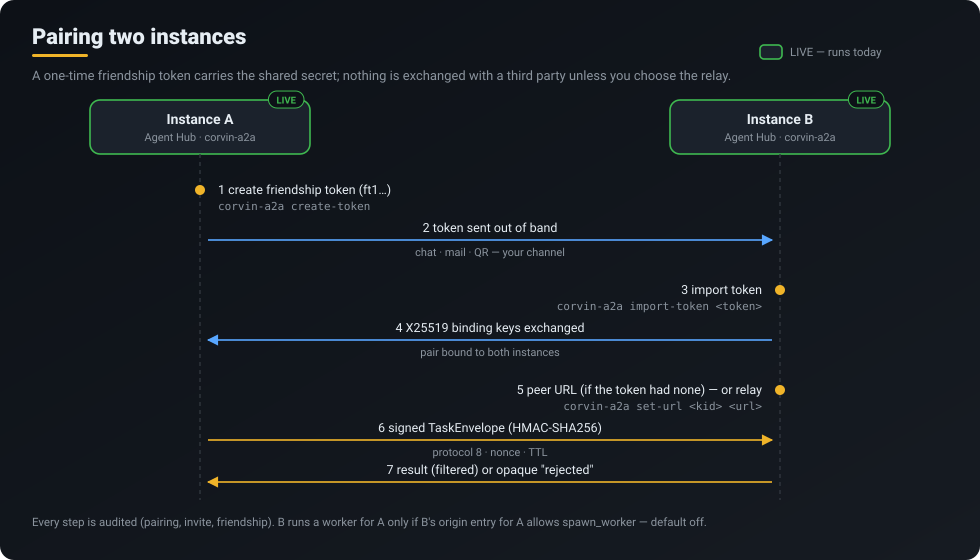
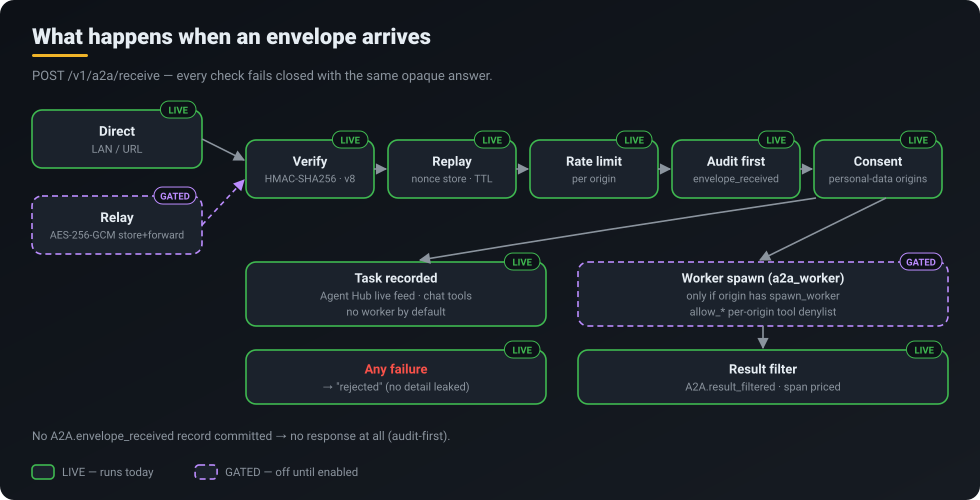

<p align="center">
  <a href="../../README.md"></a>
</p>
<p align="center">
  <a href="../../README.md">Home</a> &middot;
  <a href="token-savings.md">Token savings</a> &middot;
  <a href="self-learning.md">Self-learning</a> &middot;
  <a href="skills-acp.md">Skills 2.0 &amp; ACP</a> &middot;
  <a href="operating-system.md">CorvinOS as an OS</a> &middot;
  <a href="organizations.md">Organizations</a> &middot;
  <strong>A2A</strong> &middot;
  <a href="video.md">Video</a> &middot;
  <a href="marketplace.md">Marketplace &amp; plugins</a> &middot;
  <a href="extensibility.md">Extensibility</a>
</p>

# A2A — agents across instances

> **Two CorvinOS instances — yours and a partner's, or your laptop and your GPU box — pair once and then hand each other signed tasks, with every step on both audit chains and nothing executed unless the receiver allowed it.**

<p align="center"></p>

## What you get

- **Pairing — and exactly what it depends on.** A one-time friendship token (`corvin-a2a:ft1:…`, console *Connect* or `create-token`) carries the pairing secret; you send it through any channel you trust and no hosted service is asked. With `corvin-a2a pair`, **online pairing is checked once against a hosted service; offline pairing (`--offline-pair`) needs no service and is verified by the two operators**, who compare a fingerprint out of band. Traffic between paired installations is peer-to-peer either way.
- **Signed, replay-proof tasks.** Every TaskEnvelope is HMAC-SHA256 signed, carries a nonce and a TTL, and is checked against the receiver's protocol (version 8).
- **The receiver stays in charge.** A peer's task is recorded, not executed — unless the receiver set `spawn_worker` for that peer, and even then a per-peer `allow_*` denylist limits which tools the worker may touch.
- **Proof on both sides.** Pairing, invites, every envelope and every filtered result land in each instance's own hash-chained audit chain; the receiver writes its record before it answers.
- **Works across networks.** Direct over LAN or a public URL; an AES-256-GCM store-and-forward relay is available when neither side is reachable.

## How it works

**Pairing.** Instance A creates a friendship token in the console's **Agent Hub → Connect** tab or with `corvin-a2a create-token`. The token goes to B out of band (chat, mail, QR). B imports it; during the handshake both instances exchange the public halves of their long-term X25519 keys and derive a per-pairing binding secret. That matters because the token is a bearer secret: someone who finds it later can derive the HMAC keys but not the binding secret, so they cannot re-point the pairing, forge a revoke or push a reconnect. A connection becomes ACTIVE once a peer URL is set (`corvin-a2a set-url`) — or the relay is enabled.

**Sending.** `corvin-a2a send <endpoint_id> "<instruction>"` (or the Agent Hub) builds a TaskEnvelope with a nonce, a TTL and optional attachments (sha256-pinned, at most 16 files and 1 MiB in total) and signs it.

<p align="center"></p>

**Receiving** (`POST /v1/a2a/receive`, on the gateway and the standalone console):

1. Signature and protocol version are verified, the nonce is checked against the replay store, the origin's rate limit applies.
2. **Audit first:** an `A2A.envelope_received` record must commit to the audit chain. If it does not, there is no response at all.
3. Origins flagged as carrying personal data need the consent the receiver granted for them.
4. The task is recorded and appears in the Agent Hub live feed. Only if the origin has `spawn_worker` does `a2a_worker` run it: the instruction is framed as untrusted, capped at 16 KB, normalised, and the worker is started with a `--disallowedTools` denylist compiled from the origin's `allow_*` policy plus `--strict-mcp-config`, so no tool outside the grant is reachable.
5. The result passes a filter (`A2A.result_filtered`); the worker's span carries its model and tokens, so the run is priced like any other.

Every failure — bad signature, replay, unknown origin, missing consent — answers with the same opaque `rejected`. A probing sender learns nothing about which check failed.

### Typical setups

| Setup | What pairs with what | Typical settings |
|---|---|---|
| Laptop + GPU box | Your two instances on one LAN | `spawn_worker` on the GPU box for the laptop's origin, `allow_*` narrowed to the tools the job needs |
| Partner organisation | Your instance and theirs over public URLs | No `spawn_worker` — tasks land in the Agent Hub feed and a human decides |
| Instances behind NAT | Neither side reachable | Relay enabled (`a2a_relay_fallback`); the relay only stores AES-256-GCM ciphertext |
| Personal-data exchange | An origin flagged `personal_data` | Required consent purposes set; without consent the envelope is rejected |

## What runs today

| Capability | Status | Where |
|---|---|---|
| Signed envelope receiver, nonce store, rate limit, audit-first | **LIVE** | `corvin_operator/bridges/shared/remote_trigger_receiver.py` |
| Friendship tokens, invites, X25519 binding keys | **LIVE** | `a2a_friendship.py`, `a2a_invite.py`, `a2a_binding.py` |
| `corvin-a2a` CLI | **LIVE** | `corvin_operator/voice/scripts/corvin_a2a.py` |
| Console Agent Hub (Live Feed, Peers, Connect, Audit trail) | **LIVE** | `core/console/corvin_console/web-next/src/pages/agent-hub.tsx` |
| Attachments (sha256, ≤ 1 MiB total) | **LIVE** | `a2a_attachments.py` |
| Reply files above 1 MiB as signed references + signed `object-pull` (ADR-2287) | **LIVE** (worker output only; CLI + Python API pull) | `a2a_objects.py` |
| A2A network membership (`a2a.network`, member-only: a Free install cannot pair, ping or exchange — every console surface, the CLI and the feed say *member seat required*, pairing answers 402) | **LIVE** | `a2a_license_gate.py`, `routes/a2a_pair.py::a2a_network_status` |
| Peer limit by license (`a2a_peers_max`, free tier 1; over it → 402; a pairing the peer ended holds no seat) | **LIVE** | pairing path |
| Inbound worker spawn | **GATED** — `spawn_worker` off per origin by default | `a2a_worker.py` |
| Relay fallback (AES-256-GCM store-and-forward) | **GATED** — flag `a2a_relay_fallback` | `a2a_relay.py` |
| LAN bind | **GATED** — flag `a2a_lan_bind` | gateway |
| `a2a_send` from chat (two-step, browser + CSRF confirm) | **GATED** | Forge MCP tool |
| Offline pairing with an out-of-band fingerprint (`pair --offline-pair` → `pair-import` → `pair-confirm` on both sides; accepted as `attested_out_of_band`, no grace cut-off; CLI only) | **LIVE** | `a2a_offline_pairing.py`, `corvin_a2a.py` |
| Instance-bound attestation (IBC) | **PARTIAL** — new pairings require it; auto-renew open (ADR-2099) | `instance_identity.py` |
| Group chat with foreign agents (inside the console chat; fan-out, mirror groups, hub relay) | **LIVE** | `chat_group_store.py`, `routes/chat_groups.py`, `pages/chat.tsx` |

All `a2a_*` files above live in `corvin_operator/bridges/shared/` unless a path is given.

## Try it

**In the console:** open **Agent Hub → Connect**, create a friendship token, send it to your peer; they import it in their own Agent Hub. Watch both sides in **Live Feed** and **Audit trail**.

**On the command line:**

```bash
# instance A
corvin-a2a my-url https://a.example.org          # this instance's own A2A base URL
corvin-a2a create-token --label "partner-b" --ttl 7d
# send the printed corvin-a2a:ft1:… token to B through a channel you trust

# instance B
corvin-a2a import-token 'corvin-a2a:ft1:…'
corvin-a2a set-url <kid> https://a.example.org   # only if the token carried no URL
corvin-a2a agents                                # list local and remote agents

# send a task with an attachment
corvin-a2a send <endpoint_id> "Summarise the attached report" --attach report.pdf

# end the pairing
corvin-a2a revoke-token <kid>
```

Grant execution only when you want the peer to run work on your instance: `corvin-a2a pair --spawn-worker` (or `invite --spawn-worker`) sets it for that one origin, and the origin's `allow_*` settings decide which tools its worker may use. `corvin-a2a pair --offline-pair` records the pairing audit-first and refuses if the record cannot commit. The offline pair stays pending until both operators confirmed the same fingerprint:

```bash
corvin-a2a pair --offline-pair peer-b https://this.host:8000   # A: hand the printed file to B
corvin-a2a pair-import endpoint.json                          # B: prints B's instance id + fingerprint
corvin-a2a pair-confirm peer-b --peer-instance-id <B> --fingerprint <read by B>   # A
corvin-a2a pair-confirm corvin-local --fingerprint <read by A>                    # B
```

## Honest limits

- **Execution is off by default.** A freshly paired peer can deliver tasks; it cannot make your instance run them until you set `spawn_worker` for it.
- **Relay and LAN bind are gated.** Two instances that cannot reach each other directly need the relay flag turned on.
- **IBC auto-renewal is open** (ADR-2099).
- **An offline pair is only as good as the two operators' care.** The fingerprint must be compared through a channel outside the network you pair (phone, paper). A confirm typed without really comparing is a weaker attestation than the hosted check, and it is accepted without the attestation grace cut-off — the trust moves from a service to two people. A wrong fingerprint on either side changes nothing (and shows no value to copy), and a fingerprint or key set is never reused. Confirmation is enforced per side, not end to end: your receiver cannot tell whether the other side confirmed, so a peer on an older build (or with a hand-copied endpoint file) can send once you confirmed. The fingerprint covers the keys and both instance ids, not the URL, TTL or pairing id in the endpoint file, and that file carries the keys — keep it confidential in transit. The stored pairing files are not covered by the path gate: a process running as your OS user can rewrite them consistently, which the receiver's check cannot detect. The console has no offline-pairing dialog; it is CLI only.
- **The completeness ADR is still PROPOSED.** A2A audit coverage is documented in ADR-2042, which has not been accepted.
- **A2A is member-only.** A Free install can run everything else, but it cannot join the network: creating or importing a token, sending from the chat, the CLI and every ping answer *A2A network requires a member seat* (HTTP 402 `license_limit` / `a2a.network` in the console). Two fresh installs therefore cannot talk to each other until one seat each is active — the peers tab, the diagnostics and the feed carry `network.allowed` so the UI says so instead of "unreachable".
- **A peer without a seat is named.** If the other install has no member seat, its hello answer says so and your peers tab shows *PEER HAS NO MEMBER SEAT* (the thread: *<peer> has no member seat*) instead of "unreachable" or "set your own A2A URL"; every CLI pairing command (`pair`, `pair-import`, `pair-confirm`, `invite`, `accept`, `create-token`, `import-token`) and every console pairing route refuse on a Free install exactly alike, and `/v1/a2a/ping` / `/v1/a2a/friendship-ack` answer 403 `license_required` on every host.
- **Member tier: `a2a_peers_max` applies.** Over the limit the pairing path answers 402. A pairing the peer ended (its signed revoke notice) shows *ended by peer*, holds no seat, carries no task in either direction and stays readable until you remove it.
- **A delivery that fails is a presence observation.** The sender wakes the connectivity probe for that peer at once, so the feed shows it *offline* within the probe's timeout instead of up to a minute later.
- **A plain-text chat message to an offline peer waits in a sender outbox for up to 24 hours** (feed row *Waiting for peer*, with Cancel) and is resent with the same task id; a retry whose first attempt may have been delivered is sent only after the peer's signed status says it never heard of the task. **Attachments, group messages and federated tasks are not kept**: the relay holds them for at most 5 minutes and the envelope expires after its TTL (60 s by default); the sender reports *delivery unconfirmed* — resend when the peer is back.
- **Classified data goes only to a partner whose GDPR role you stated.** Each connection carries an organisation and a role (controller, processor, joint controller), written only by you in the console (Peers > the partner > *Set role*) or with `corvin-a2a set-role`. Until you do, anything above public (including a phone number, e-mail address, IBAN or card number the detector recognises) is refused locally — and that includes every connection paired before this rule existed. Public data is unaffected. The role is your statement, recorded in the audit trail and the Art. 30 record; it is never guessed from the partner and not checked against a contract (a data processing agreement must exist outside the product).
- **Inline attachments stop at 1 MiB in total (16 files), on both transports; larger reply files travel by reference.** Measured through the real sender, direct and over a local relay: 1 048 576 bytes pass inline, one byte more is refused before it leaves your machine. A file the peer's worker writes that does not fit inline comes back as a signed reference (name, size, sha256, classification) and is pulled in signed 1 MiB chunks — only when you ask for it: `corvin-a2a send --attach-out-dir` asks and pulls for you, the bytes are kept only if the digest matches, and a second file with the same name is refused rather than overwriting the first. Every other way of sending (console, MCP) keeps today's "dropped" report. A reference can be pulled only by you, for 15 minutes by default (at most 24 hours) and at most three times; a peer on an older build answers *pull unsupported*. **Not yet:** sending a file above 1 MiB yourself (still refused), and the console chat and the MCP tool do not pull references. Reply files, inline or by reference, now also pass the classification and egress gates, over their whole content: a confidential file to a peer allowed only internal data is reported as dropped, and so are archives (zip, Office files, gzip …) and files of no known format to such a peer; a peer allowed only public data gets no binary files at all, and a peer reached only through the relay under a deny-by-default egress policy gets no files. The worker's structured answer is not affected.
- **CorvinOS does not interoperate with foreign A2A agents.** There is exactly one inbound protocol: the paired, signed one. The optional Google-compatible adapter (off by default, never switched on by anything) was removed; the words *parts* and *artifacts* in the media section are an analogy, not compatibility.

## Under the hood

- Receiver and sender: `corvin_operator/bridges/shared/remote_trigger_receiver.py`, `remote_trigger_sender.py`; worker `a2a_worker.py`; relay `a2a_relay.py`; nonces `a2a_nonce_store.py`.
- Reference: `docs/claude-ref/layer-38-a2a-network.md`.
- ADRs (Corvin-Knowledge): ADR-0063 (invites), ADR-0070 (friendship tokens), ADR-2042 (A2A audit events), ADR-2064 (binding keys), ADR-2099 (IBC), ADR-2216 (chat-native tokens, group chat), ADR-2218 (group routing over A2A).
- GDPR erasure reaches paired peers: `erasure_a2a.py` — see [Organizations](organizations.md).
- Related: [CorvinOS as an OS](operating-system.md) · [Organizations](organizations.md) · [Marketplace &amp; plugins](marketplace.md)
